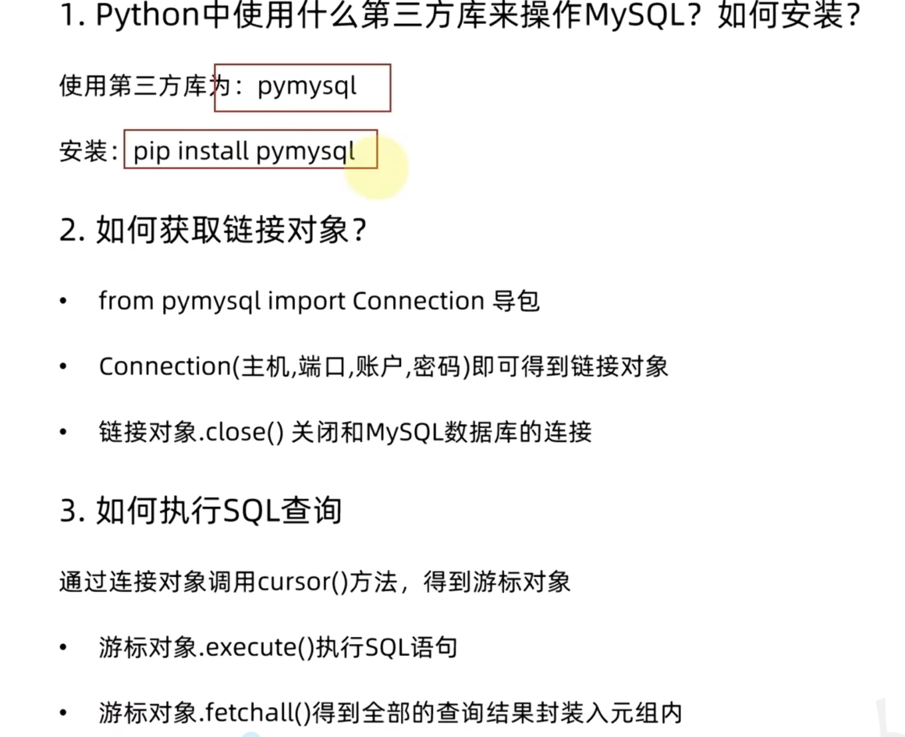

### pymysql

除了使用图形化工具以外，我们也可以使用编程语言来执行SQL从而操作数据库。
在Python中，使用第三方库：**pymysql** 来完成对MySQL数据库的操作。

**安装：**
```bash
pip install pymysql
```

### 创建到MySQL的数据库链接

代码如下：
```Python
from pymysql import Connection

# 构建MySQL数据库连接
conn = Connection(
    host="localhost",
    port=3306,
    user="root",
    password="admin"
)

# 选择要操作的数据库
conn.select_db("worlds")

# 获取游标对象（用来执行SQL）
cursor = conn.cursor()

# 执行查询SQL
cursor.execute("SELECT * FROM student")

# 获取所有查询结果
results = cursor.fetchall()

# 打印每一行数据
for row in results:
    print(row)

# 关闭连接
conn.close()
```


### 总结


