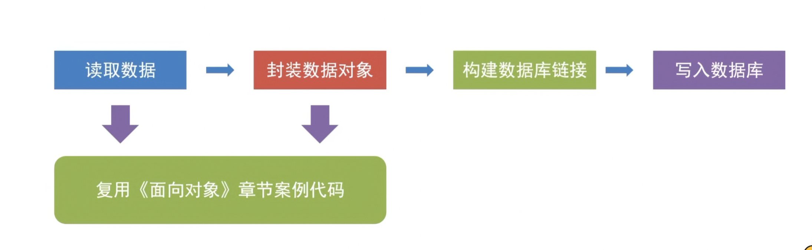

																						前置信息接入：
[[63-Python案例数据分析]]

### DDL定义

本次需求开发我们需要新建一个数据库来使用，数据库名称：my_sql
基于数据结构，可以得到建表语句：
```mysql
CREATE TABLE orders(
	order_date DATE,
	order_id, VARCHAR(255),
	province VARCHAR(10)
);
```

### 实现步骤




**代码**

```Python
# "K:/Mirror_Void_Arsenal/Python/day16/2011年1月销售数据.txt"  
# "K:/Mirror_Void_Arsenal/Python/day16/2011年2月销售数据JSON.txt"  
"""  
1、设计一个类，可以完成数据的封装  
2、设计一个抽象类，定义文件读取的相关内容，并使用子类实现机具体功能  
3、读取文件，生产数据对象  
4、进行数据需求的逻辑计算（计算每一天的销售额）  
5、通过pyecharts进行图形绘制  
"""  
  
  
# 导包  
from data_define import Record  
from file_define import FileReader,JsonFileReader,TextFileReader  
from pyecharts.charts import Bar  
from pyecharts.options import *  
from pymysql import Connection  
  
  
text_file_reader = TextFileReader("K:/Mirror_Void_Arsenal/Python/day16/2011年1月销售数据.txt")  
json_file_reader = JsonFileReader("K:/Mirror_Void_Arsenal/Python/day16/2011年2月销售数据JSON.txt")  
  
jan_data: list [Record] = text_file_reader.read_data()  
feb_data: list [Record] = json_file_reader.read_data()  
  
# 两个文件合并成一个list  
all_data: list [Record] = jan_data + feb_data  
  
# 开始数据计算  
# 字典  
# data_dict = {}  
# for record in all_data:  
#     if record.date in data_dict.keys():  
#         # 当前日期已经有记录了  
#         data_dict[record.date] += record.money  
#     else:  
#         data_dict[record.date] = record.money  
#  
# # 可视化图标开发  
# bar = Bar(init_opts=InitOpts(theme=ThemeType.ROMANTIC))  
# bar.add_xaxis(list(data_dict.keys()))                 # 添加x轴数据  
# bar.add_yaxis("销售额",list(data_dict.values()),label_opts=LabelOpts(is_show=False))    # 添加y轴数据  
# bar.set_global_opts(  
#     title_opts=TitleOpts(title="每日销售额")  
# )  
# bar.render("可视化图标设计.html")  
  
# 构建MySQL链接对象  
conn = Connection(  
    host = "localhost",  
    port = 3306,  
    user = "root",  
    password = "admin",  
    autocommit=True  
)  
  
# 获得游标对象  
cursor = conn.cursor()  
  
# 选择数据库  
conn.select_db("py_sql")  
  
# 组织SQL语句  
for record in all_data:  
    sql = (f"insert into orders(order_date, order_id, money, province) "  
           f"values('{record.date}','{record.order_id}',{record.money},'{record.province}')")  
  
    # 测试数据是否正常封装  
    # print(record)  
  
    # 写入，执行SQL语句  
    cursor.execute(sql)  
# 关闭MySQL链接对象  
conn.close()
```

### 练习

