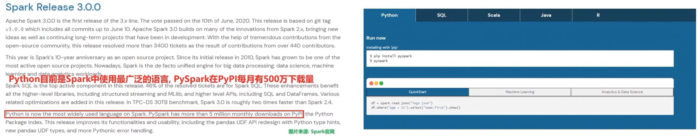
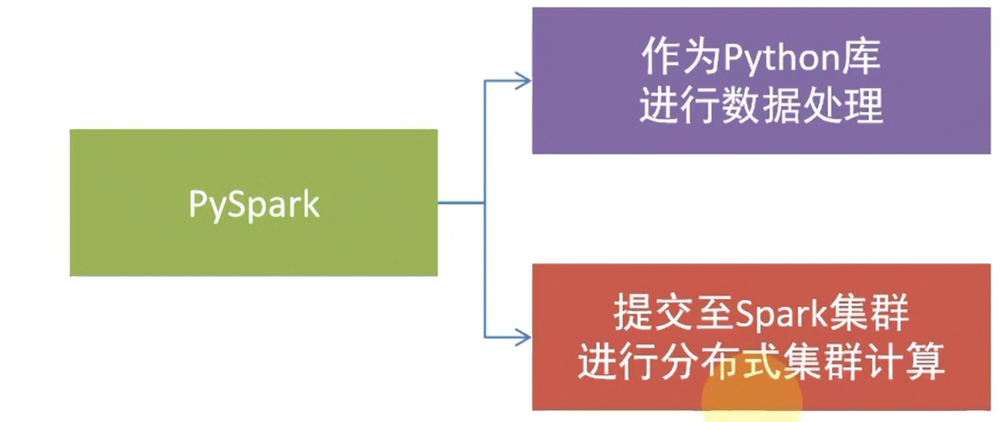
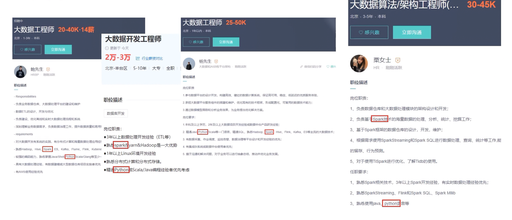
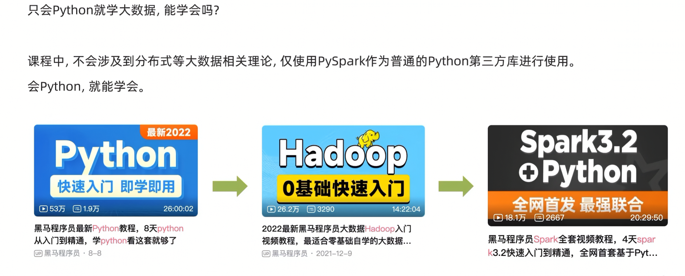
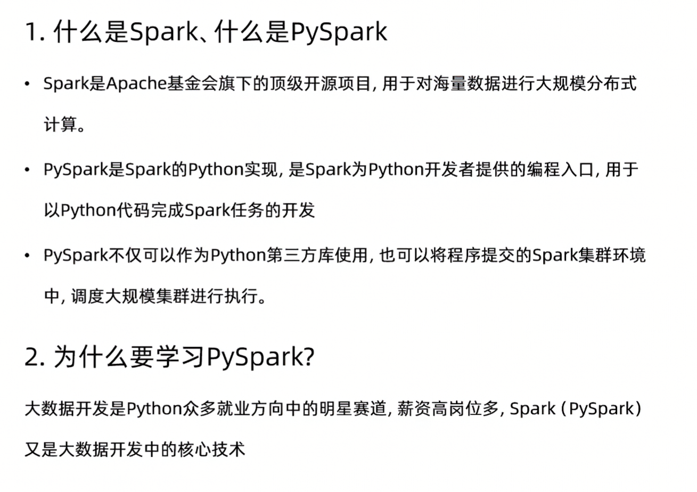

### 什么是spark

Spark作为全球顶级的分布式计算框架，支持众多的编程语言进行开发。而python语言，则是Spark重点支持的对象。

### PySpark

Spark对Python语言的支持，重点体现在Python第三方库：**PySpark**之上。
PySpark是由**Spark官方开发**的Python语言第三方库。
Python开发者可以使用**pip**程序快速的安装PySpark，并像其它三方库那样直接使用。

### Why PySpark

很赚钱。。。但是难找

### 衔接大数据方向
还得学其他的。。。

### 总结

