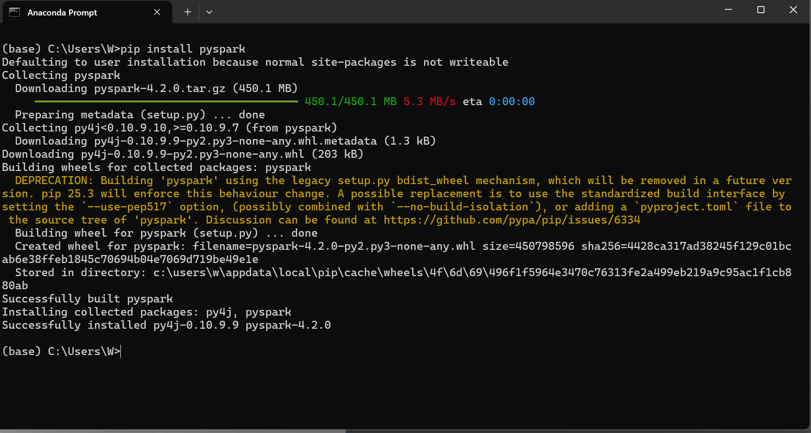
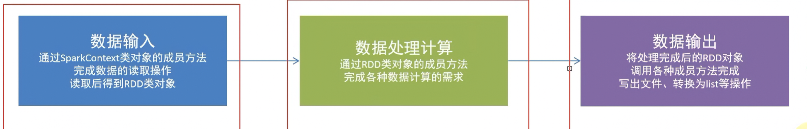
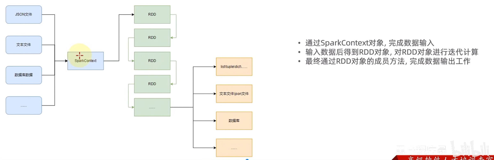
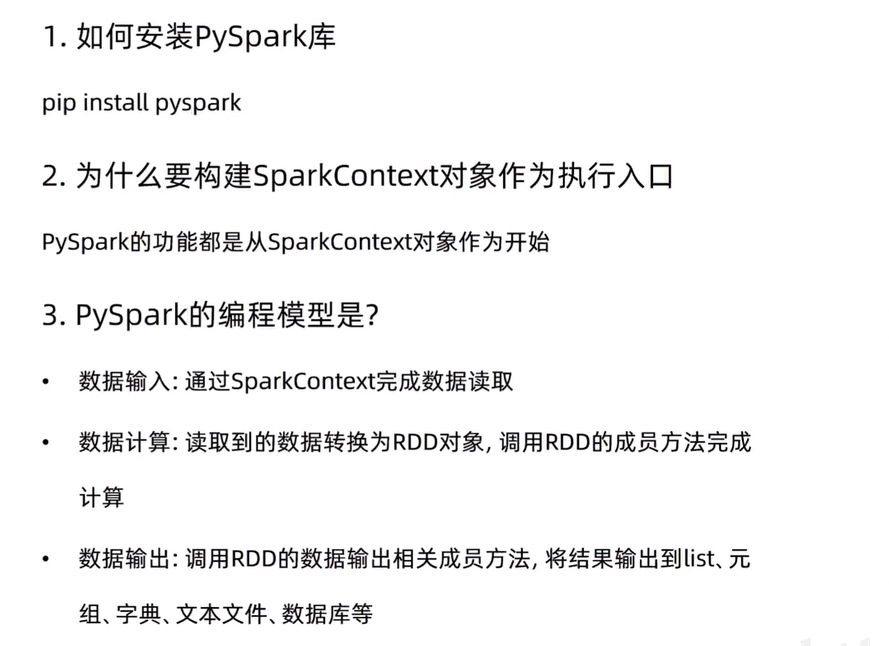

### PySpark库的安装

同其它的Python第三方库一样，PySpark同样可以使用pip程序进行安装。
在 **“CMD”命令提示符程序**内，输入：
```Python
pip install pyspark
```
或使用国内代理镜像网站（清华大学源）：
```Python
pip install -i https://pypi.tuna.tsinghua.edu.cn/simple pyspark
```



### 构建PySpark执行环境入口的对象
想要使用PySpark库完成数据处理，首先需要构建一个执行环境入口对象。
PySpark的执行环境入口对象是：类 **SparkContext** 的类对象
```Python
# 导包
from pyspark import SparkConf, SparkContext

# 创建SparkConf类对象
conf = SparkConf().setMaster("local[*]").\
    setAppName("test_spark_app")

# 基于SparkConf类对象创建SparkContext类对象
sc = SparkContext(conf=conf)

# 打印PySpark的运行版本
print(sc.version)

# 停止SparkContext对象的运行（停止PySpark程序）
sc.stop()
```

### PySpark的编程模型
SparkContext类对象，是PySpark编程种一切功能的入口。
PySpark的编程，主要分为如下三大类：




### 总结

