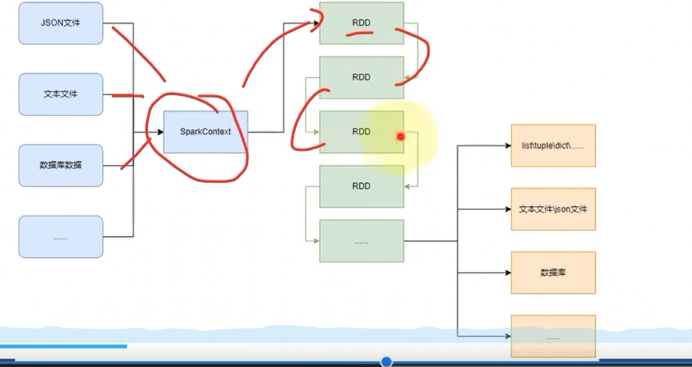
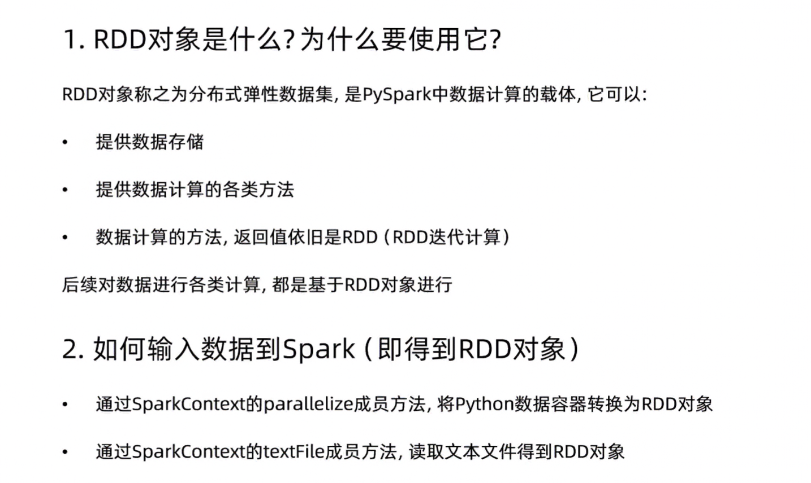

### RDD对象

如图可见，PySpark支持多种数据的输入，在输入完成后，都会得到一个：**RDD类**的对象。
RDD全称为：**弹性分布式数据集（Resilient Distributed Datasets）**
PySpark针对数据的处理，都是以RDD对象作为载体，即：
- 数据存储在RDD内
- 各类数据的计算方法，也都是RDD的成员方法
- RDD的数据计算方法，返回值依旧是RDD对象



### python数据容器转RDD对象

PySpark支持通过SparkContext对象的`parallelize`成员方法，将以下Python数据容器转换为RDD对象：

- `list`
- `tuple`
- `set`
- `dict`
- `str`

示例代码
```python
from pyspark import SparkConf, SparkContext

conf = SparkConf().setMaster("local[*]").\
    setAppName("test_spark_app")

sc = SparkContext(conf=conf)

rdd = sc.parallelize(数据容器对象)

# 输出RDD的内容
print(rdd.collect())
```

**注意事项：**

- **字符串**会被拆分成一个个的字符，存入RDD对象
- **字典**仅有key会被存入RDD对象

```Python
# 导包  
from pyspark import SparkContext,SparkConf  
  
conf = SparkConf().setMaster("local[*]").setAppName("test_spark")  
  
sc = SparkContext(conf=conf)  
  
rdd1 = sc.parallelize([1,2,3,4,5,6,7,8,9,10])  
rdd2 = sc.parallelize((1,2,3,4,5,6,7,8,9,10))  
rdd3 = sc.parallelize("abcdefghijklmnopqrstuvwxyz")  
rdd4 = sc.parallelize({1,2,3,4,5,6,7,8,9,10})  
rdd5 = sc.parallelize({"key1": "values1","key2": "values2"})  
  
# 乳沟要查看rdd里面会有什么内容，需要用到collect()方法  
print(rdd1.collect())  
print(rdd2.collect())  
print(rdd3.collect())  
print(rdd4.collect())  
print(rdd5.collect())  
  
  
# 停止程序运行  
sc.stop()
```

### 读取文件转RDD对象

PySpark也支持通过SparkContext入口对象，来**读取文件**，来构建出RDD对象。
```python
from pyspark import SparkConf, SparkContext

conf = SparkConf().setMaster("local[*]").\
    setAppName("test_spark_app")
sc = SparkContext(conf=conf)

rdd = sc.textFile(文件路径)

# 打印RDD内容
print(rdd.collect())
```

示例

```python
# 导包  
from pyspark import SparkContext,SparkConf  
  
conf = SparkConf().setMaster("local[*]").setAppName("test_spark")  
  
sc = SparkContext(conf=conf)  
  
# rdd1 = sc.parallelize([1,2,3,4,5,6,7,8,9,10])  
# rdd2 = sc.parallelize((1,2,3,4,5,6,7,8,9,10))  
# rdd3 = sc.parallelize("abcdefghijklmnopqrstuvwxyz")  
# rdd4 = sc.parallelize({1,2,3,4,5,6,7,8,9,10})  
# rdd5 = sc.parallelize({"key1": "values1","key2": "values2"})  
#  
# # 乳沟要查看rdd里面会有什么内容，需要用到collect()方法  
# print(rdd1.collect())  
# print(rdd2.collect())  
# print(rdd3.collect())  
# print(rdd4.collect())  
# print(rdd5.collect())  
  
  
# 通过textfile方法  
rdd = sc.textFile("K:\Mirror_Void_Arsenal\第15章资料\资料\search_log.txt")  
print(rdd.collect())  
# 停止程序运行  
sc.stop()
```
### 总结

