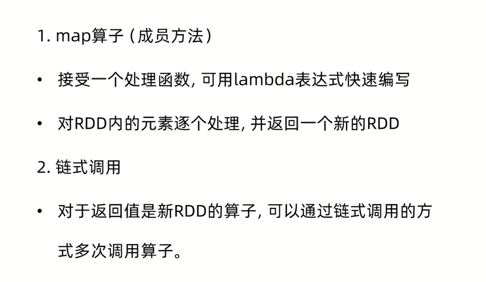

### map方法

PySpark的数据计算，都是基于RDD对象来进行的，那么如何进行呢？
自然是依赖RDD对象内置丰富的：**成员方法（算子）**
**map算子**
功能：
	map算子，是将RDD的数据一条条处理（处理的逻辑基于map算子中接收的处理函数），返回**新的RDD**。

语法：
```Python
rdd.map(func)
# map 算子：对 RDD 中的每条数据逐个处理，返回一个新的 RDD
# rdd.map(func)
# 
# func 是一个函数，它的类型注解可以这样理解：
# 
# func: f: (T) -> U
# 
# f：表示这是一个函数（方法）
# 
# (T) -> U 表示这个函数的定义：
#   - (T) 表示传入 1 个参数，参数类型不限（T 是泛型，代表任意类型）
#   - -> U 表示有返回值，返回值类型不限（U 是泛型，代表任意类型）
#   - () 表示没有传入参数
# 
# 总结：
#   - (T) -> U：接收一个任意类型的参数，返回一个任意类型的值
#   - (A) -> A：接收一个任意类型的参数，返回值和传入参数类型一致
```

示例

```Python
from pyspark import SparkConf,SparkContext  
import os  
os.environ['PYSPARK_PYTHON'] = "F:\python\python.exe"  
  
conf = SparkConf().setMaster("local[*]").setAppName("map_test")  
  
sc = SparkContext(conf=conf)  
  
#准备一个RDD  
rdd = sc.parallelize([1,2,3,4,5,6])  
  
# map方法  
def func(data):  
    return data * 10  
  
rdd2 = rdd.map(func)  
print(rdd2.collect())  
  
# 另外一种写法：lambda函数  
rdd3 = rdd.map(lambda x: x * 10)  
print(rdd3.collect())  
  
# 链式调用  
rdd4 = rdd.map(lambda x: x * 10).map(lambda x: x + 5)  
print(rdd4.collect())
```


### 总结

