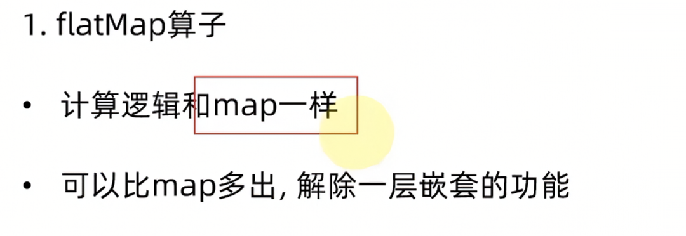

### flatMap算子
功能：对rdd执行map操作，然后进行解除嵌套操作。

**解除嵌套示例：**
```Python
# 嵌套的list
lst = [[1, 2, 3], [4, 5, 6], [7, 8, 9]]

# 如果解除了嵌套
lst = [1, 2, 3, 4, 5, 6, 7, 8, 9]
```

**演示代码：**
```Python
# coding:utf8
# 演示rdd的flatMap算子

from pyspark import SparkConf, SparkContext

if __name__ == '__main__':
    # 0. 构建Spark执行环境
    conf = SparkConf().setAppName("create_rdd").setMaster("local[*]")
    sc = SparkContext(conf=conf)

    rdd = sc.parallelize([["a b c", "a c e", "e c a"]])
    # 按照空格切分数据后，解除嵌套
    print(rdd.flatMap(lambda x: x.split(" ")).collect())
```

小练习

```Python
# 导包  
from pyspark import SparkConf,SparkContext  
  
conf = SparkConf().setMaster("local[*]").setAppName("test_flatmap")  
  
sc = SparkContext(conf=conf)  
  
# 准备一个rdd  
rdd = sc.parallelize(["it hei ma it cast 666","python is very good","it is python"])  
  
# 需求，将rdd数据里面的一个个单词提取出来  
rdd2 = rdd.flatMap(lambda x: x.split(" "))  
print(rdd2.collect())
```


### 总结

