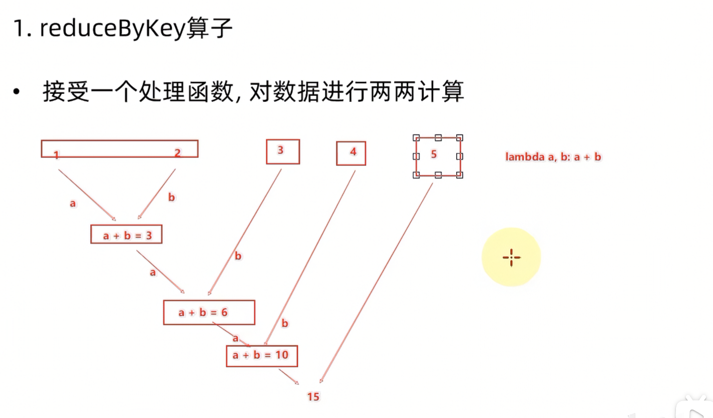

### reduceByKey算子

**功能**：针对 **KV型 RDD**，自动按照 key 分组，然后根据你提供的聚合逻辑，完成组内数据（value）的聚合操作。

**用法：**
```Python
rdd.reduceByKey(func)
# func: (V, V) -> V
# 接受2个传入参数（类型要一致），返回一个返回值，类型和传入要求一致。
```

**代码示例：**
```Python
rdd = sc.parallelize([('a', 1), ('a', 1), ('b', 1), ('b', 1), ('b', 1)])
result = rdd.reduceByKey(lambda a, b: a + b)
print(result.collect())
# 结果：[('b', 3), ('a', 2)]
```

**注意：** reduceByKey中接收的函数，只负责聚合，**不理会分组**。分组是自动 **by key** 来分组的。

**reduceByKey 中的聚合逻辑示例：**
比如，有 `[1, 2, 3, 4, 5]`，聚合函数是 `lambda a, b: a + b`：

|步骤|a|b|计算结果|
|---|---|---|---|
|1|1|2|3|
|2|3|3|6|
|3|6|4|10|
|4|10|5|15|
最终结果：**15**

示例
```Python
# 导包  
from pyspark import SparkConf,SparkContext  
  
conf = SparkConf().setMaster("local[*]").setAppName("reducrByKye")  
sc = SparkContext(conf=conf)  
  
# 准备rdd数据  
rdd = sc.parallelize([('男',99),('男',88),('女',71),('女',66)])  
  
# 求和  
rdd2 = rdd.reduceByKey(lambda a,b: a + b)  
print(rdd2.collect())
```


### 总结

