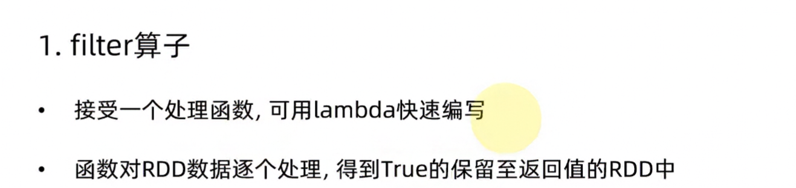

### filter算子
**功能：** 过滤想要的数据进行保留。
**语法：**
```Python
rdd.filter(func)
# func: (T) -> bool
#     传入1个参数进来，类型随意，返回值必须是 True 或 False
```

- 返回 `True` 的数据被**保留**
- 返回 `False` 的数据被**丢弃**

**示例代码：**
```Python
# coding:utf8
# 演示rdd的filter算子

from pyspark import SparkConf, SparkContext

if __name__ == '__main__':
    # 0. 构建Spark执行环境
    conf = SparkConf().setAppName("create_rdd").\
        setMaster("local[*]")
    sc = SparkContext(conf=conf)

    rdd = sc.parallelize([1, 2, 3, 4, 5])

    # 保留奇数
    # rdd.filter(lambda x: True if (x % 2 == 1) else False)
    print(rdd.filter(lambda x: x % 2 == 1).collect())
```

**代码编写**
```Python
# 导包  
from pyspark import SparkConf,SparkContext  
  
conf = SparkConf().setMaster("local[*]").setAppName("filter_app")  
sc = SparkContext(conf=conf)  
  
# 准备rdd数据  
rdd = sc.parallelize([1,2,3,4,5,6,7,8,9,10])  
  
# 对rdd数据进行过滤  
results = rdd.filter(lambda num: num % 2 == 0)  
print(results.collect())
```

### 总结

