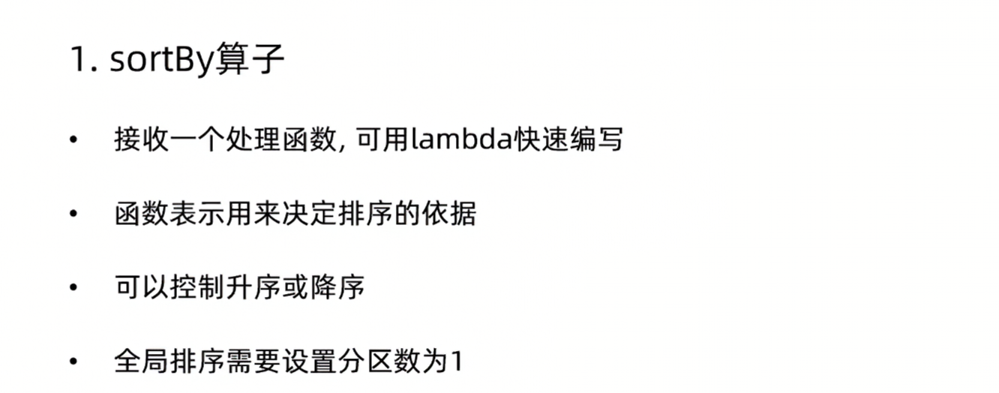

### sortBy算子
**功能：**
	对rdd数据进行排序，基于你指定的排序依据。
**语法**：
```Python
rdd.sortBy(func, ascending=False, numPartitions=1)
```

**函数定义：**

- `func: (T) -> U`：告知按照 rdd 中的**哪个数据**进行排序，比如 `lambda x: x[1]` 表示按照 rdd 中的第二列元素进行排序
- `ascending`：`True` 升序，`False` 降序
- `numPartitions`：用多少分区排序

```Python
# 1、构建执行环境入口对象  
from pyspark import SparkContext,SparkConf  
conf = SparkConf().setMaster("local[*]").setAppName("test_spark")  
sc = SparkContext(conf=conf)  
  
# 2、读取数据文件  
rdd = sc.textFile("K:/Mirror_Void_Arsenal/第15章资料/资料/hello.txt")  
  
# 3、取出全部单词  
word_rdd = rdd.flatMap(lambda x: x.split(" "))  
  
# 4、将所有单词都转换成二元元组，单词为Key，values值为1  
word_rdd_one = word_rdd.map(lambda word: (word, 1))  
  
# 5、分组并求和  
results = word_rdd_one.reduceByKey(lambda a,b: a + b)  
  
# 6、打印输出结果  
print(results.collect())  
  
# 7、对结果进行排序  
finan_rdd = results.sortBy(lambda x: x[1], ascending=False,numPartitions=1)  
print(finan_rdd.collect())
```

### 总结


