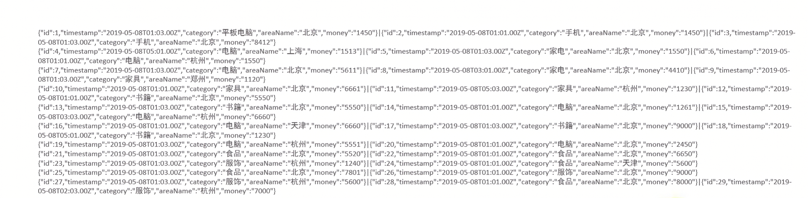

### 案例


**数据内容：** 城市、商品类别、销售额
**需求列表：**
1. 各个城市销售额排名，从大到小
2. 全部城市有哪些商品类别在售卖
3. 北京市有哪些商品类别在售卖



示例
```python
import json  
from pyspark import SparkContext,SparkConf  

conf = SparkConf().setMaster("local[*]").setAppName("al_app")  
sc = SparkContext(conf=conf)  
  
# T0D0 需求1：城市销售额排名  
# 1、1 读取文件得到RDD  
file_rdd = sc.textFile("K:/Mirror_Void_Arsenal/第15章资料/资料/orders.txt")  
  
# 1、2 取出一个json字符串  
json_str_rdd = file_rdd.flatMap(lambda x: x.split("|"))  
  
# 1.3 将一个个json字符串转换问字典  
dict_rdd = json_str_rdd.map(lambda x: json.loads(x))  
  
# 1.4 取出城市和销售额数据  
# 城市，销售额  
city__whit_money_rdd = dict_rdd.map(lambda x: (x['areaName'],int(x['money'])))  
  
# 1.5 按城市分组按销售额聚合  
city_results_rdd = city__whit_money_rdd.reduceByKey(lambda a, b: a + b)  
  
# 1.6 按销售额聚合结果进行排序  
results = city_results_rdd.sortBy(lambda x: x[1],ascending=False,numPartitions=1)  
print(results.collect())  
  
# TODO 需求2：全部城市都有哪些物品在卖  
# 2、1 取出全部的商品类别  
category_rdd = dict_rdd.map(lambda x: x['category']).distinct()  
print(category_rdd.collect())  
  
  
# TODO 需求3；北京市有哪些商品在售卖  
# 3、1 过滤北京市的数据  
Beijing = dict_rdd.filter(lambda x: x['areaName'] == '北京')  
  
# 3、2 取出全部商品类别  
Beijing_map = Beijing.map(lambda x: x['category']).distinct()  
print(Beijing_map.collect())
```