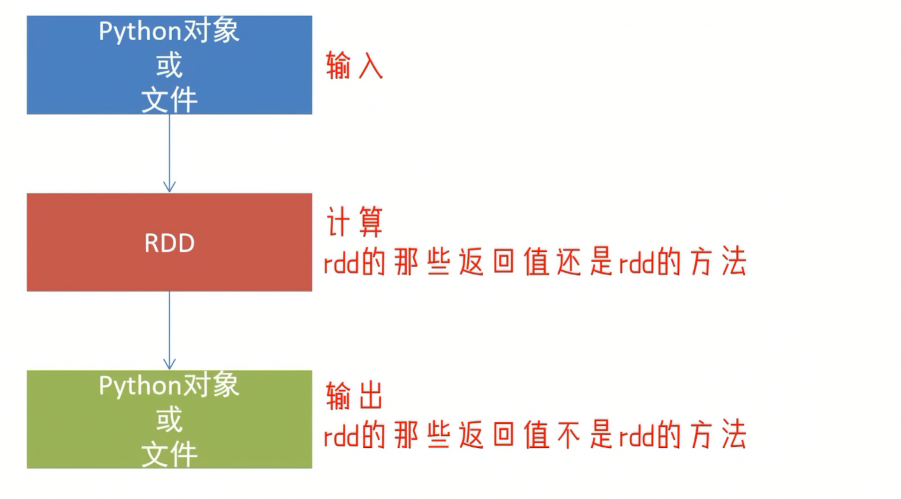
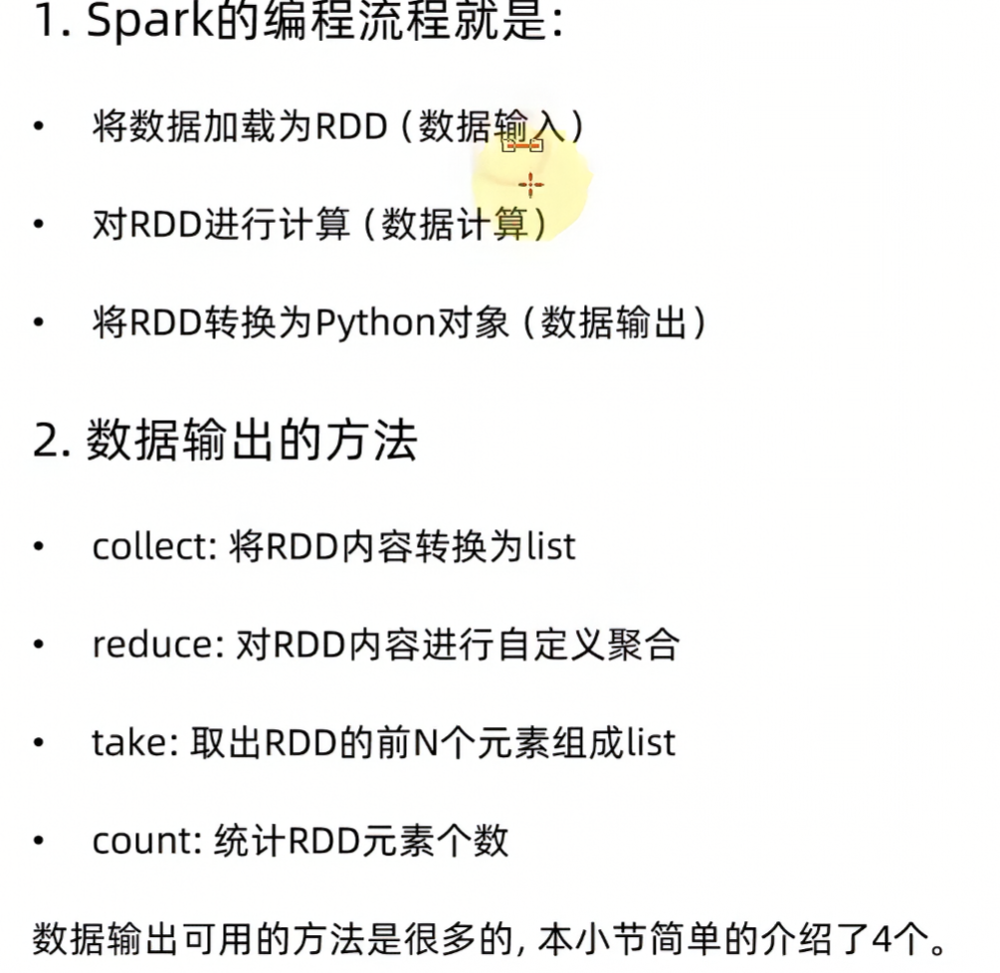

### 数据输出

- `sc.parallelize`
- `sc.textFile`

**数据计算：**

- `rdd.map`
- `rdd.flatMap`
- `rdd.reduceByKey`
- ...

**数据输出：**

- Python对象 或 文件
- RDD 的方法（返回值还是 RDD）


### collect 算子
功能：
将RDD各个分区内的数据，统一收集到Driver中，形成一个list对象。
用法：
```python
rdd.collect()
```
返回值是一个list

示例
```Python
# 导包  
from pyspark import SparkConf,SparkContext  
import json  
  
conf = SparkConf().setMaster("local[*]").setAppName("collect_app")  
sc = SparkContext(conf=conf)  
  
# 准备RDD数据  
rdd = sc.parallelize([1,2,3,4,5,6,7,8,9,10,0])  
print(type(rdd))  
# collect算子，输出rdd为list对象  
rdd_list: list = rdd.collect()  
print(rdd_list)  
print(type(rdd_list))
```

### reduce算子
功能：
对RDD数据集按照你传入的逻辑进行聚合。
语法：
```Python
rdd.reduce(fuunc):
# func: (T, T) --> T
# 2参数传入 1个返回值，返回值和参数要求类型一致
```

执行流程如下：
```Python
rdd = sc.parallelize(range(1, 10))
# 将rdd的数据进行累加求和
print(rdd.reduce(lambad a, b: a + b))
```

返回值等同于计算函数的返回值

示例
```Python
# 导包  
from pyspark import SparkContext,SparkConf  
  
conf = SparkConf().setMaster("local[*]").setAppName("reduce_app")  
sc = SparkContext(conf=conf)  
  
# 准备rdd数据  
rdd = sc.parallelize([1,2,3,4,5,6,7,8,9,10])  
  
# reduce算子，对rdd进行两两聚合  
number_rdd = rdd.reduce(lambda a, b: a + b)  
print(number_rdd)
```

### take算子

功能：
取RDD的N个元素，组合成list返回给你

用法：
```python
>>> sc.parallelize([3,2,1,4,5,6]).take(5)
>>> [3,2,1,4,5]
```

示例
```python
# 导包  
from pyspark import SparkContext,SparkConf  
  
conf = SparkConf().setMaster("local[*]").setAppName("reduce_app")  
sc = SparkContext(conf=conf)  
  
# 准备rdd数据  
rdd = sc.parallelize([1,2,3,4,5,6,7,8,9,10])  
  
# reduce算子，对rdd进行两两聚合  
number_rdd = rdd.reduce(lambda a, b: a + b)  
print(number_rdd)  
  
# take算子  
take_list = rdd.take(3)  
print(take_list)  
```

### count算子
功能：
计算RDD有多少条数据，返回值是一个数字

用法：
```python
>>> sc.parallelize([1,2,3,4,5,6,7,8,9]).count()
>>> 9
```

示例
```python
# 导包  
from pyspark import SparkContext,SparkConf  
  
conf = SparkConf().setMaster("local[*]").setAppName("reduce_app")  
sc = SparkContext(conf=conf)  
  
# 准备rdd数据  
rdd = sc.parallelize([1,2,3,4,5,6,7,8,9,10])  
  
# reduce算子，对rdd进行两两聚合  
number_rdd = rdd.reduce(lambda a, b: a + b)  
print(number_rdd)  
  
# take算子  
take_list = rdd.take(3)  
print(take_list)  
  
# count算子  
rdd_count = rdd.count()  
print(rdd_count)
```


### 总结


