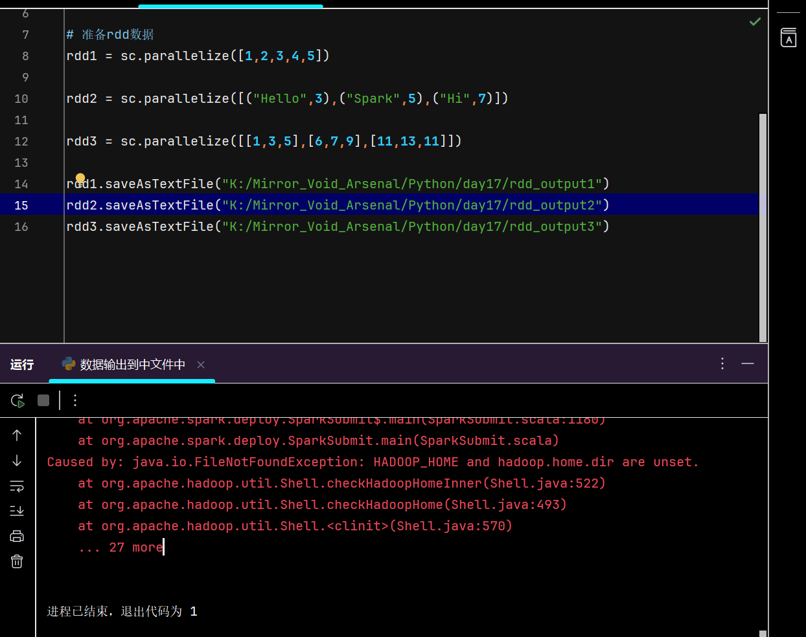
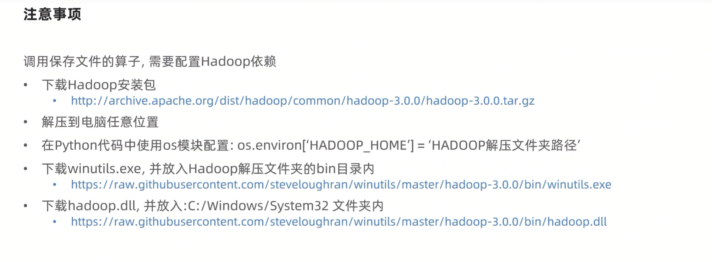
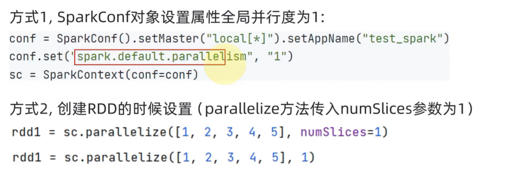
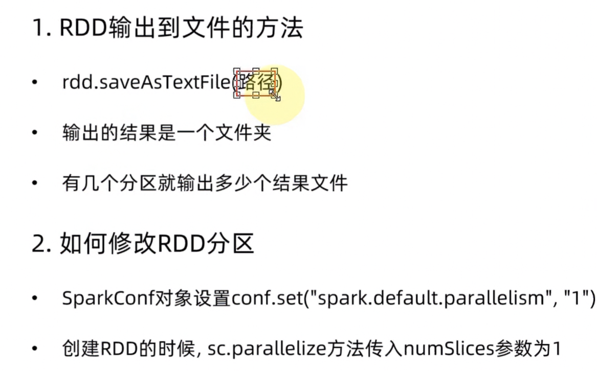

### saveAsTextFile算子

**功能：** 将RDD的数据写入文本文件中，支持本地写出、HDFS等文件系统。

**代码：**
```python
rdd = sc.parallelize([1, 2, 3, 4, 5])
rdd.saveAsTextFile("./data/output/test.txt")
```

代码示例
```python
# 导包  
from pyspark import SparkContext,SparkConf  
  
conf = SparkConf().setMaster("local[*]").setAppName("out_app")  
sc = SparkContext(conf=conf)  
  
# 准备rdd数据  
rdd1 = sc.parallelize([1,2,3,4,5])  
  
rdd2 = sc.parallelize([("Hello",3),("Spark",5),("Hi",7)])  
  
rdd3 = sc.parallelize([[1,3,5],[6,7,9],[11,13,11]])  
  
rdd1.saveAsTextFile("K:/Mirror_Void_Arsenal/Python/day17/rdd_output1")  
rdd2.saveAsTextFile("K:/Mirror_Void_Arsenal/Python/day17/rdd_output2")  
rdd3.saveAsTextFile("K:/Mirror_Void_Arsenal/Python/day17/rdd_output3")
```


出现报错，就需要安装hadoop相关依赖和环境了


步骤如下


### 修改rdd分区



### 总结

