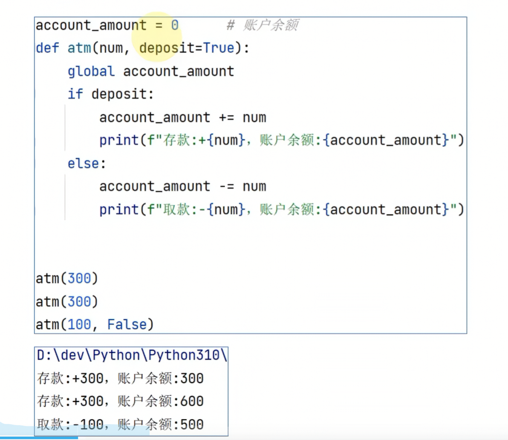
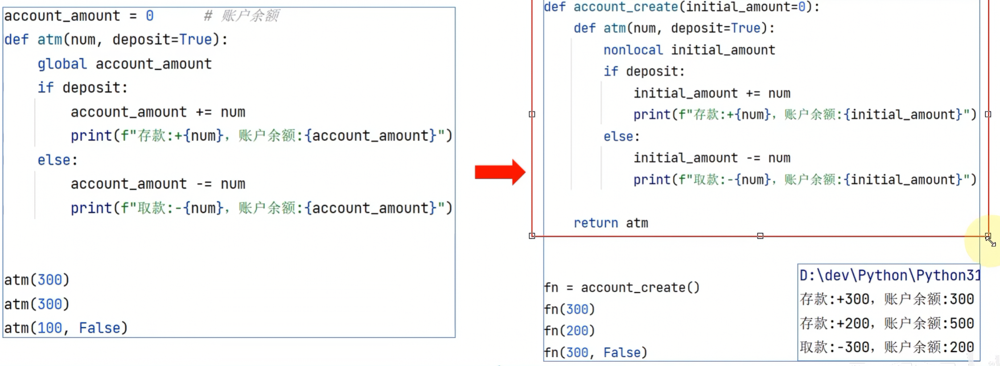
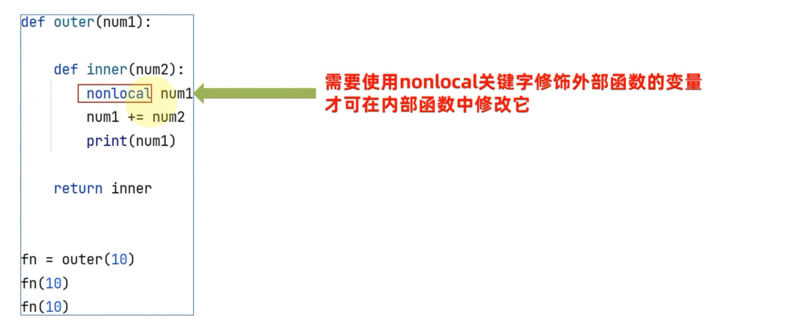
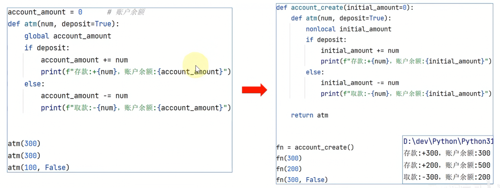
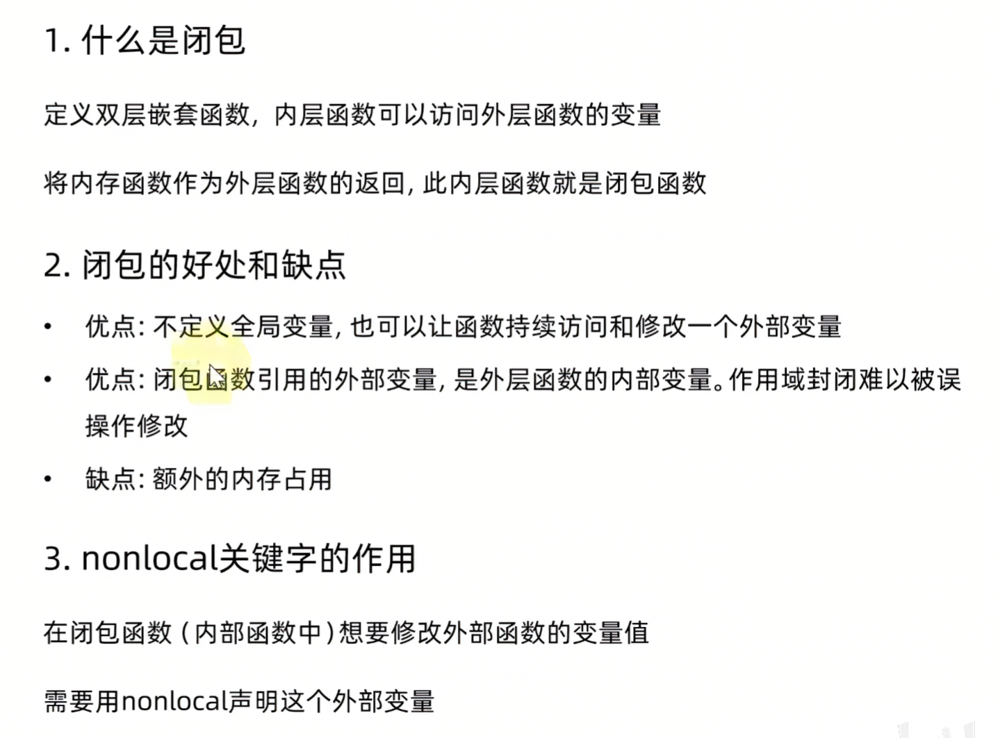

### 闭包

通过全局变量account_amount来记录余额
- 尽管功能实现是ok的，但是仍有问题：
- 代码在命名空间上（变量定义）不够干净、整洁
- 全局变量有被修改的风险



在函数嵌套的前提下，内部函数使用了外部函数的变量，并且外部函数返回了内部函数，我们把这个使用外部函数变量的内部函数称为闭包。




####  简单闭包

```python
def outer(logo):

    def inner(msg):
        print(f"<{logo}>{msg}<{logo}>")
        
    return inner

fn1 = outer("黑马程序员")
fn1("大家好呀")
fn1("学Python就来")

fn2 = outer("传智教育")
fn2("IT职业教育培训")
fn2("学Python就来")
```

**输出结果**
```text
<黑马程序员>大家好呀<黑马程序员>
<黑马程序员>学Python就来<黑马程序员>
<传智教育>IT职业教育培训<传智教育>
<传智教育>学Python就来<传智教育>
```

你可以把 `outer` 想象成一个 **“带记忆功能的函数打印机”**：

1. 你告诉打印机（`outer`）：“以后打印时，给我加上 `<黑马程序员>` 这个前缀和后缀。”
2. 打印机吐出一台**定制好的新打印机**（`fn1`）。
3. 你往这台新打印机里塞纸（`"大家好"`），它就印出 `<黑马程序员>大家好<黑马程序员>`。

 一句话总结

> **`outer` 不负责处理 `"大家好"`，它只负责“制造”一个能处理 `"大家好"` 的函数，并把这个函数交给你（`fn1`）。**  
> **`fn1("大家好")` 是在调用你手里那台定制好的“内函数”打印机，把内容传进去打印。**

#### 修改外部函数变量的值



现在可以尝试实现以下atm取钱的闭包实现了。



示例
```Python
# atm闭包  
def account_create(initial_amount=0):  
  
  
    def atm(num,deposit=True):  
        nonlocal initial_amount  
        if deposit:  
            initial_amount += num  
            print(f"存款：{num},账户余额：{initial_amount}")  
        else:  
            initial_amount -= num  
            print(f"取款：{num},账户余额：{initial_amount}")  
  
    return atm  
  
atm = account_create()  
  
atm(100)  
atm(200)  
  
atm(200,False)
```

### 闭包注意事项

**优点：**
- 无需定义全局变量即可实现通过函数，持续的访问、修改某个值
- 闭包使用的变量的作用域在函数内，难以被错误的调用修改

**缺点：**
- 由于内部函数持续引用外部函数的值，所以会导致这一部分内存空间不被释放，一直占用内存


### 总结

