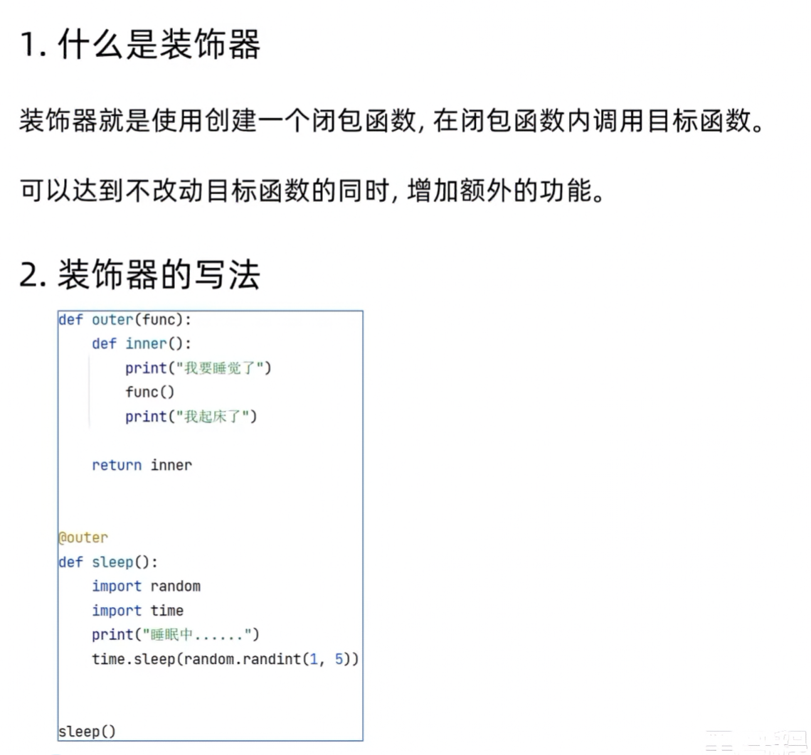

### 装饰器

装饰器其实也是一种**闭包**，其功能就是**在不破坏目标函数原有的代码和功能的前提下，为目标函数增加新功能**

```Python
def sleep():
    import random
    import time
    print("睡眠中......")
    time.sleep(random.randint(1, 5))
```
希望给 `sleep` 函数增加一个功能：

- 在调用 `sleep` 前输出：**我要睡觉了**
- 在调用 `sleep` 后输出：**我起床了**

### 装饰器的一般写法（闭包写法）

```Python
def outer(func):  
    def inner():            # 定义一个闭包函数，再闭包函数内部：  
        print("我要睡觉了")   # 执行目标函数  
        func()  
        print("我起床了")     # 并完成功能的添加  
  
    return inner  
  
def sleep():  
    import random                        # 执行结果
    import time                          # 我睡觉了
    print("睡眠中....")                   # 睡眠中。。。。
    time.sleep(random.randint(1,5))      # 我起床了  
  
fn = outer(sleep)  
fn()
```


### 装饰器的语法糖写法

```Python
def outer(func):  
    def inner():  
        print("我要睡觉了")  
        func()  
        print("我起床了")  
  
    return inner  
  
@outer                                        # 使用@outer  
def sleep():                                  # 定义在目标函数sleep之上  
    import random  
    import time  
    print("睡眠中。。。")                        # 执行结果：  
    time.sleep(random.randint(1,5))     # 我要睡觉了  
                                               # 睡眠中。。。  
sleep()                                        # 我起床了
```

### 总结

