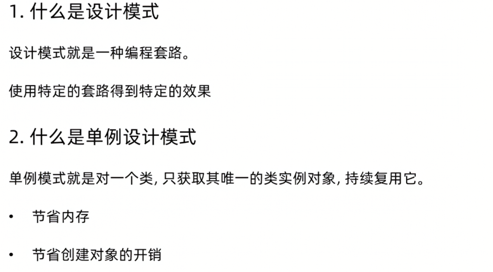

### 设计模式

设计模式是一种编程套路，可以极大的方便程序的开发。
最常见、最经典的设计模式，就是我们所学习的**面向对象**了。
除了面向对象外，在编程中也有很多既定的套路可以方便开发，我们称之为设计模式：

- **单例、工厂模式**
- 建造者、责任链、状态、备忘录、解释器、访问者、观察者、中介、模板、代理模式
- 等等模式

设计模式非常多，我们主要挑选了2个经常用到的进行讲解。

### 单例模式

```Python
class Tool:
    pass

t1 = Tool()
t2 = Tool()
print(t1)
print(t2)
```

创建类的实例后，就可以得到一个完整的、独立的类对象。
通过print语句可以看出，它们的内存地址是不相同的，即t1和t2是完全独立的两个对象。
```Python
<__main__.Tool object at 0x0000027246FCCEE0>
<__main__.Tool object at 0x0000027246FCD9F0>
```

某些场景下，我们需要一个类无论获取多少次类对象，都仅仅提供一个具体的实例用以节省创建类对象的开销和内存开销。
比如某些工具类，仅需要1个实例，即可在各处使用
这就是**单例模式**所要实现的效果。


**单例模式**（Singleton Pattern）是一种常用的软件设计模式，该模式的主要目的是**确保某一个类只有一个实例存在**。

在整个系统中，某个类只能出现一个实例时，单例对象就能派上用场。
- **定义**：保证一个类只有一个实例，并提供一个访问它的全局访问点
- **适用场景**：当一个类只能有一个实例，而客户可以从一个众所周知的访问点访问它时。


**单例的实现模式：**
```Python
# 文件：test.py
class StrTools:
    pass

str_tool = StrTools()
```

```python
# 另一个文件中导入对象
from test import str_tool

s1 = str_tool
s2 = str_tool
print(s1)
print(s2)
```

**输出：**
```Python
# s1和s2都是u同一个对象
<test.StrTools object at 0x0000013D001DB910>
<test.StrTools object at 0x0000013D001DB910>
```

### 总结

