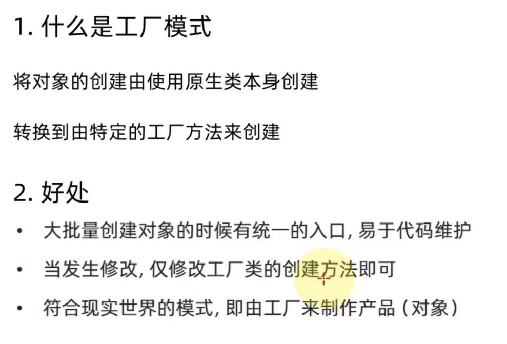

### 工厂模式介绍

当需要**大量创建**一个类的实例的时候，可以使用工厂模式。

即，从原生的使用类的构造去创建对象的形式：
```Python
worker = Worker()
stu = Student()
teacher = Teacher()
```
迁移到，基于**工厂提供的方法**去创建对象的形式：

```Python
class Person:
    pass

class Worker(Person):
    pass

class Student(Person):
    pass

class Teacher(Person):
    pass
```

### 工厂模式


- 使用工厂类的 `get_person()` 方法去创建具体的类对象

**优点：**

- 大批量创建对象的时候有统一的入口，易于代码维护
- 当发生修改，仅修改工厂类的创建方法即可
- 符合现实世界的模式，即由工厂来制作产品（对象）

```Python
class Person:
    pass

class Worker(Person):
    pass

class Student(Person):
    pass

class Teacher(Person):
    pass

class Factory:
    def get_person(self, p_type):
        if p_type == 'w':
            return Worker()
        elif p_type == 's':
            return Student()
        else:
            return Teacher()

factory = Factory()
worker = factory.get_person('w')
stu = factory.get_person('s')
teacher = factory.get_person('t')
```

### 总结

