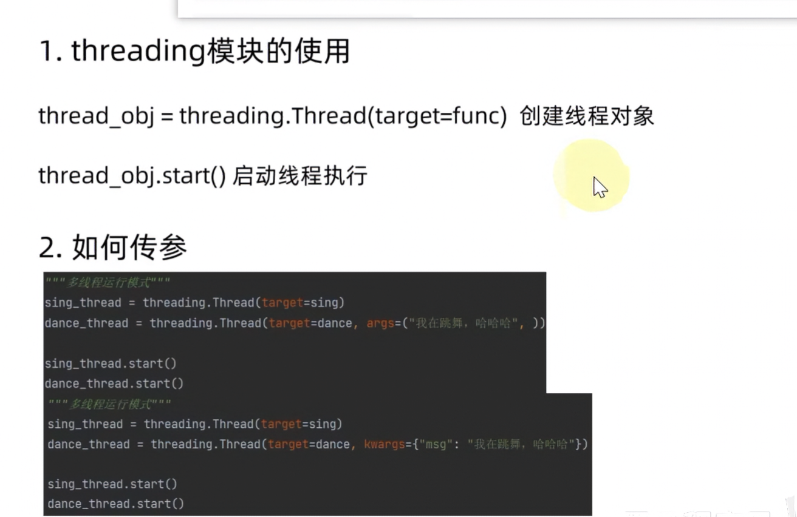

### threading模块

绝大多数编程语言，都允许多线程编程，Python也不例外。
Python的多线程可以通过 **`threading`** 模块来实现。
```Python
import threading

thread_obj = threading.Thread([group [, target [, name [, args [, kwargs]]]]])
```

**参数说明：**

- `group`: 暂时无用，未来功能的预留参数
- `target`: 执行的目标任务名
- `args`: 以元组的方式给执行任务传参
- `kwargs`: 以字典方式给执行任务传参
- `name`: 线程名，一般不用设置

### 多线程编程

```Python
import threading
import time

def sing():
    while True:
        print("我在唱歌，啦啦啦...")
        time.sleep(1)

def dance():
    while True:
        print("我在跳舞，哗哗哗哗哗")
        time.sleep(1)

# 创建线程对象
sing_thread = threading.Thread(target=sing)
dance_thread = threading.Thread(target=dance)

# 启动线程
sing_thread.start()
dance_thread.start()
```

示例
**单线程**
```Python
# 单线程编程
import time  
  
  
def sing():  
    while True:  
        print("我在唱歌，啦啦啦。。。")  
        time.sleep(1)  
  
def dance():  
    while True:  
        print("我在跳舞，呱呱呱。。。")  

# 这是要做的事情，但是死循环会一直做  
if __name__ == '__main__':  
    sing()  
    dance()
```

**多线程**
```Python
import time  
import threading  
  
def sing():  
    while True:  
        print("我在唱歌，啦啦啦。。。")  
        time.sleep(1)  
  
def dance():  
    while True:  
        print("我在跳舞，呱呱呱。。。")  
        time.sleep(1)  
  
if __name__ == '__main__':  
  
    # 创建一个唱歌的线程  
    sing_thread = threading.Thread(target=sing)  
    # 创建一个跳舞的线程  
    dance_thread = threading.Thread(target=dance)  
  
    # 干活！  
    sing_thread.start()  
    dance_thread.start()
```

**需要传参的话可以通过：**
	- args参数通过元组（按照参数排序）的方式传参
	- 或使用kwargs参数用字典的形式传参

```Python
import time  
import threading  
  
def sing(msg):  
    while True:  
        print(msg)  
        time.sleep(1)  
  
def dance(msg):  
    while True:  
        print(msg)  
        time.sleep(1)  
  
if __name__ == '__main__':  
  
    # 创建一个唱歌的线程  
    sing_thread = threading.Thread(target=sing,args=("我要唱歌 哈哈哈哈哈",))  
    # 创建一个跳舞的线程  
    dance_thread = threading.Thread(target=dance,kwargs={"msg": "我要跳舞 啦啦啦啦啦"})  
  
    # 干活！  
    sing_thread.start()  
    dance_thread.start()
```


### 总结

