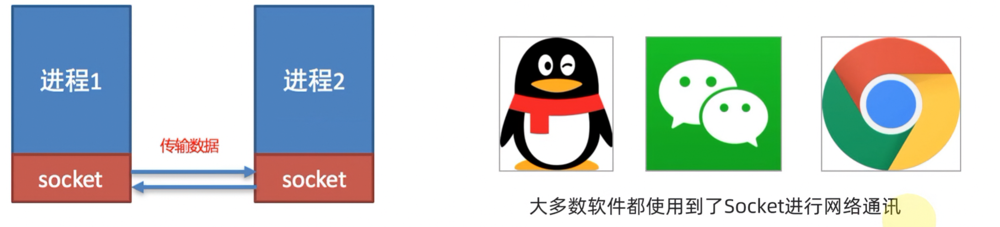

## Socket（套接字）
socket（简称**套接字**）是进程之间通信的一个工具，好比现实生活中的**插座**，所有的家用电器要想工作都是基于插座进行，进程之间想要进行网络通信需要socket。

Socket负责进程之间的网络数据传输，好比数据的**搬运工**。



### 客户端和服务端

2个进程之间通过Socket进行相互通讯，就必须有**服务端**和**客户端**

- **Socket服务端**：等待其它进程的连接、可接受发来的消息、可以回复消息
- **Socket客户端**：主动连接服务端、可以发送消息、可以接收回复

```text
    服务端                    客户端
    ┌─────┐                  ┌─────┐
    │     │ ←── 发送消息 ─── │     │
    │     │ ─── 回复消息 ──→ │     │
    └─────┘                  └─────┘
                                │
                                ↓
                             客户端

```

## Socket服务端编程

主要分为如下几个步骤：

**1. 创建socket对象**
```Python
import socket
socket_server = socket.socket()
```
**2. 绑定socket_server到指定IP和地址**
```Python
socket_server.bind(host, port)
```
**3. 服务端开始监听端口**
```Python
socket_server.listen(backlog)
# backlog为int整数，表示允许的连接数量，超出的会等待，可以不填，不填会自动设置一个合理值
```
**4. 接收客户端连接，获得连接对象**
```Python
conn, address = socket_server.accept()
print(f"接收到客户端连接，连接来自：{address}")
# accept方法是阻塞方法，如果没有连接，会卡在当前这一行不向下执行代码
# accept返回的是一个二元元组，可以使用上述形式，用两个变量接收二元元组的2个元素
```
**5. 客户端连接后，通过 `recv` 方法，接收客户端发送的消息**
```Python
while True:
    data = conn.recv(1024).decode("UTF-8")
    # recv方法的返回值是字节数组（Bytes），可以通过decode使用UTF-8解码为字符串
    # recv方法的传参是buffsize，缓冲区大小，一般设置为1024即可
    if data == 'exit':
        break
    print("接收到发送来的数据：", data)
    # 可以通过while True无限循环来持续和客户端进行数据交互
    # 可以通过判定客户端发送的特殊标记，如exit，来退出无限循环
```
**6. 通过 `conn`（客户端当次连接对象），调用 `send` 方法可以回复消息**
```Python
while True:
    data = conn.recv(1024).decode("UTF-8")
    if data == 'exit':
        break
    print("接收到发送来的数据：", data)

conn.send("你好呀哈哈哈".encode("UTF-8"))
```
**7. `conn`（客户端当次连接对象）和 `socket_server` 对象调用 `close` 方法，关闭连接**

```Python
conn.close()
socket_server.close()
```
### 完整代码
```Python
import socket  
  
# 创建Socket  
socket_server = socket.socket()  
  
# 绑定IP地址和端口  
socket_server.bind(("localhost",8888))  
  
# 监听端口  listen方法内表示接受几个链接数量  
socket_server.listen(1)  
print(f"链接隧道已经开启，等待目标链入...")  
  
  
# 等待客户端链接  
# results = socket_server.accept()  
# conn = results[0]  
# address = results[1]  
# 等同于上三个  
# accept方法返回的是二元元组(链接对象，客户端地址信息)  
# 可以通过 变量1，变量2 = socket_server.accept()的形式，直接接受二元元组的两个元素  
# accept()方法，是阻塞的方法，等待客户端的链接，如果没有链接就，就一直卡在这里等待链接  
conn, address = socket_server.accept()  
  
print(f"接收了客户端的信息，客户端的信息是：{address}")  
print("等待客户端发送信息...")  
# 接收客户端信息，要使用客户端和服务端的本次链接对象，而非socket_server对象  
# recv接收的参数是缓冲区，一般给1024即可  
# recv方法的返回值是一个字节数组也就是bytes对象，不是字符串，可以通过decode方法通过UTF-8编码，将字节数组转换成字符串对象  
while True:  
    data = conn.recv(1024).decode("UTF-8")  
    print(f"客户端发来的消息：{data}")  
  
    # 发送回复消息  
    # encode是将字符串转码为字节数组对象  
    msg = input("请输入你要和客户端回复的消息：")  
    if msg == 'exit':  
        print("断开链接")  
        break  
    conn.send(msg.encode("UTF-8"))  
  
# 关闭链接  
conn.close()  
socket_server.close()
```

## Socket客户端编程
**1. 创建socket对象**
```Python
import socket
socket_client = socket.socket()
```
**2. 连接到服务端**
```Python
socket_client.connect(("localhost", 8888))
```
**3. 发送消息**
```Python
while True:    # 可以通过无限循环来确保持续的发送消息给服务端
    send_msg = input("请输入要发送的消息")
    if send_msg == 'exit':
        # 通过特殊标记来确保可以退出无限循环
        break
    socket_client.send(send_msg.encode("UTF-8"))    # 消息需要编码为字节数组（UTF-8编码）
```

### 客户端Socket完整代码
```Python
import socket  
  
# 创建套接字对象  
socket_client = socket.socket()  
  
# 连接到服务端  
socket_client.connect(("localhost",8888))  
  
# 无限循环  
while True:  
    # 发送消息  
    msg = input("请输入要给服务器发送的消息：")  
    if msg == "exit":  
        print("断开连接")  
        break  
    socket_client.send(msg.encode("UTF-8"))  
  
    # 接收返回信息  
    recv_data = socket_client.recv(1024)  
    print(f"客户端回复的消息是：{recv_data.decode('UTF-8')}")  
  
# 关闭  
socket_client.close()
```