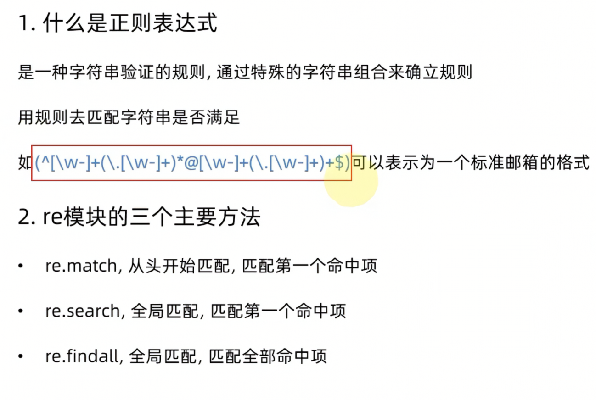

### 正则表达式

正则表达式，又称**规则表达式（Regular Expression）**，是使用单个字符串来描述、匹配某个句法规则的字符串，常被用来**检索、替换**那些符合某个模式（规则）的文本。
简单来说，正则表达式就是使用**字符串定义规则**，并通过规则去**验证字符串是否匹配**。
比如，验证一个字符串是否是符合条件的电子邮箱地址，只需要配置好正则规则，即可匹配任意邮箱。
比如通过正则规则：**`^[\w-]+(\.[\w-]+)*@[\w-]+(\.[\w-]+)*$`** 即可匹配一个字符串是否是标准邮箱格式。
但如果不使用正则，使用 `if else` 来对字符串做判断就非常困难了。

### 正则的三个基础方法

Python正则表达式，使用`re`模块，并基于re模块中三个基础方法来做正则匹配。
分别是：`match`、`search`、`findall` 三个基础方法
**`re.match(匹配规则，被匹配字符串)`**
从被匹配字符串**开头**进行匹配，匹配成功返回匹配对象（包含匹配的信息），匹配不成功返回空。
#### re.match方法
```Python
import re

s = 'python itheima python itheima python itheima'

result = re.match('python', s)
print(result)  # <re.Match object; span=(0, 6), match='python'>
print(result.span())  # (0, 6)
print(result.group())  # python
```
```Python
s = '1python itheima python itheima python itheima'

result = re.match('python', s)
print(result)  # None
```

#### re.search方法

**`re.search(匹配规则，被匹配字符串)`**
搜索整个字符串，找出匹配的。从前向后，找到第一个后，就**停止**，不会继续向后。
```Python
import re

s = '1python666itheima666python666'

result = re.search('python', s)
print(result)          # <re.Match object; span=(1, 7), match='python'>
print(result.span())   # (1, 7)
print(result.group())  # python
```
**整个字符串都找不到，返回 `None`：**
```Python
s = 'itheima666'

result = re.search('python', s)
print(result)          # None
```
#### re.findall方法

**`re.findall(匹配规则，被匹配字符串)`**
匹配整个字符串，找出**全部**匹配项。
```Python
import re

s = '1python666itheima666python666'

result = re.findall('python', s)
print(result)    # ['python', 'python']
```
**找不到返回空列表 `[]`：**
```Python
s = '1python666itheima666python666'

result = re.findall('itcast', s)
print(result)    # []
```

示例
```Python
import re  
  
s = 'python itheima python nihao python'  
  
# 从头匹配  
results = re.match("python", s)  
print(results)  
print(results.span())  
print(results.group())  
  
# 搜索匹配  
results = re.search("pytho", s)  
print(results)  
  
# 搜索全部匹配  
results = re.findall("python", s)  
print(results)
```

### 总结

