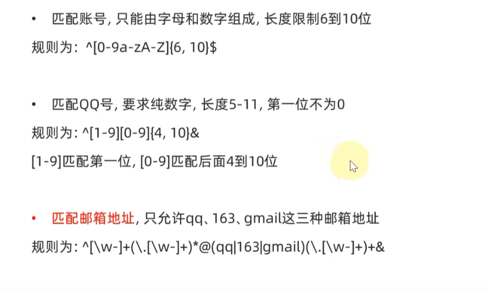
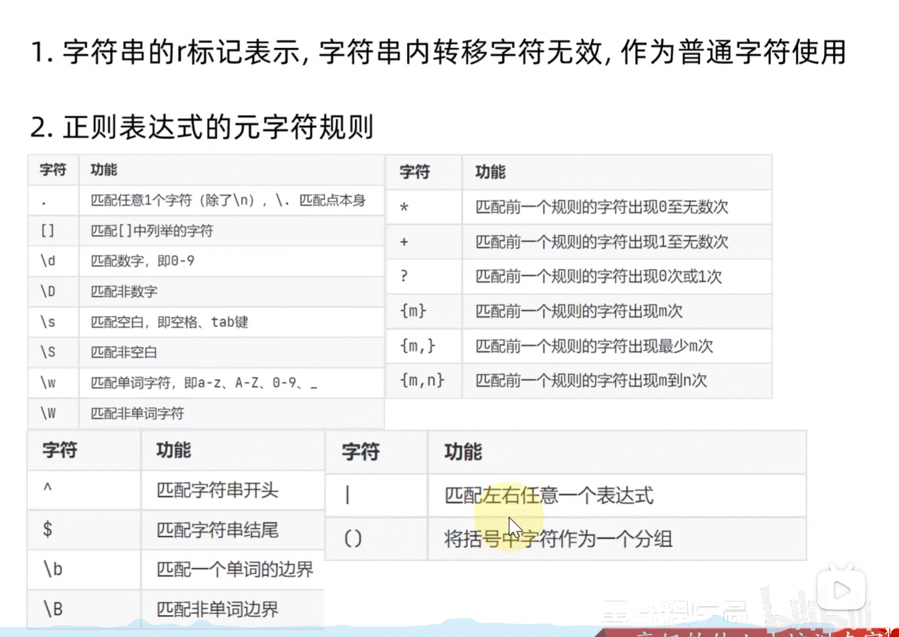

### 元字符匹配

在刚刚我们只是进行了基础的字符串匹配，正则最强大的功能在于**元字符匹配规则**。
#### 单字符匹配：

| 字符   | 功能                          |
| ---- | --------------------------- |
| `.`  | 匹配任意1个字符（除了`\n`），`\.` 匹配点本身 |
| `[]` | 匹配`[]`中列举的字符                |
| `\d` | 匹配数字，即0-9                   |
| `\D` | 匹配非数字                       |
| `\s` | 匹配空白，即空格、tab键               |
| `\S` | 匹配非空白                       |
| `\w` | 匹配单词字符，即a-z、A-Z、0-9、_       |
| `\W` | 匹配非单词字符                     |
**示例：**
```Python
import re

	s = "itheima1 @@python2 !!666 ##itcast3"

# 找出全部数字
re.findall(r'\d', s)

# 找出特殊字符
# 找出全部英文字母
re.findall(r'[a-zA-Z]', s)
```

#### 数量匹配：

| 字符      | 功能                    |
| ------- | --------------------- |
| `*`     | 匹配前一个规则的字符出现**0至无数次** |
| `+`     | 匹配前一个规则的字符出现**1至无数次** |
| `?`     | 匹配前一个规则的字符出现**0次或1次** |
| `{m}`   | 匹配前一个规则的字符出现**m次**    |
| `{m,}`  | 匹配前一个规则的字符出现**最少m次**  |
| `{m,n}` | 匹配前一个规则的字符出现**m到n次**  |


#### 边界匹配：

| 字符   | 功能        |
| ---- | --------- |
| `^`  | 匹配字符串开头   |
| `$`  | 匹配字符串结尾   |
| `\b` | 匹配一个单词的边界 |
| `\B` | 匹配非单词边界   |

**分组匹配：**


#### 分组匹配：

| 字符   | 功能           |
| ---- | ------------ |
| `\|` | 匹配左右任意一个表达式  |
| `()` | 将括号中字符作为一个分组 |

### 案例



示例
```Python
import re  
  
# 陪陪账号，只能由字母和数字足证，长度6-10位置  
r = "^[0-9a-zA-Z]{6,10}$"  
  
s = '12345678ab'  
print(re.findall(r, s))  
  
# 匹配qq号，要求纯数字，长度5-11，第一位不为0  
r = '^[1-9][0-9]{4,10}$'  
s = '012345678'  
print(re.findall(r, s))  
  
# 匹配邮箱地址，只允许qq、163、gmail这三种地址  
# {内容}.{内容}.{内容}.{内容}.{内容}.{内容}.{内容}.{内容}  
r = '^[\w-]+(\.[\w-]+)*@(qq|163|gmail)(\.[\w-]+)+$'  
s = 'a.b.c.d.e.f.g@163.com.a.z.c.d.e'  
print(re.match(r, s))
```

### 总结

