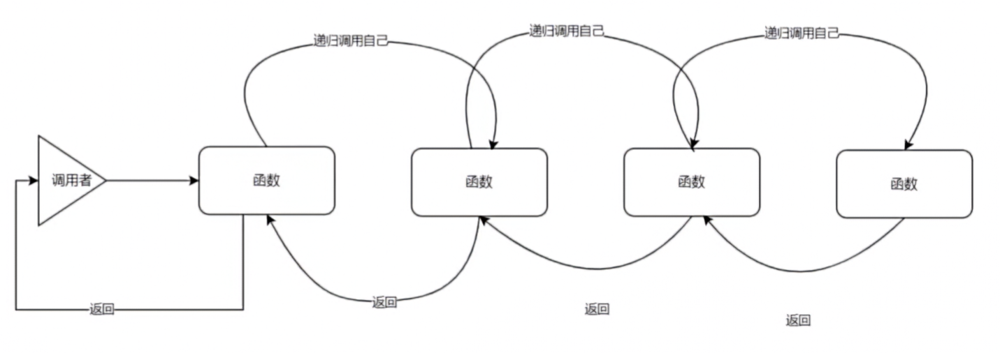
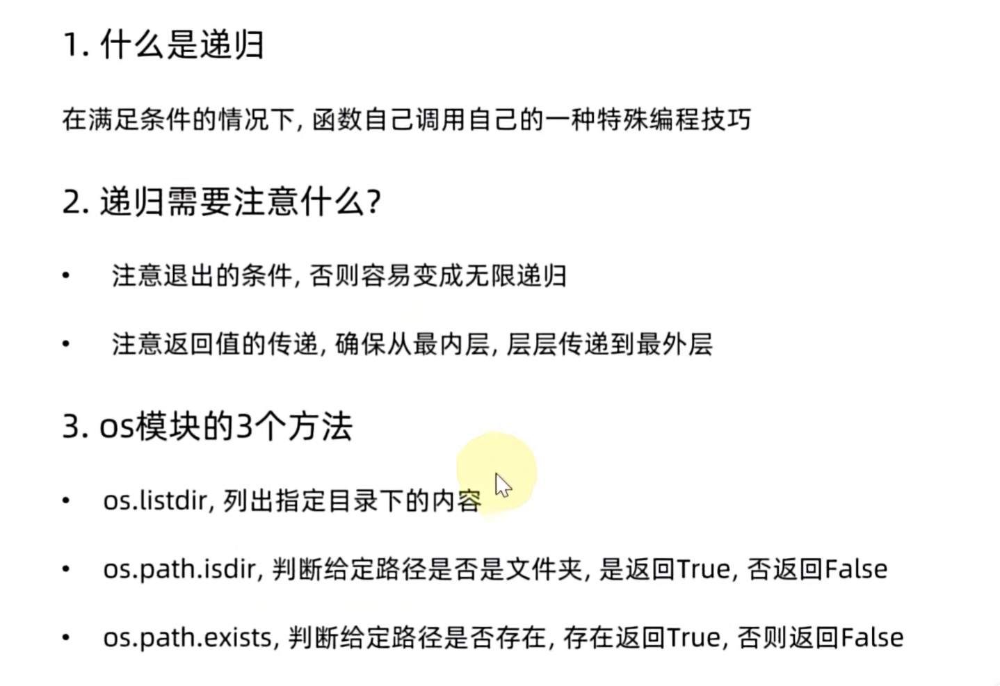

### 递归

递归在编程中是一种非常重要的算法。
**递归**：即方法（函数）**自己调用自己**的一种特殊编程写法。
如：
```Python
def func():
    if ...:
        ...
    func()
    return ...
```
### 递归找文件

最典型的递归场景为**找出一个文件夹中全部的文件**。
如图，在 `D:/test` 文件夹内，有如下嵌套结构和所属的文件，可以通过递归编程的形式完成：
```text
D:/test
├── 1.txt
├── 2.txt
├── 3.txt
├── a/
│   ├── a1.txt
│   ├── a2.txt
│   └── a3.txt
├── b/
│   ├── b1.txt
│   ├── b2.txt
│   └── b3.txt
└── c/
    ├── c1.txt
    ├── c2.txt
    └── c3.txt

5 directories, 15 files
```


示例
```Python
import os  
  
def file_to():  
    """  
    三个基础方法  
    """    print(os.listdir("K:/Mirror_Void_Arsenal/test"))  
    print(os.path.isdir("K:/Mirror_Void_Arsenal/test/a"))  
    print(os.path.exists("K:/Mirror_Void_Arsenal/test"))  
  
  
def get_file_recursion_from_dir(path):  
    """  
    :param path: 被判断的文件夹  
    :return list：包含全部的文件，如果目录下面不粗真乃或者无文件就返回一个空list  
    """    print(f"当前判断的文件夹是：{path}")  
    file_list = []  
    if os.path.exists(path):  
        for f in os.listdir(path):  
            new_path = path + "/" + f  
            if os.path.isdir((new_path)):  
                # 进入到这里，表明这个目录是文件夹不是文件  
                file_list += get_file_recursion_from_dir(new_path)  
            else:  
                file_list.append(new_path)  
    else:  
        print(f"指定的目录{path}不存在")  
        return []  
  
    return file_list  
  
if __name__ == '__main__':  
    print(get_file_recursion_from_dir("K:/Mirror_Void_Arsenal/test"))
```


### 总结

