# 一、进攻性安全介绍
### 什么是进攻性别安全？
==“要智胜黑客，你得像黑客一样思考。”==

这就是“进攻性安全”的核心。它涉及入侵计算机系统、利用软件漏洞，并寻找应用程序漏洞以获得未经授权的访问权限。目标是理解黑客战术并增强我们的系统防御。

开始你的学习之旅

在这个TryHackMe房间里，你将被引导在合法安全的环境中黑入你的第一个网站。目标是向你展示道德黑客的运作方式。

我们的实验室也可以恢复到初始状态，所以别害怕破坏机器。尽情实验，我们帮你解决！

---
请回答以下问题：
以下哪个选项更能代表模拟黑客寻找系统漏洞的过程？  

- 进攻性安全
- 防御性安全
`Offensive Security`
### 启动实验室
这个不用学！
### 你的第一次黑客
我们的目标是找到破解FakeBank应用以盗取资金的方法。为此，他们为我们提供了一个银行账户，就像我们是普通用户一样。

我们尝试破解应用的最简单方法之一是发现应用中的隐藏功能。有时，应用会通过隐藏URL向用户暴露敏感功能。如果我们能找到这些URL，可能就能执行普通用户不该做的作。

为了查找隐藏的URL，我们将使用一种叫做的工具。该工具采用**暴力破解**方法，通过收集**潜在页面名称**列表，逐一测试它们是否存在于你的网站上。这种方法之所以有效，是因为人们经常使用可预测的名称。`dirb`

**开设航站楼**

终端，也称为命令行，是一种允许我们向计算机发送文本命令的程序。许多黑客工具，包括 dirb，都需要从终端中执行。

在机器上，点击屏幕右侧的终端图标打开终端。
**使用 dirb 查找隐藏网站页面**

使用dirb非常简单。使用终端，先写命令，然后输入你想暴力破解的网站URL。一定要按键盘执行命令：
`dirb ENTER`
示例：
```bash
dirb http://fakebank.thm   #命令
```
该命令运行需要一分钟，并显示类似这样的输出：
```bash
ubuntu@tryhackme:~/Desktop$ dirb http://fakebank.thm 
----------------- 
DIRB v2.22 By The Dark Raver 
----------------- 
START_TIME: Thu Apr 17 16:29:52 2025 
URL_BASE: http://fakebank.thm/ WORDLIST_FILES: /usr/share/dirb/wordlists/common.txt 
----------------- 
GENERATED WORDS: 4610 
---- Scanning URL: http://fakebank.thm/ 
---- 
+ http://fakebank.thm/bank-deposit (CODE:200|SIZE:4663) 
+ http://fakebank.thm/images (CODE:301|SIZE:179) 
----------------- 
END_TIME: Thu Apr 17 16:29:59 2025 
DOWNLOADED: 4610 - FOUND: 2
```
命令的输出可能看起来有些令人生畏，但这里有一份简明的报告分解：

- 输出的第一部分告诉我们扫描的URL_BASE，这只是我们给工具提供的URL。它还显示了工具使用的单词列表文件的位置，该文件包含在暴力破解攻击中将测试的常见页面名称。此时，工具使用工具默认的词表，位于 。如果你想探索，桌面里也有文件副本。`/usr/share/dirb/wordlists/common.txt``common.txt`
- 以符号开头的线条是扫描的结果。在这种情况下，dirb帮你找到了两个URL。试着在机器浏览器里打开它们！你可能会发现有趣的东西。`+`
==请回答以下问题==
Dirb本应该找到两个隐藏的URL。其中一个是。另一个是什么？http://fakebank.thm/images
`http://fakebank.thm/bank-deposit`
### 向您的账户充值
这个没啥要记得~

# 二、防御安全导论
### 防御安全导论
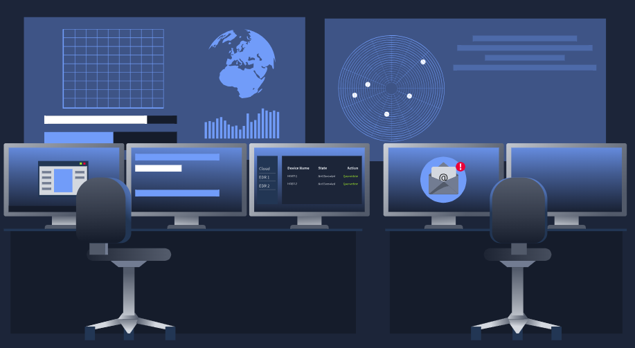在这个房间里，我们将探讨防守安全（**也称为蓝队）**的世界。我们将揭示防御性安全团队在保护全球网络和组织中的关键作用，并理解防御性安全在实际中的表现。

不幸的是，头条新闻告诉我们防御性安全不足时会发生什么。从大规模的勒索软件攻击医疗系统到大型企业的数据泄露，安全漏洞对组织的影响可能非常严重且代价高昂，且还需处以罚款。以下是一些真实世界的例子：
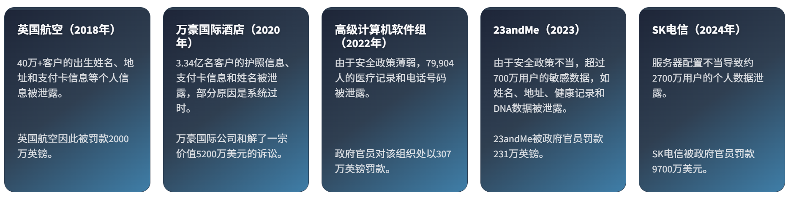
**==请回答以下问题==**
防御性安全也是什么？
	Blue Teaming

### 防御安全的职责
该任务将更深入地探讨防御安全。你还将与防御安全团队中的一些专家见面，了解他们的日常职责。

让我们先聚焦于防御安全的一些关键领域：
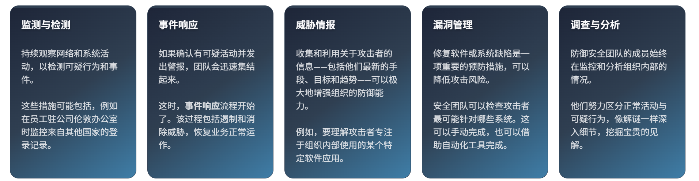
更何况，防御性安全团队由多种角色和职责组成。下面，让我们认识一些你在防御安全团队中会遇到的高技能人员：
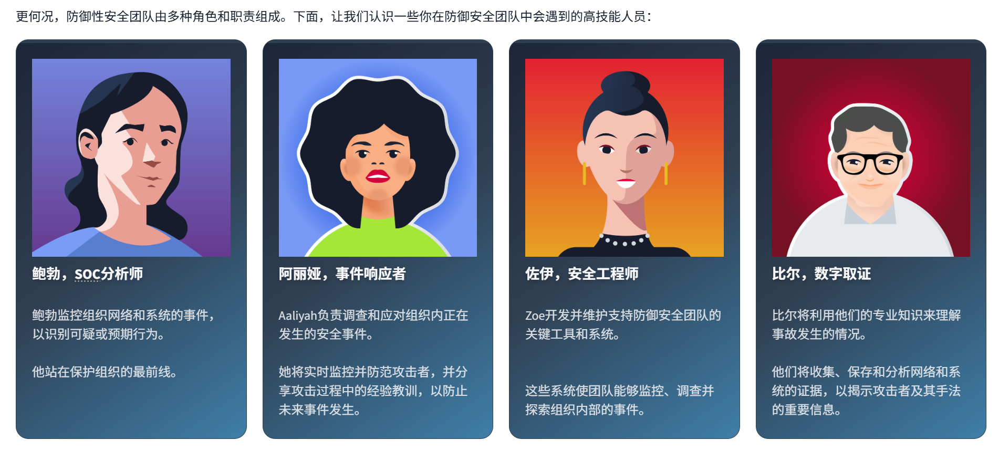
**==请回答以下问题==**
在某个组织的网络上检测到攻击。上面那位负责回应攻击的人叫什么名字？
	Aaliyah

### 防御性安全实践
既然你已经了解了防御性安全并认识了一些关键人物，让我们来了解一下它是如何应用的。

组织不依赖单一工具或方法来保持安全——它们像洋葱或城堡的多层防御一样，构建层层防御。我们称之为“纵深防御”，意思是如果一项安全措施失效，我们会在不同阶段依赖其他措施。

这些防御措施的例子包括：
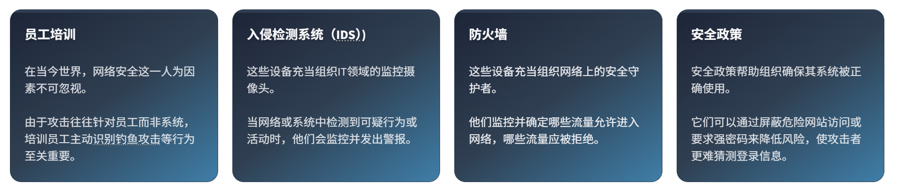
这意味着即使员工点击了邮件中的危险附件，也会有其他保护措施防止恶意附件损害组织。

防御性安全团队依赖广泛的工具和技术。这些工具使专业人员能够更有效地分析信息并调查威胁。本节将介绍全球防御安全团队常用的一些关键技术。
### 探索安全行动中心（SOC）
可以把SOC看作是组织技术的防御性安全中心。这个繁忙的中心是保护组织的前线，通常全年365天全天候运作，并雇佣了多位安全专业人员，负责监控和保护组织的网络、系统和数据。

SOC的典型一天可能如下：

- 审查由安全工具触发的警报
- 调查异常
- 响应事件

这些专业人士往往是保护组织前线的眼睛和耳朵。
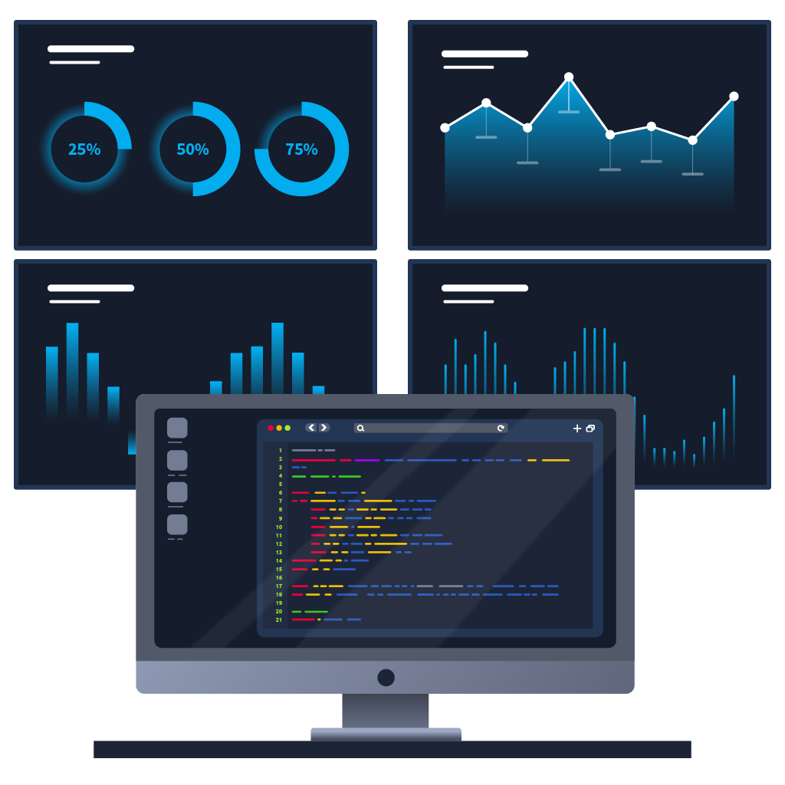
## SIEMs：防御安全雷达

就像现实中的控制中心一样，SIEM（安全信息与事件管理）系统是组织内从安全设备、工作站、服务器等收集的所有数据和信息的中心场所。

就像雷达扫描数字环境一样，这些系统是任何组织防御安全中绝对关键的一部分，因为它们提供了对组织IT内部动态的洞察。

组织内部的系统产生大量信息。这些信息需要集中在一个易于访问的地方，以便快速清晰地理解正在发生的事情。这样，多人可以快速审查和分析。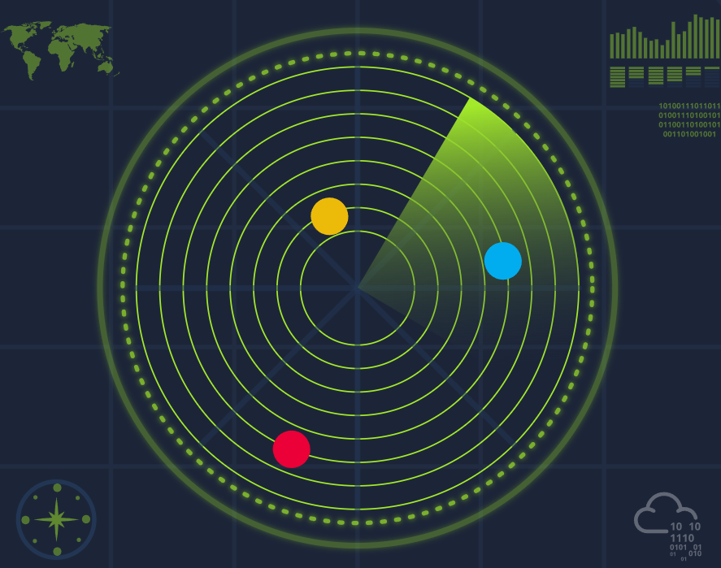
**==请回答以下问题==**
“安全行动中心”一词的缩写是什么？
	SOC
### 实用：捍卫假银行
这个就算了，没有记的必要

# 三、网络领域的职业
### 简介
网络安全职业需求日益增加，薪资也较[高](https://tryhackme.com/resources/blog/cyber-security-salary-career-options)。安全行业有许多不同的工作岗位，从进攻渗透测试（黑客攻击和漏洞报告）到防御性安全（防御和调查网络攻击）。

为什么选择网络安全职业：

- 高薪——安保岗位起薪较高
- 令人兴奋的是——工作内容可以包括合法入侵系统或防御网络攻击
- 保持需求——目前有超过350万个网络职位空缺

本课程通过提供关于各种网络安全岗位的信息，帮助你进入网络安全领域;它还链接到不同的学习路径，帮助你开始提升网络技能。
### 证券分析师
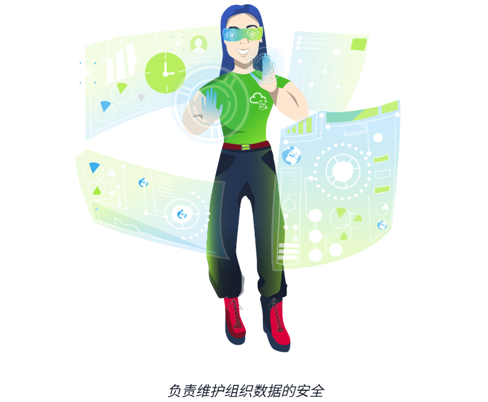
安全分析师在构建各组织的安全措施中至关重要，以保护公司免受攻击。分析师探索和评估公司网络，以发现可作的数据和工程师制定预防措施的建议。该职位需要与各方利益相关者合作，以了解安全需求和安全环境。

### 职责

- 与各方利益相关者合作，分析公司内的网络安全
- 汇编关于网络安全的持续报告，记录安全问题及应对措施
- 制定安全计划，结合对新攻击工具和趋势的研究，以及团队维护数据安全的措施。

### 学习路径

TryHackMe的学习路径将为您提供基础技术知识和实践经验，这对成为成功的安全分析师至关重要。

- [安全出现前](https://tryhackme.com/path/outline/presecurity/)
- [网络安全101](https://tryhackme.com/path/outline/cybersecurity101)
- [SOC第一关](https://tryhackme.com/path/outline/soclevel1)

### 相关职业指南

- [成为网络安全分析师](https://tryhackme.com/r/careers/cyber-security-analyst)
- [如何成为一级SOC分析师](https://tryhackme.com/r/resources/blog/become-level-1-soc-analyst)
- [SOC分析师的一天生活](https://tryhackme.com/r/resources/blog/interview-with-soc-analyst)
- [终极SOC L1分析师面试指南](https://tryhackme.com/r/resources/blog/soc-analyst-interview-guide)
- [从学生到SOC分析师：Hayden的成功故事](https://tryhackme.com/r/resources/blog/haydens-success-story)

### 安全工程师
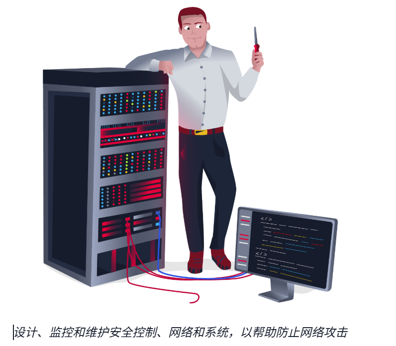
安全工程师利用威胁和漏洞数据开发并实施安全解决方案——这些数据通常来自安全员工。安全工程师致力于规避各种攻击，包括网页应用攻击、网络威胁以及不断演变的趋势和策略。最终目标是保留并采用安全措施，以降低攻击和数据丢失的风险。

### 职责

- 跨软件测试与筛查安全措施
- 监控网络和报告，更新系统并缓解漏洞
- 识别并实施实现最佳安全所需的系统

### 学习路径

TryHackMe的学习路径将为你提供基础的技术知识和实践经验，这对于成为一名成功的安全工程师至关重要。

- [SOC第一关](https://tryhackme.com/path/outline/soclevel1)
- [JR渗透测试仪](https://tryhackme.com/path/outline/jrpenetrationtester)
- [进攻性渗透测试](https://tryhackme.com/path/outline/pentesting)

### 相关职业指南

- [成为一名安全工程师](https://tryhackme.com/r/careers/security-engineer)
- [如何成为一名安全工程师](https://tryhackme.com/r/resources/blog/become-security-engineer)
- [安全工程师的一天生活](https://tryhackme.com/r/resources/blog/interview-with-security-engineer)
- [准备安全工程面试](https://tryhackme.com/r/resources/blog/security-engineer-interview-guide)
- [成为安全工程师：Richárd 的成功故事](https://tryhackme.com/r/resources/blog/richard-success-story)

### 事件响应者

事件响应人员高效且高效地响应安全漏洞。职责包括制定计划、政策和协议，供组织在事件期间及之后执行。这通常是一个高度压力的职位，需要实时评估和应对，因为攻击正在发生。事件响应指标包括MTTD、MTTA和MTTR——即检测、确认和恢复（从攻击中恢复）的时间。目标是实现迅速有效的响应，保持财务状况，避免负面违约后果。归根结底，事件响应人员保护公司的数据、声誉和财务状况免受网络攻击。

### 职责

- 制定并采纳全面且可执行的事件响应计划
- 保持强有力的安全最佳实践并支持事件响应措施
- 事件后报告和未来攻击准备，考虑从事件中汲取的经验和适应方法

### 学习路径

TryHackMe的学习路径将为你提供基础的技术知识和实践经验，这对于成为一名成功的事件响应者至关重要。

- [SOC第一关](https://tryhackme.com/path/outline/soclevel1)

### 数字取证鉴定者

如果你喜欢当侦探，这可能是完美的工作。如果你在执法部门工作，你会专注于收集和分析证据以帮助破案：起诉有罪者并为无辜者洗清冤屈。另一方面，如果你的工作属于维护公司网络的范畴，你将利用你的取证技能分析事件，比如政策违规。

### 职责

- 在监督法律程序的同时收集数字证据
- 分析数字证据，寻找与案件相关的答案
- 记录你的发现并报告案件情况

### 恶意软件分析师
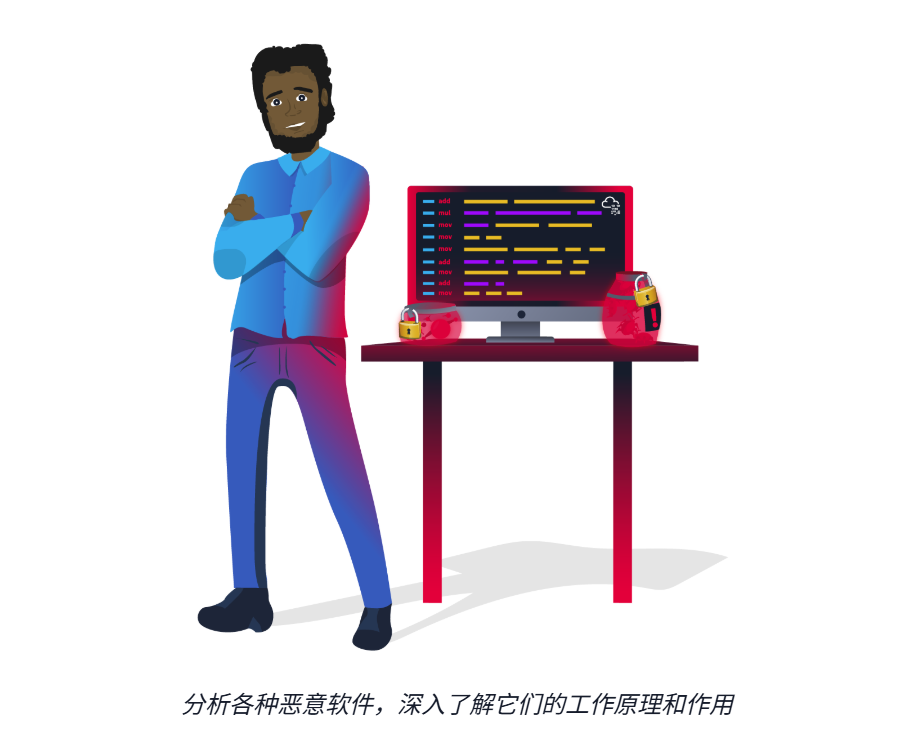
恶意软件分析师的工作包括分析可疑程序，发现它们的功能并撰写报告。恶意软件分析师有时被称为逆向工程者，因为他们的核心任务是将编译程序从机器语言转换为可读代码，通常是低级语言。这项工作要求恶意软件分析师具备扎实的编程背景，尤其是在汇编语言和C语言等低级语言方面。最终目标是了解恶意程序执行的所有活动，找出如何检测并举报。

### 职责

- 对恶意程序进行静态分析，这涉及逆向工程
- 通过在受控环境中观察恶意软件样本的活动，对其进行动态分析
- 记录并报告所有发现

### 渗透测试仪
你可能会看到渗透测试被称为渗透测试和道德黑客。渗透测试员的工作是测试公司内部系统和软件的安全性——这通过系统化黑客手段发现漏洞和漏洞来实现。渗透测试人员利用这些漏洞评估每个实例的风险。公司随后可以利用这些洞见纠正问题，防止现实世界的网络攻击。

### 职责

- 对计算机系统、网络和基于网页的应用程序进行测试
- 进行安全评估、审计和分析政策
- 评估并报告洞见，建议攻击预防的行动

### 学习路径

TryHackMe的学习路径将为您提供基础技术知识和实践经验，这对于成为成功的渗透测试员至关重要。

- [初级穿透测试仪](https://tryhackme.com/path/outline/jrpenetrationtester)
- [进攻性渗透测试](https://tryhackme.com/path/outline/pentesting)

### 相关职业指南

- [成为渗透测试员](https://tryhackme.com/r/careers/penetration-tester)
- [如何成为渗透测试员](https://tryhackme.com/r/resources/blog/how-to-become-a-penetration-tester)
- [准备初级渗透测试员面试](https://tryhackme.com/r/resources/blog/jr-pentester-interview-guide)
- [从IT支持到Pentester：Tom的成功故事](https://tryhackme.com/r/resources/blog/tom-success-story)

### 红队成员
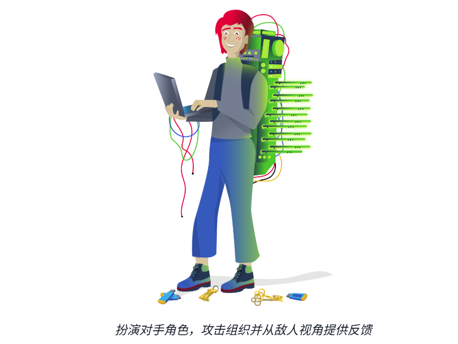
红队成员与渗透测试人员有相似之处，但工作岗位更具针对性。渗透测试人员致力于发现系统中的多个漏洞，以保持网络防御的良好状态，而红队成员则被派遣测试公司的检测和响应能力。该职位要求模仿网络犯罪分子的行为，模拟恶意攻击，保留访问权限，并避免被发现。红队评估通常可持续一个月，通常由公司外部的团队进行。它们通常最适合拥有成熟安全项目的组织。

### 职责

- 模拟威胁行为者的角色，发现可利用的漏洞，保持访问权限并避免被发现
- 评估组织的安全控制、威胁情报和事件响应程序
- 评估并报告洞察，提供可作的数据，帮助公司避免重蹈现实世界的重演

### 学习路径

TryHackMe的学习路径将为你提供基础的技术知识和实践经验，这对成为成功的红队成员至关重要。

- [JR渗透测试仪](https://tryhackme.com/path/outline/jrpenetrationtester)
- [进攻性渗透测试](https://tryhackme.com/path/outline/pentesting)
- [红队成员](https://tryhackme.com/path/outline/redteaming)

### 相关职业指南

- [红队：职位岗位、薪资与机会](https://tryhackme.com/r/resources/blog/red-teaming-jobs-salaries-opportunities)