# 一、什么是人脉网络
网络只是连接在一起的东西。比如你的朋友圈：你们因为兴趣、爱好、技能等相似而相互联系。

网络存在于各行各业：

- 城市公共交通系统
- 基础设施，如国家电力网络
- 与邻居见面并打招呼
- 用于寄送信件和包裹的邮政系统

但更具体地说，在计算机领域，网络也是同样的概念，只是分散到了技术设备上。以你的手机为例;你拥有它的原因是为了访问各种东西。我们将介绍这些设备之间如何通信以及后续规则。

在计算机领域，一个网络可以由2台设备到数十亿台设备不等组成。这些设备包括从笔记本电脑和手机到监控摄像头、交通信号灯，甚至农场设备！

网络已融入我们的日常生活。无论是收集天气数据、为家庭供电，还是确定道路上的优先通行权。由于网络深植于现代社会，网络成为网络安全中必须掌握的重要概念。

以下面的示意图为例，爱丽丝、鲍勃和吉姆已经建立了他们的网络！我们稍后会详细谈到这个。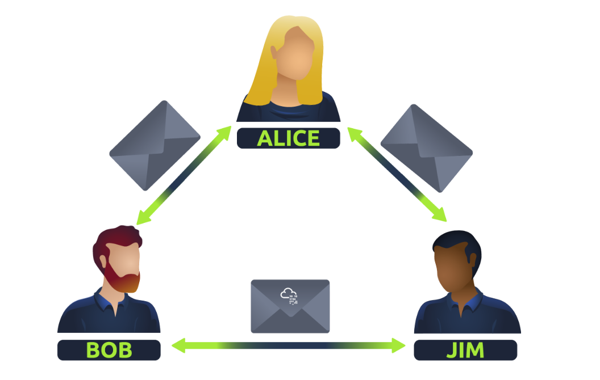
网络有各种各样的形态和大小，这也是我们本模块中会讨论的内容。
**==请回答以下问题==**
连接在一起的设备，关键术语是什么？
	Network

### 什么是互联网
既然我们已经了解了什么是网络以及计算中的定义（即连接的设备），让我们来探讨一下互联网。

互联网是一个庞大的网络，由许多小网络组成。以上一个任务的例子为例，现在假设爱丽丝交了几个新朋友，名叫扎因和托比，她想介绍给鲍勃和吉姆。问题是爱丽丝是唯一一个和扎因、托比说同一种语言的人。所以爱丽丝必须成为传话人！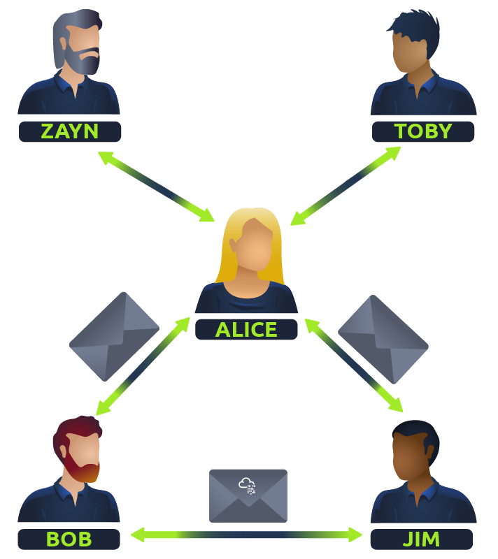
因为爱丽丝会说两种语言，她们可以通过爱丽丝相互交流——形成一个新的网络。

互联网的首次迭代出现在20世纪60年代末的ARPANET项目中。该项目由美国国防部资助，是首个有文献记录的实际网络。然而，直到1989年，我们所知的互联网才由蒂姆·伯纳斯-李通过创造**W**orld **W**ide **W**eb（**WWW**）发明。直到这一时期，互联网才开始被用作存储和共享信息的存储库，就像今天一样。

让我们把爱丽丝的朋友网络与计算机设备联系起来。互联网看起来就像是这种图表的放大版：
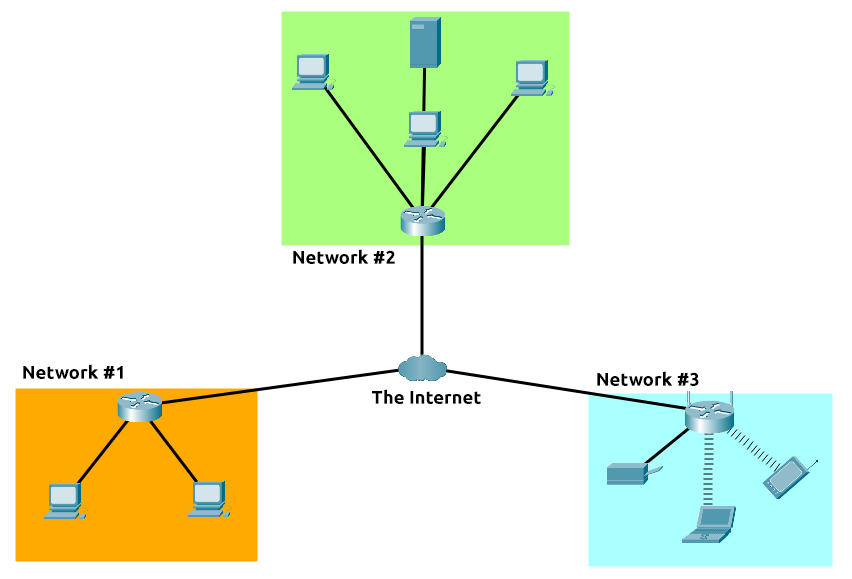如前所述，互联网由许多小型网络组成，全部连接在一起。这些小型网络被称为私有网络，连接这些小型网络的网络称为公共网络——或者说互联网！总结一下，网络可以分为两种类型：  

- 专用网络  
    
- 公共网络

设备将使用一组标签来识别自己在网络上的身份，我们将在下面的任务中详细介绍。
**==请回答以下问题==**
谁发明了万维网？
	Tim Berners-Lee

### 网络上的设备识别
为了通信和维持秩序，设备必须在网络上既具备识别性，也必须易于识别。如果你一天结束时不知道自己在和谁说话，那又有什么用？

网络上的设备与人类非常相似，我们有两种身份识别方式：

- 我们的名字
- 我们的指纹

现在我们可以通过契约改名，但指纹不能更改。每个人都有一套独特的指纹，这意味着即使他们改了名字，背后依然有身份认同。设备也有同样的特点：两种识别方式，其中一种是透气的。这些包括：

- 一个IP地址
- 媒体访问控制（MAC）地址——可以把它看作类似序列号。

### 

### **IP地址**

简而言之，IP地址**（或i**nternet **P**rotocol）地址可以用来在一段时间内识别网络上的主机，然后该IP地址可以与另一台设备关联，而IP地址不会改变。首先，我们先把下面的图中IP地址具体划分一下：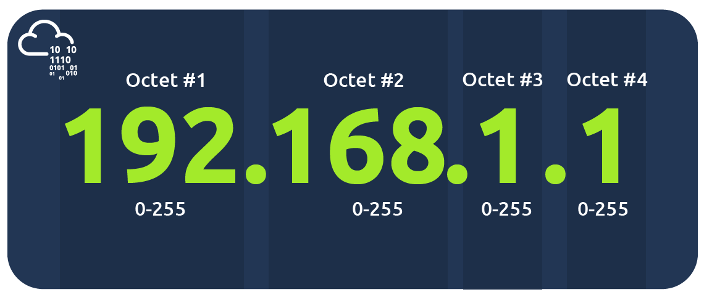
**IP**地址是一组被划分为四个八位元组的数字。每个八位元组的值汇总为该设备在网络上的IP地址。这个数字是通过一种称为IP地址和子网的技术计算的，但那是另一个话题。这里需要理解的是，IP地址可以在不同设备之间切换，但在同一网络内不能同时激活多个。

IP地址遵循一套称为协议的标准。这些协议是网络的骨干，迫使许多设备使用同一种语言交流，这点我们以后会详细讨论。不过，我们应当记住，设备可以同时存在于私有和公共网络上。根据他们所在的位置，将决定他们拥有的IP类型：公网IP还是私有IP。

公共地址用于在互联网上识别设备，而私有地址用于在众多设备中识别设备。以下面的表格和截图为例。这里我们有两个设备在一个私有网络上：

| 设备名称       | IP地址         | IP地址类型 |
| ---------- | ------------ | ------ |
| 桌面KJE57FD  | 192.168.1.77 | 私人     |
| 桌面KJE57FD  | 86.157.52.21 | 公共     |
| CMNatic-PC | 192.168.1.74 | 私人     |
| CMNatic-PC | 86.157.52.21 | 公共     |
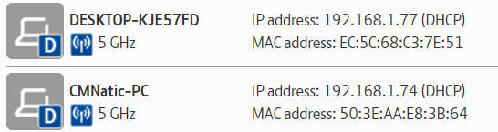
这两台设备将能够使用各自的私有IP地址相互通信。然而，从这两台设备发送到互联网的任何数据都会被识别为相同的公共IP地址。公共IP地址由你的I-nternet **S**ervice **P**rovider（或**ISP**）以月费（你的账单！）提供。
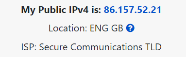
随着越来越多的设备被连接，获取一个尚未被使用的公共地址变得越来越困难。例如，作为网络行业巨头的思科，估计到2021年底，互联网连接的设备将达到约500亿台。[（Cisco.，2021年）。](https://www.cisco.com/c/dam/en_us/about/ac79/docs/innov/IoT_IBSG_0411FINAL.pdf)进入IP地址版本。到目前为止，我们只讨论了被称为IPv4的互联网协议寻址方案的一个版本，它采用了2^32个IP地址（42.9亿）的编号系统——所以你可以理解为什么会有如此严重的IP地址短缺！

IPv6是互联网协议寻址方案的新版本，旨在帮助解决这一问题。虽然看起来更令人生畏，但它有几个好处：

- 支持最多2^128个IP地址（超过340万亿），解决IPv4面临的问题
- 由于采用了新的方法论，效率更高

下面的截图对比了IPv6和IPv4地址。

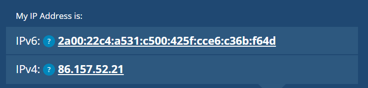

**MAC地址  **
网络中的设备都会有一个物理网络接口，即安装在设备主板上的微芯片板。该网络接口在其制造工厂被分配一个唯一地址，称为**MAC**（**M**edia **A**ccess **C**ontrol）地址。MAC地址是一个十二**字符**的十六进制数字（计算中_用于表示数字的十六进制数字系统_），分为两个，并用冒号分隔。这些结肠被视为分隔物。例如，_a4：c3：f0：85：ac：2d_。前六个字符代表制造网络接口的公司，后六个字符为唯一编号。
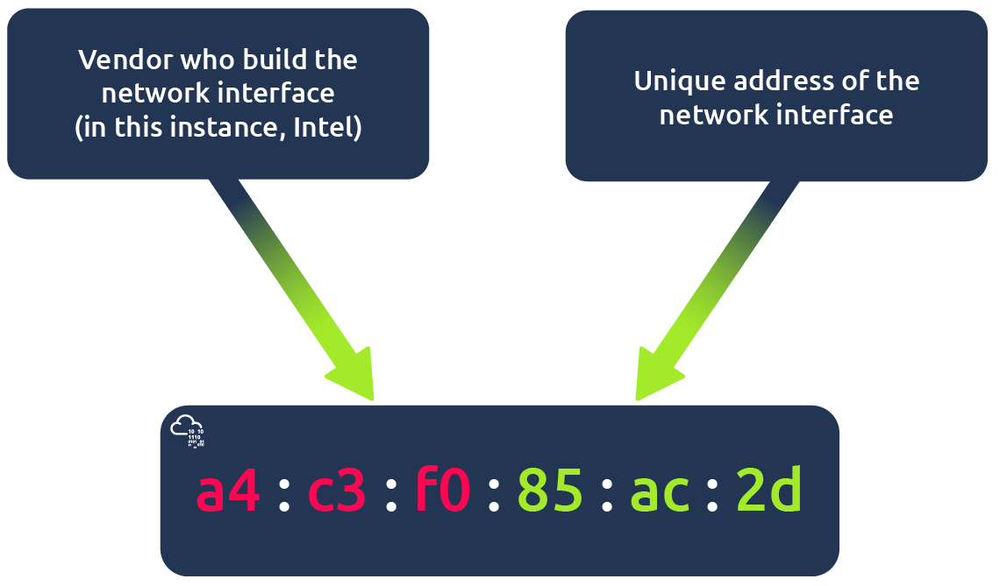

然而，MAC地址的一个有趣之处在于，它们可以通过一种称为伪造的过程被伪造或“伪装”。这种伪装发生在网络设备假装使用其MAC地址的另一个设备时。当这种情况发生时，它往往会破坏实施不当的安全设计，这些设计假设网络上通信的设备是可信的。假设以下场景：防火墙配置允许任何与管理员MAC地址之间的通信。如果设备假装或“伪装”该MAC地址，防火墙就会误以为它正在接收管理员的通信，实际上并非如此。

咖啡馆、咖啡馆和酒店等场所在使用“访客”或“公共”Wi-Fi时，通常会使用MAC地址控制。这种配置可以提供更好的服务，即如果你愿意按设备付费，能以更快速的连接方式付费。**与此任务相关的互动实验室**专门设计了这种场景！

**实用**  

交互式实验室模拟了一个酒店的Wi-Fi网络，需要付费使用。你会注意到路由器不允许Bob的数据包（蓝色）进入TryHackMe网站，而是把它们放进了垃圾桶，但Alice的数据包（绿色）通过得很好，因为她已经付费了Wi-Fi。试着把Bob的MAC地址改成和Alice的一样，看看会发生什么。  

部署互动实验室，继续回答以下问题。

**==请回答以下问题==**
“知识产权”这个词代表什么？
	Internet Protocol
IP地址的每个部分叫什么？
	Octet
IPv4地址有多少个区段（数字单位）？
	4
“MAC”这个词代表什么？
	Media Access Control
使用“查看网站”按钮部署交互实验室，并伪造您的MAC地址访问该网站。这面旗帜是什么？
	THM{YOU_GOT_ON_TRYHACKME}

### Ping(ICMP)
Ping是我们可用的最基础的网络工具之一。Ping 使用 **ICMP**（**I**nternet **C**ontrol **M**essage **P**rotocol）数据包来判断设备间连接的性能，例如连接是否存在或可靠。

ICMP数据包在设备间传输的时间通过ping来衡量，如下图所示。该测量通过ICMP的回声包以及目标设备的ICMP回声响应完成。
  
对网络上的设备（如家庭网络或网站等资源）进行 ping 搜索。该工具易于使用，并安装在Linux和Windows等作系统上。进行简单ping的语法是 。下面截图让我们看看这个过程。
`ping IP address or website URL`
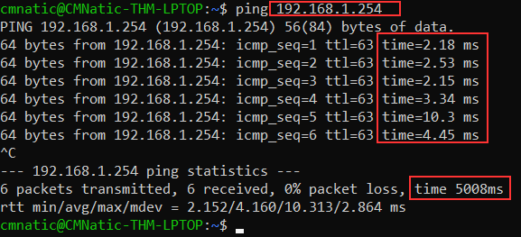

我们正在ping一个拥有_192.168.1.254_私密地址的设备。Ping通知我们已发送六个ICMP包，平均接收时间为4.16毫秒。

现在你在这个任务中，也要用同样的方法ping部署网站上的“**8.8.8.8”**地址。ping正确地址会显示一个旗帜，回答下面的问题。

**==请回答以下问题==**
Ping使用什么协议？
	ICMP
ping 10.10.10.10 的语法是什么？
	ping 10.10.10.10
当你ping 8.8.8.8时，会触发什么标志？
	THM{I_PINGED_THE_SERVER}

# 二、局域网入门
### 局域网拓扑介绍
##### 局域网（LAN）拓扑

多年来，网络设计进行了实验和实施。在 关于网络，当我们提到“拓扑”时，实际上指的是设计或外观 关于当前的网络。下面我们来讨论这些拓扑的优缺点。
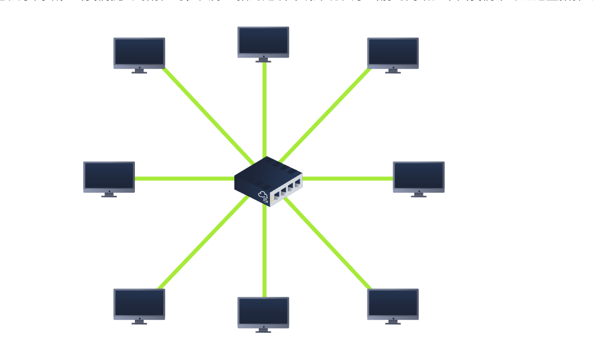
#### 星形拓扑

星型拓扑的主要前提是设备通过中央网络设备单独连接，如 作为交换机或集线器。这种拓扑因其可靠性和可扩展性，成为当今最常见的拓扑—— 尽管代价高昂。

在该拓扑结构中，发送到设备的任何信息都通过其连接的中央设备发送。让我们一起探索 以下为该拓扑的一些优缺点：

由于该拓扑需要更多布线和专用网络设备，因此 比其他任何拓扑都昂贵。然而，尽管成本增加，这确实带来了一些显著的效果 优势。例如，这种拓扑结构本质上更具可扩展性，这意味着添加更多拓扑非常容易 随着网络需求的增加，设备。

不幸的是，网络规模越大，维护维护就越多，以保持网络正常运行。就是这样 对维护的依赖增加也会使故障排查变得更加困难。此外，星形拓扑 仍然容易失效——虽然减少了。例如，如果连接设备的集中硬件故障， 这些设备将无法再发送或接收数据。幸运的是，这些集中式硬件设备是 通常很强壮。

#### 总线拓扑

这种连接依赖于一个称为骨干的单一连接 有线电视。这种类型的拓扑类似于树叶，因为器件（叶子）源自 分支位于这根电缆上的位置。

由于所有发送给每个设备的数据都沿着同一根电缆传输，因此很容易变得缓慢， 如果拓扑内的设备同时请求数据，则会被瓶颈化。这种瓶颈也导致了 排查困难，因为很快就很难确定是哪台设备出现了问题 数据都沿着同一条路线传播。

不过，话虽如此，总线拓扑是较容易且成本效益较高的拓扑之一，因为 它们的费用，比如用于连接这些设备的电缆或专用网络设备。

最后，总线拓扑的另一个缺点是故障时几乎没有冗余。 这一缺点是主干线沿线存在单一故障点。如果这条电缆会 断开后，设备无法再沿总线接收或传输数据。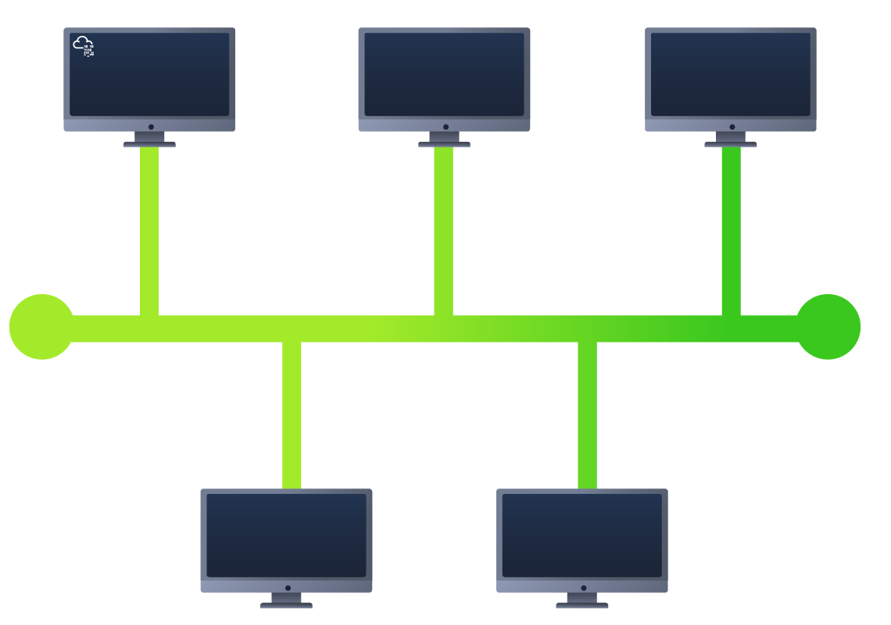
#### 环形拓扑

环形拓扑（也称为标记拓扑）有一些相似之处。计算机等设备是相互连接的 直接连接形成一个环路，意味着所需的布线较少，且对 专用硬件，比如星型拓扑结构中的硬件。

环形拓扑通过通过环路发送数据直到到达指定设备，同时沿途使用其他设备 转发数据的循环。有趣的是，设备只能发送来自另一台设备的接收数据 如果它没有任何可发送的结构，则为拓扑。如果设备有数据要发送，它会发送自己的数据 先数据，再从其他设备发送数据。

由于数据在该拓扑结构中只有一个方向传输，排查任何问题都相当容易 问题随之而来。然而，这也是一把双刃剑，因为它并不是高效的数据传输方式 网络，因为它可能需要先访问多个设备才能到达目标设备。

最后，环形拓扑较不易出现瓶颈，如总线拓扑中，因为大量流量则较少 不会同时穿越网络。然而，这种拓扑设计意味着会出现 因为断线或设备损坏会导致整个网络中断。
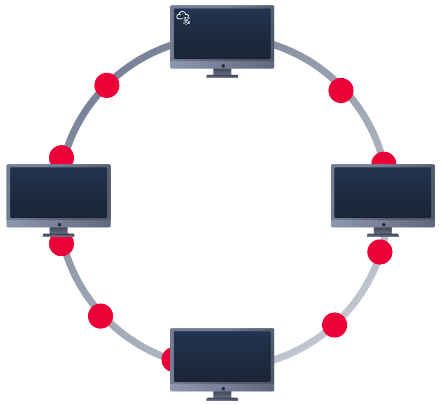
#### 什么是交换机？

交换机是网络中的专用设备，设计用来聚合多个其他设备，例如计算机、打印机或任何使用以太网的具备网络能力的设备。这些不同的设备插入交换机的端换机通常出现在较大的网络中，如企业、学校或类似规模的网络，当有许多设备需要连接到网络时。交换机可以通过4、8、16、24、32 和 64 端口连接大量设备，供设备插入。

交换机比它们的低级对应物（集线器/中继器）效率高得多。开关会记录设备 连接到哪个端口。这样，当他们收到数据包时，就不用把数据包重复到每个端口 就像集线器一样，它只是把数据发送到目标，从而减少网络流量。
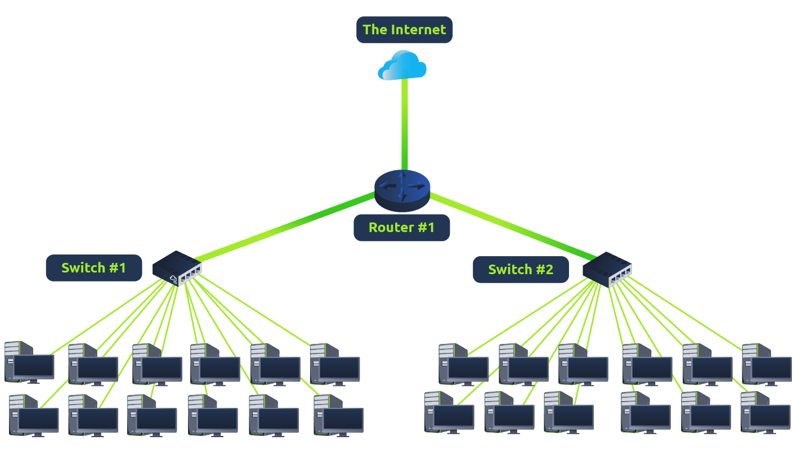
交换机和路由器都可以相互连接。能够做到这一点会增加冗余（ 通过增加多条数据路径来实现网络的可靠性。如果一条路径向下，可以使用另一条路径。 虽然这可能会降低网络整体性能，因为数据包传输时间更长，但确实存在 没有停机时间——考虑到另一种选择，这点代价算不了什么。

#### 什么是路由器？

路由器的工作是连接网络并在它们之间传递数据。它通过使用路由实现这一点（因此得名 路由器！）。

路由是数据在网络中传输过程的标签。 路由涉及在网络之间创建一条路径，使这些数据能够 成功交付。

当设备通过多条路径连接时，路由非常有用，如下图所示。
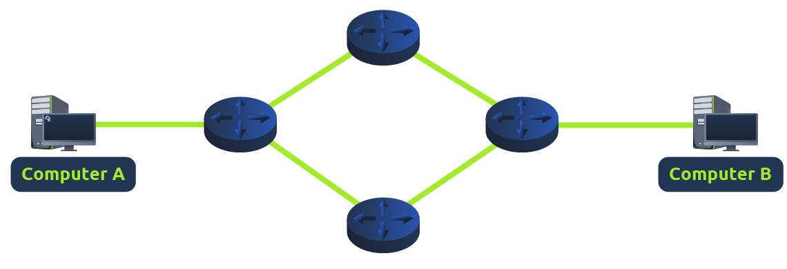

### 子网划分入门
正如我们之前在模块中讨论过的，网络有各种形状和大小——从小到大不等。子网划分是指将网络拆分为自身内部更小、更微型的网络。把它想象成给朋友切蛋糕。蛋糕的数量有限，但每个人都想分一块。子网划分就是你决定谁能分到哪一块，并预留这块比喻蛋糕的那一部分。

以一家企业为例;你会有不同的部门，比如：

- 会计
- 财务
- **人力资源**
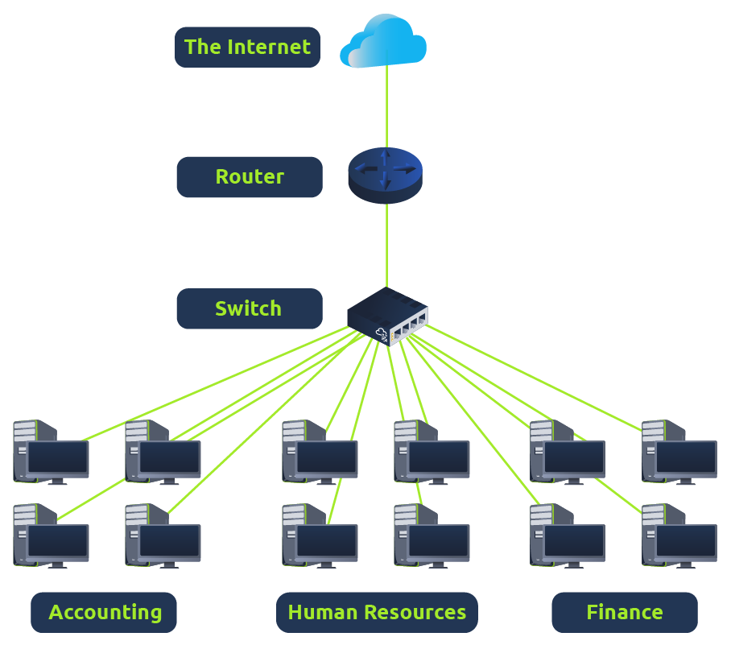
虽然你知道现实中该向正确的部门发送信息，但网络也需要知道。网络管理员利用子网划分来对网络的特定部分进行分类和分配，以反映这一点。

子网划分是通过将可容纳在网络中的主机数量分割实现的，这些主机用一个称为子网掩码的数字表示。让我们回到本模块第一个房间的示意图：
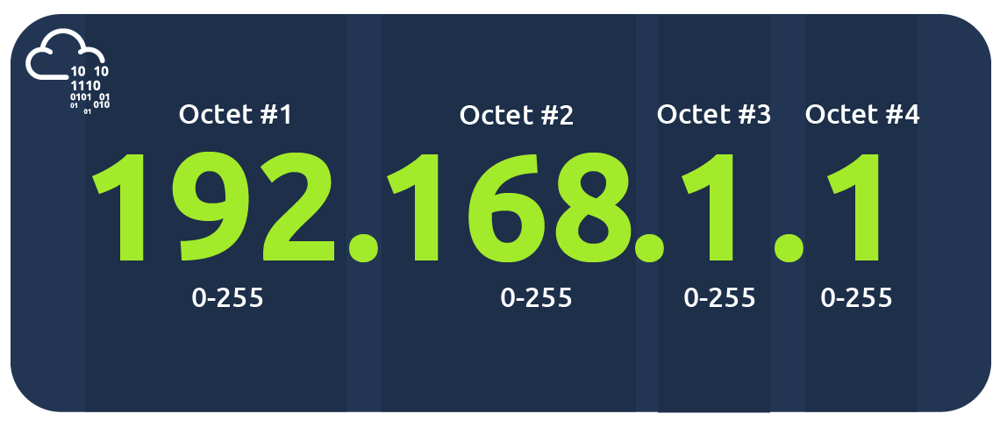
据我们所知，一个IP地址由四个称为八位元组的部分组成。子网掩码同样以四个字节（32位）的数字表示，范围为0到255（0-255）。

子网以三种不同方式使用 IP 地址：

- 识别网络地址
- 识别主机地址
- 识别默认网关

让我们把这三者拆分成下表，以理解它们的用途：

| 类型   | 目的                                     | 解释                                                                                        | 示例            |
| ---- | -------------------------------------- | ----------------------------------------------------------------------------------------- | ------------- |
| 网路地址 | 该地址标识实际网络的起始位置，并用于识别网络的存在。             | 例如，IP地址为192.168.1.100的设备将位于192.168.1.0标识的网络上                                              | 192.168.1.0   |
| 主机地址 | 这里的IP地址用于识别子网上的设备                      | 例如，某设备网络地址为192.168.1.1                                                                    | 192.168.1.100 |
| 默认网关 | 默认网关地址是分配给网络中设备的一个特殊地址，该设备能够向另一个网络发送信息 | 任何需要传输到不在同一网络（即不在192.168.1.0）设备上的数据都会发送到该设备。这些设备可以使用任意主机地址，但通常使用网络中的第一个或最后一个主机地址（.1或.254） | 192.168.1.254 |
而在家庭等小型网络中，你会在一个子网上，因为你几乎不可能同时连接超过254台设备。

然而，在企业和办公室等场所，这些设备（PC、打印机、相机和传感器）会更多，因此子网会进行。

子网划分带来了多种好处，包括：

- 效率
- 安全性
- 完全控制

我们稍后会详细探讨子网如何提供这些好处;不过，目前我们只需要了解其中的安全因素。我们来看看街上的典型咖啡馆。这家咖啡馆将有两个网络：

1. 一个是员工用的，一个是收银机，还有设施里的其他设备
2. 一个供公众使用的热点

子网化允许你将这两种用例分开，同时又能连接到更大的网络，比如互联网。

### 防空警报---不知道为什么翻译成了这个...🤣

回顾我们之前的任务，设备可以有两个标识符：MAC地址和IP地址，**A-ddress** **R**esolution **P**rotocol，简称**ARP**，是允许设备在网络上识别自身的技术。

简单来说，ARP允许设备将其MAC地址与网络中的IP地址关联。网络上的每个设备都会保存与其他设备关联的MAC地址日志。

当设备希望与其他设备通信时，会向整个网络发送广播，搜索该特定设备。设备可以使用ARP查找设备的MAC地址（因此物理标识符）进行通信。

ARP是如何运作的？

网络中的每个设备都有一个用于存储信息的账本，称为缓存。在ARP的语境中，该缓存存储网络中其他设备的标识符。

为了将这两个标识符（IP地址和MAC地址）映射在一起，ARP发送两种类型的消息：

1. **空袭警报请求**
2. **ARP回复**

当发送**ARP请求**时，网络上会向其他设备广播一条消息，问道：“拥有该IP地址的MAC地址是什么？”当其他设备收到该消息时，只有在拥有该IP地址时才会响应，并发送带有MAC地址的**ARP回复**。请求设备现在可以记住该映射，并将其存储在**ARP缓存**中以备将来使用。  

该过程如下图所示：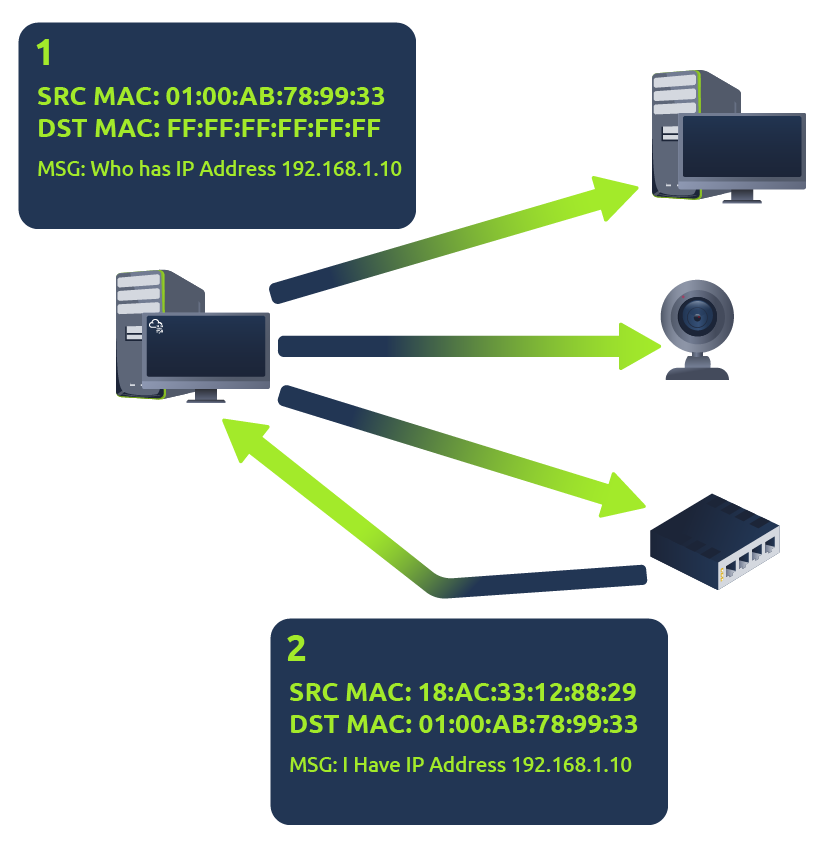
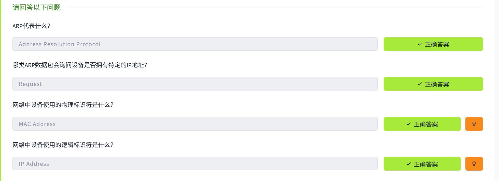

### DHCP
IP 地址可以手动分配，或通过物理输入设备，或者自动分配，最常见的方式是通过 **DHCP**（**D**ynamic **H**ost **C**onfiguration **P**rotocol）服务器。当设备连接到网络时，如果还没有手动分配IP地址，它会发送请求（DHCP Discover）以查看网络中是否有DHCP服务器。DHCP服务器随后回复设备可以使用的IP地址（DHCP提供）。设备随后发送回复确认需要提供的IP地址（DHCP 请求），最后DHCP服务器回复确认已完成，设备即可开始使用该IP地址（DHCP ACK）。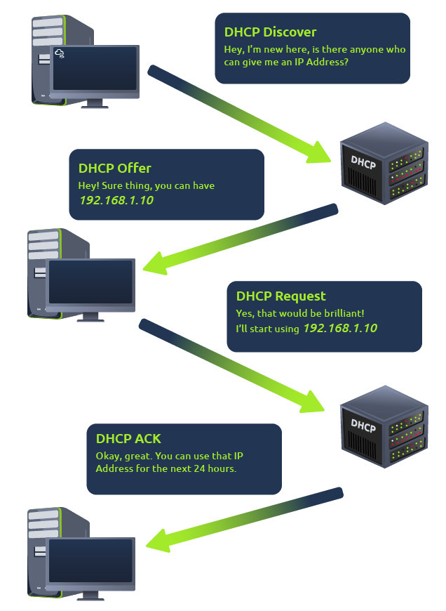

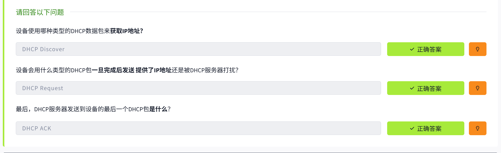

# 三、OSI模型
### 什么是OSI模型
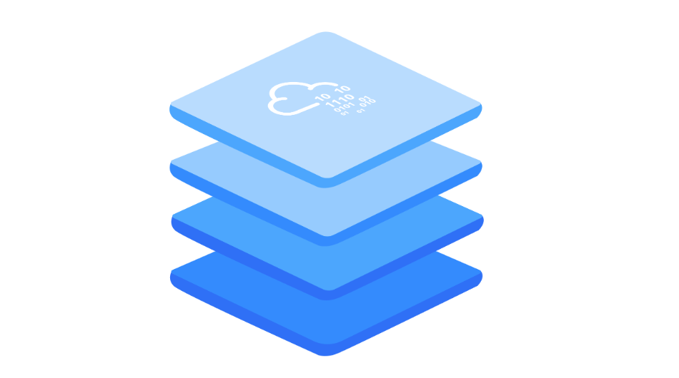
**OSI**模型（或称**O**pen **S**ystems **I**nterconnection模型）是网络中常用的一个重要模型。这一关键模型提供了一个框架，规定所有联网设备如何发送、接收和解释数据。

OSI模型的主要优势之一是设备在网络上可以拥有不同的功能和设计，同时与其他设备通信。通过遵循OSI模型统一性传输的数据可以被其他设备理解。

OSI模型由七个层组成，如下图所示。每个层级都有不同的职责，从第7层到第1层排列。

在数据经过的每一层，都会进行特定的流程，并将信息片段添加到这些数据中，这也是我们将在本房间接下来的任务中讨论的内容。不过，目前我们只需理解这个过程被称为封装，以及下图中OSI模型的样貌：
这个很重要！！！
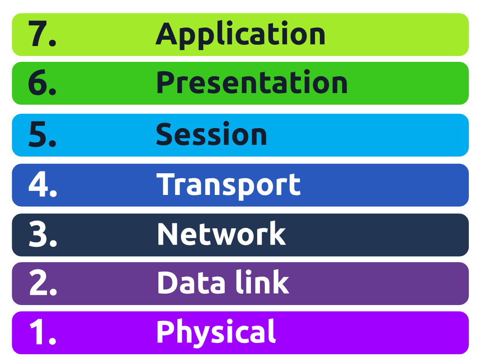
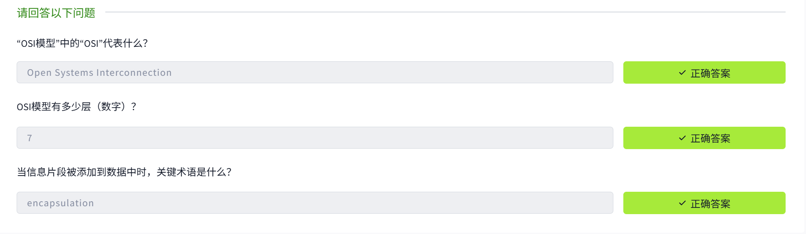

### 第一层：物理

这一层是最容易理解的层面之一。简单来说，这一层指的是网络中使用硬件的物理组件，是你能找到的最低层。设备通过电信号在二进制编码系统（1和0）中相互传输数据。

例如，连接设备的以太网线，如下图所示：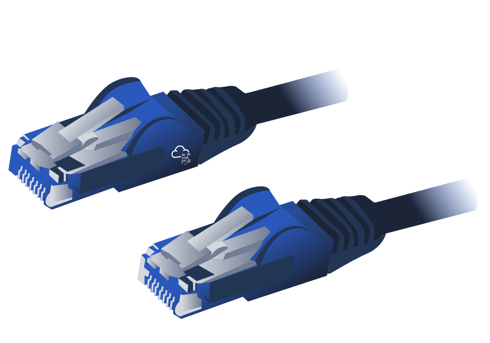

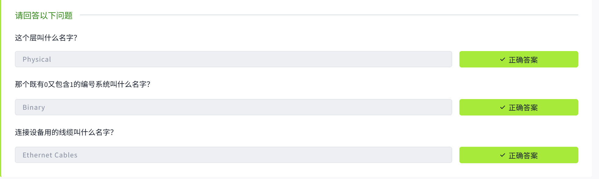

### 第二层：数据链路

数据链路层专注于传输的物理寻址。它从网络层接收一个数据包（包括远程计算机的IP地址），并添加接收端的物理**MAC**（媒体访问控制）地址。每台网络连接的计算机内部都配有一张**N张网**卡（**NIC**），带有唯一的MAC地址用于识别。

MAC地址由制造商设置，直接刻录在卡片上;它们无法更改——虽然可以被伪造。当信息通过网络传输时，实际上是用物理地址来确定信息的具体发送地点。

此外，数据链路层还负责以适合传输的格式呈现数据。
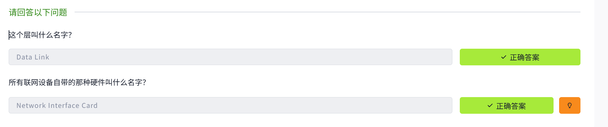

### 第三层：网络

OSI模型的第三层（网络层）是数据路由和重新组装的魔法所在（从这些小块到大块）。首先，路由仅仅决定了这些数据块应发送的最优路径。

虽然该层的一些协议会确定数据到达设备的“最佳”路径，但我们只应该知道它们的存在，而在网络模块的这个阶段。简而言之，这些方案包括**OSPF**（**O**pen **S**hortest **P**ath **F**irst）和**RIP**（**R**outing **I**nformation **P**rotocol）。决定选择哪条路线的因素由以下几项决定：

- 哪条路最短？也就是说，数据包需要通过的设备数量最少。
- 哪条路径最可靠？也就是说，之前有没有丢过数据包？
- 哪条路径的物理连接更快？也就是说，一条路径是用铜线连接（慢）还是光纤（快很多）？

在这一层，所有处理都通过IP地址处理，比如192.168.1.100。能够通过IP地址传输数据包的路由器等设备被称为第三层设备——因为它们能够在OSI模型的第三层工作。
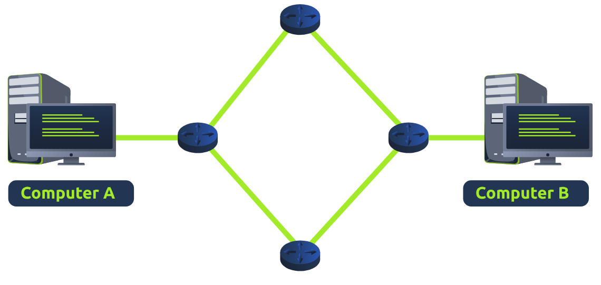
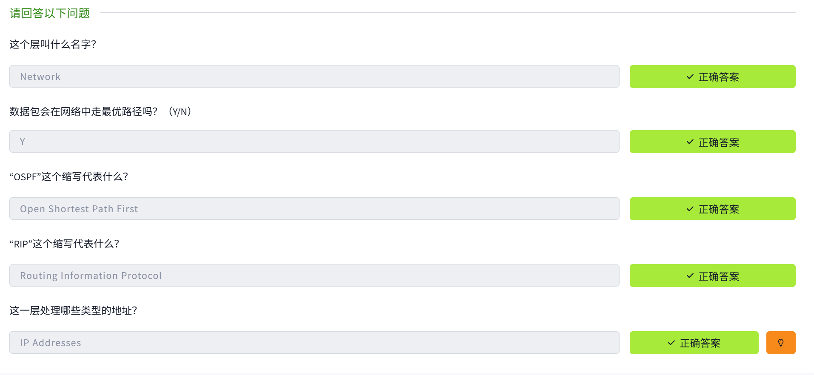

### 第四层：传输

OSI模型的第4层在跨网络传输数据中起着至关重要的作用，但有时较难理解。当设备间传输数据时，遵循两种不同的协议之一，这些协议根据多个因素决定：

- TCP
- UDP

我们先从TCP说起。**Transmission** **C**是**P的**rotocol（**TCP）。**这个协议可能从名字中暗示，其设计注重可靠性和保证。该协议在数据发送和接收所需的时间内，保留两个设备之间的恒定连接。

不仅如此，TCP还将错误检查融入设计中。错误检查是TCP能够确保从会话层（第5层）小块发送的数据能够按相同顺序接收和重新组装的方式。

让我们在下表中总结TCP的优缺点：

| TCP的优势              | TCP的缺点                                 |
| ------------------- | -------------------------------------- |
| 保证数据的准确性。           | 需要两台设备之间可靠的连接。如果没有接收到一小块数据，则整个数据块无法使用。 |
| 能够同步两台设备，防止彼此被数据淹没。 | 连接速度慢可能会给另一台设备造成瓶颈，因为连接会一直保留在接收端的电脑上。  |
| 执行更多工艺以提高可靠性。       | TCP比UDP慢得多，因为使用该协议的设备需要完成更多工作。         |
TCP用于文件共享、上网浏览或发送电子邮件等场景。这种使用是因为这些服务要求数据准确且完整（半个文件没用！）。

在下面的图中，我们可以看到一张猫的照片如何从“网络服务器”中拆分成小数据块（称为数据包），“计算机”会将猫的照片按正确顺序重建。
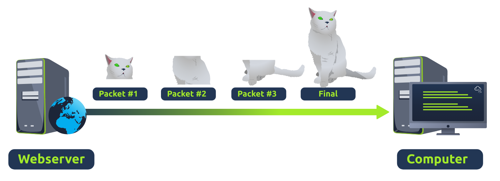
现在让我们来看看**U**ser **D**atagram **P**rotocol（简称**U****D****P**）。这个协议远不如它的兄弟TCP协议先进。它没有TCP提供的诸多功能，比如错误检查和可靠性。事实上，任何通过UDP发送的数据都会被发送到计算机，无论它是否到达。两个设备之间没有同步或保证;只能抱有希望，祈祷一切顺利。

虽然这听起来不利，但它确实有其优点，我们将在下表中进行阐：

| UDP的优势                            | UDP的缺点                 |
| --------------------------------- | ---------------------- |
| UDP比TCP快得多。                       | UDP不在乎数据是否被接收。         |
| UDP则由应用层（用户软件）自行决定是否可以控制数据包发送的速度。 | 在这方面，它对软件开发者来说相当灵活。    |
| UDP不像TCP那样在设备上保留连续连接。             | 这意味着不稳定的连接会给用户带来糟糕的体验。 |

使用之前的相同例子，我们现在可以看到“计算机”只接收到包 #1 和 #3，这意味着图像缺失了一半。
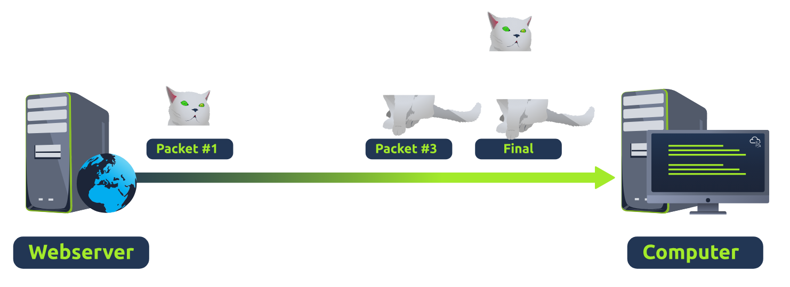
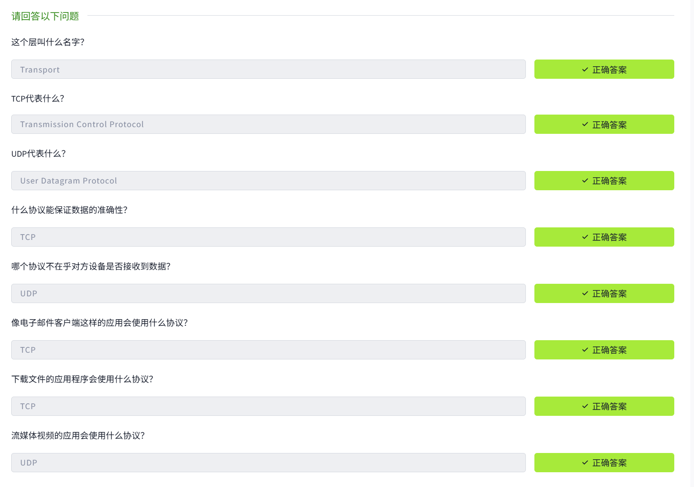
### 第五层：会话

一旦数据从呈现层（第6层）正确翻译或格式化，会话层（第5层）将开始创建并维护与数据目的地的其他计算机的连接。连接建立后，会话被创建。只要这个连接是活跃的，会话也会保持活跃。

会话层还负责关闭连接，如果连接长时间未使用或丢失。此外，会话_还可以_包含“检查点”，如果数据丢失，只需发送最新的数据片段，从而节省带宽。

值得注意的是，会话是唯一的——意味着数据不能跨越不同会话，实际上只能跨越每个会话。
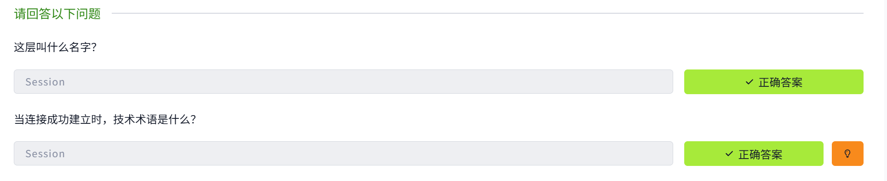

### 第六层：表示

OSI模型的第6层是标准化开始的层级。由于软件开发者可以以不同方式开发任何软件，比如电子邮件客户端，数据处理方式都必须相同——无论软件如何工作。

该层作为数据与应用层（第7层）之间的数据翻译器。接收计算机还能理解以一种格式发送到计算机、将发送到另一种格式的数据。例如，当你发送邮件时，另一用户可能有另一个邮件客户端，但邮件内容仍需显示相同内容。

安全功能如数据加密（如访问安全站点时的HTTPS）出现在这一层。
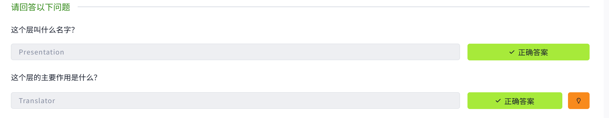

### 第七层：应用

OSI模型的应用层是你最熟悉的层。这种熟悉感源于应用层是协议和规则的层，用于决定用户应如何与发送或接收的数据交互。

日常应用如电子邮件客户端、浏览器或文件服务器浏览软件如FileZilla，为用户提供了一个**友好的图形**界面（**GUI），**方便用户与发送或接收的数据进行交互。其他协议包括**DNS**（**D**omain **N**ame **S**ystem），即网站地址转换为IP地址的方式。
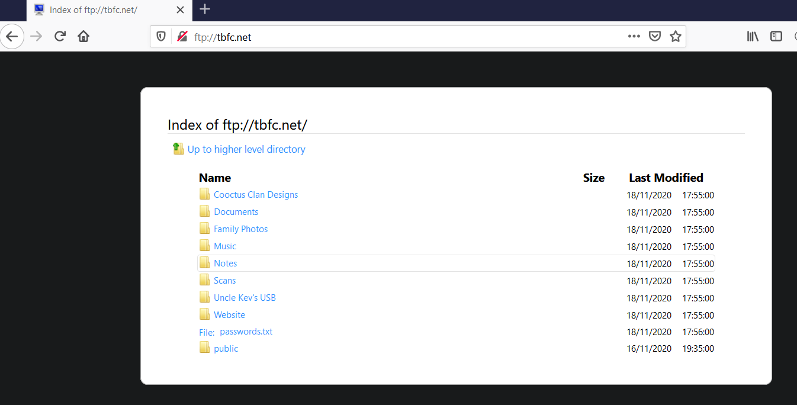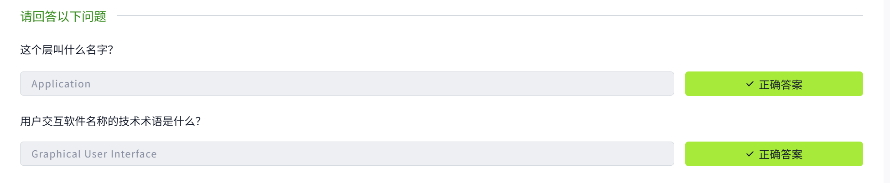

# 四、数据包与帧
### 什么是数据包与帧
数据包和帧是小块数据，当它们组合在一起时，构成了更大的信息或消息。然而，在OSI模型中，这两者是两回事。

**数据包**是OSI模型第3层（网络层）的数据，包含IP头和有效载荷等信息。然而，OSI模型的第2层（数据链路）使用了一个**帧**，封装数据包并添加如MAC地址等额外信息。

你可以把这个过程想象成通过邮寄信件。信封是一个框架，用于将信封内容（在此类比中为数据包）移动到另一个地方。一旦收件人打开信封（框架），他们就会知道如何转发信件（包）。

这个过程称为封装，我们在[第三室讨论过：OSI模型](https://tryhackme.com/room/osimodelzi)。在这个阶段，可以合理地假设，当我们谈论任何IP地址时，我们指的是数据包。当封装信息被剥离时，我们谈论的是框架本身。

数据包是一种在网络设备间高效通信数据的方式，如任务1中所述。由于这些数据是以小块交换的，因此在网络中出现瓶颈的可能性比一次性发送大消息要小。

例如，从网站加载图片时，这张图片不会整体发送到你的电脑，而是分成小块，在电脑上重建。请用下面的图片作为这一过程的说明。猫的图片被分成三个包，进入计算机时会重建成最终图像。

数据包的结构不同，这些结构取决于发送的数据包类型。正如我们接下来要讨论的，网络充满了标准和协议，这些规则作为一套规则来规范设备中数据包的处理方式。数十亿设备连接互联网，如果没有标准化，情况很容易崩溃。

让我们继续以互联网协议为例。使用该协议的数据包会有一组头部，这些头部包含与网络传输数据相关的额外信息。

一些著名的头部包括：

| 头部    | 描述                                             |
| ----- | ---------------------------------------------- |
| 活着的时刻 | 这个字段设置了一个截止时间，确保数据包如果无法到达主机或逃逸，网络不会堵塞！         |
| 校验和   | 该字段为TCP/IP等协议提供完整性检查。如果数据发生更改，这个值将与预期不同，因此会损坏。 |
| 来源地址  | 数据包发送**的**设备的IP地址，以便数据**知道返回的**方向。             |
| 目的地地址 | 数据包发送到设备的IP地址，以便数据知道下一步该去哪里。                   |
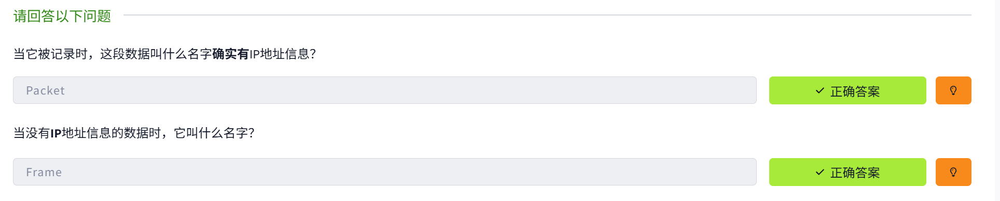

### TCP/IP（三次握手）
**TCP**（简称**T**ransmission **C**ontrol **P**rotocol）是网络中使用的另一种规则。

  

该协议与我们之前在本模块第三室讨论过的OSI模型非常相似。TCP/IP 协议由四层组成，可以说只是 OSI 模型的简化版本。这些层次包括：

- 应用
- 交通
- 互联网
- 网络接口

与OSI模型的工作原理非常相似，TCP模型的每一层都会随着数据（或数据包）的穿越而逐步添加信息。你可能还记得，这个过程被称为封装——反过来就是解封。

TCP的一个显著特点是基于**连接**，这意味着TCP必须在客户端和作为服务器的设备之间建立连接**，数据才**会发送。

因此，TCP保证任何发送的数据都会在对方接收。这个过程被称为“三方握手”，我们稍后会详细介绍。下面有一张比较TCP优缺点的表格：

| TCP的优势                   | TCP的缺点                                        |
| ------------------------ | --------------------------------------------- |
| 保证数据的完整性。                | 需要两个设备之间可靠的连接。如果没有接收到一小块数据，则整个数据块无法使用，必须重新发送。 |
| 能够同步两个设备，防止彼此以错误顺序被数据淹没。 | 连接速度慢可能会给另一台设备造成瓶颈，因为连接会一直保留在另一台设备上。          |
| 执行更多工艺以提高可靠性             | TCP比UDP慢得多，因为使用该协议的设备需要完成更多的计算工作。             |
TCP数据包包含多个称为头部的信息部分，这些信息通过封装添加而成。让我们来解释下表中的一些关键标题：

| 头部    | 描述                                                                   |
| ----- | -------------------------------------------------------------------- |
| 源端口   | 该值是发送方用来发送TCP数据包的端口。这个值是随机选择的（从0到65535之间的端口中，这些端口当时还未被使用）。           |
| 目的地港口 | 该值是应用程序或服务在远端主机（接收数据的主机）上运行的端口号;例如，运行在80端口上的网页服务器。与源端口不同，这个值不是随机选择的。 |
| 源IP   | 这是发送数据包的设备的IP地址。                                                     |
| 目的IP  | 这是数据包目的地设备的IP地址。                                                     |
| 序列号   | 当连接发生时，传输的第一条数据会被赋予一个随机数。我们会在后面更深入地解释这一点。                            |
| 致谢编号  | 在一段数据被赋予序列号后，下一段数据的序列号将为 + 1。我们也会在后面更深入地解释这一点。                       |
| 校验和   | 这个值赋予了TCP完整性。通过数学计算来记住输出。当接收设备进行数学计算时，如果输出与发送内容不同，数据必然损坏。            |
| 数据    | 该头部存储数据，即正在传输文件的字节。                                                  |
| 旗帜    | 该头决定了在握手过程中任一设备应如何处理数据包。具体的标志会决定具体的行为，这正是我们接下来要解释的内容。                |
接下来，我们将讨论_三方握手——_这是建立两台设备连接的过程。 三方握手通过几条特殊信息进行沟通——下表突出展示了主要信息：

| 步   | 信息    | 描述                                                              |
| --- | ----- | --------------------------------------------------------------- |
| 1   | SYN   | SYN消息是客户端在握手过程中发送的初始数据包。该数据包用于发起连接并同步两个设备（稍后我们会详细说明）。           |
| 2   | 同步/自动 | 该数据包由接收设备（服务器）发送，以确认客户端的同步尝试。                                   |
| 3   | AKK   | 客户端或服务器都可以使用确认包来确认一系列消息/数据包已成功接收。                               |
| 4   | 数据    | 一旦建立连接，数据（如文件的字节）通过“DATA”消息发送。                                  |
| 5   | 芬兰    | 该数据包用于在连接完成后_干净（正确地）_关闭连接。                                      |
| #   | RST   | 这个数据包会突然中断所有通信。这是最后的手段，说明过程中存在问题。例如，如果服务或应用工作不正常，或者系统存在资源不足等故障。 |
下图展示了爱丽丝和鲍勃之间正常的三方握手过程。现实中，这会在两个设备之间进行。
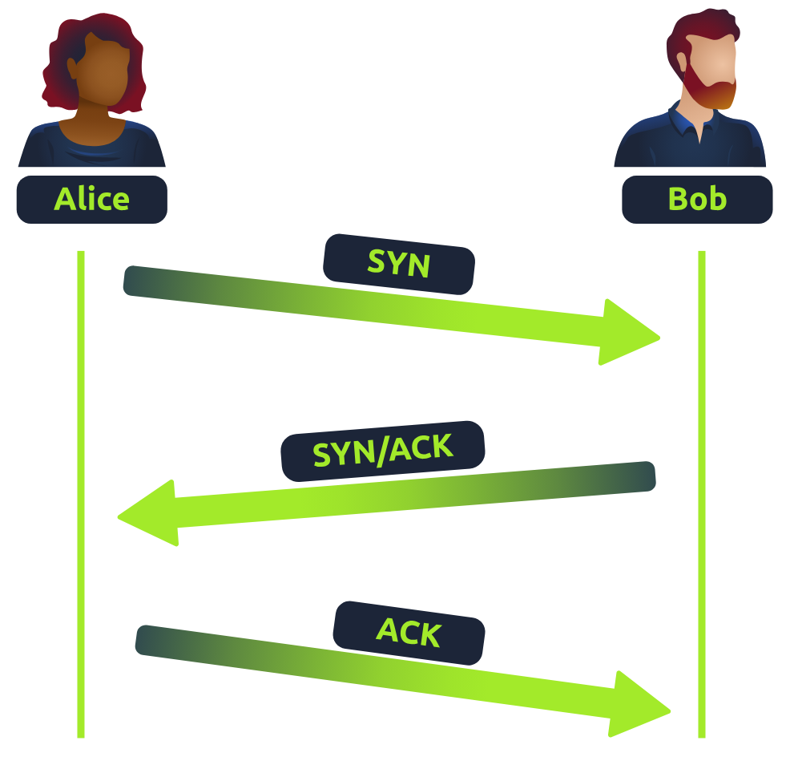
任何发送的数据都会被赋予一个随机数序列，并用该数字序列重建，并以1递增。两台计算机必须同意相同的数字序列，数据才能按正确顺序发送。该顺序通过三个步骤达成：

1. SYN - 客户端：这是我用于同步的初始序列号（ISN），与（0）同步
2. SYN/ACK - 服务器：这是我的初始序列号（ISN），用来与（5,000）进行SYN同步，我现在确认你的初始编号序列（0）
3. ACK - 客户：我现在确认你的初始序列号（ISN）为（5,000），这里有一些我的ISN+1（0+1）数据。

| 装置       | 初始数列（ISN） | 最终数字序列    |
| -------- | --------- | --------- |
| 客户端（发送方） | 0         | 0 + 1 = 1 |
| 客户端（发送方） | 1         | 1 + 1 = 2 |
| 客户端（发送方） | 2         | 2 + 1 = 3 |
**TCP关闭连接：**

让我们快速解释一下TCP关闭连接背后的过程。首先，一旦设备确定另一台设备已成功接收所有数据，TCP会关闭连接。

由于TCP在设备上保留系统资源，最佳实践是尽快关闭TCP连接。

为了启动TCP连接的关闭，设备会向另一台设备发送一个“FIN”数据包。当然，使用TCP时，另一台设备也必须确认该数据包。

让我们用爱丽丝和鲍勃展示这个过程，就像之前一样。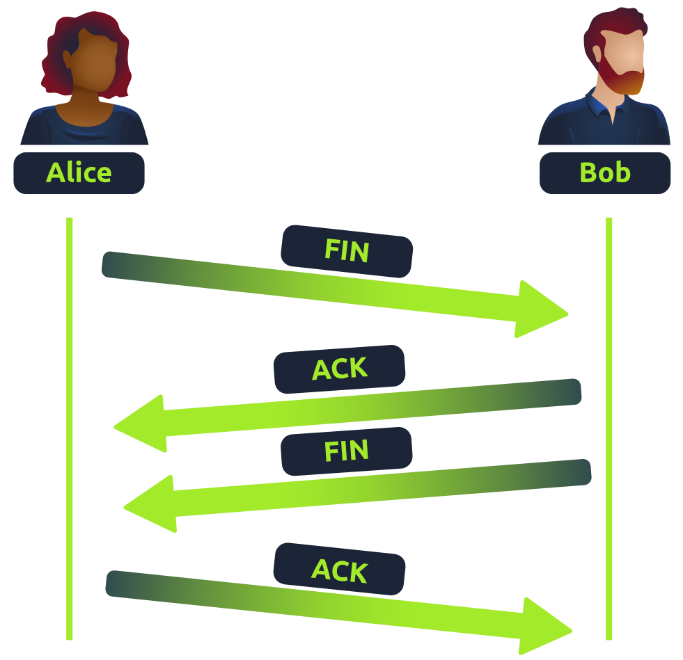在图中，我们可以看到爱丽丝给鲍勃发送了一个“**FIN**”包。因为鲍勃收到了这个包，他会告诉爱丽丝他已经收到了，并且他也想关闭连接（使用FIN代码）。爱丽丝清楚地听到了鲍勃的声音，并会让鲍勃知道她已经确认了这一点。
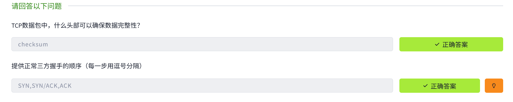

### 实用——握手
帮助Alice和Bob通过在附加的静态实验室中按正确顺序重新组装TCP握手来沟通！

请在下面的问题中输入对话结束时给出的旗帜价值。

### UDP/IP
**U**ser **D**atagram **P**rotocol（**UDP**）是另一种用于设备间数据通信的协议。

与其兄弟TCP不同，UDP是一种**无状态**协议，不需要两设备之间持续连接即可发送数据。例如，三方握手不会发生，两设备之间也没有同步。

回想一下在第3号房间“OSI模型”中对这两种协议所做的一些比较。具体来说，UDP用于应用能够容忍数据丢失的情况（如视频流或语音聊天），或连接不稳定并非最终原因的场景。下面有一张比较UDP优缺点的表格：

| UDP的优势                            | UDP的缺点                |
| --------------------------------- | --------------------- |
| UDP比TCP快得多。                       | UDP并不在意数据是否被接收。       |
| UDP则由应用程序（用户软件）自行决定是否能控制数据包发送的速度。 | 在这方面，它对软件开发者来说相当灵活。   |
| UDP不像TCP那样在设备上保留连续连接。             | UDP不像TCP那样在设备上保留连续连接。 |
如前所述，两个设备之间建立连接时没有任何过程。这意味着不考虑是否接收到数据，也没有像TCP那样提供的数据完整性等保障措施。

UDP数据包比TCP数据包简单得多，且头部更少。然而，两个协议共享一些标准头部，这些头部在下表中有注释：

| 头部         | 描述                                                                   |
| ---------- | -------------------------------------------------------------------- |
| 活着的时间（TTL) | 这个字段会为数据包设置一个过期计时器，这样如果数据包无法到达主机或逃逸，就不会让你的网络堵塞！                      |
| 来源地址       | 数据包发送的设备的IP地址，以便数据知道返回的地址。                                           |
| 目的地地址      | 数据包发送到设备的IP地址，以便数据知道下一步该去哪里。                                         |
| 源端口        | 该值是发送方打开的端口，用于发送UDP数据包。这个值是随机选择的（从0到65535之间的端口中，这些端口当时还没被使用）。        |
| 目的地港口      | 该值是应用程序或服务在远程主机（接收数据的主机）上运行的端口号;例如，运行在80端口上的网页服务器。与源端口不同，这个值不是随机选择的。 |
| 数据         | 该头部存储数据，即正在传输文件的字节。                                                  |
接下来，我们将讨论通过UDP连接的过程与TCP连接的区别。我们应当记住，UDP是**无国籍**的。连接过程中不会发送任何确认。

下图显示了Alice和Bob之间的正常UDP连接。现实中，这会在两个设备之间进行。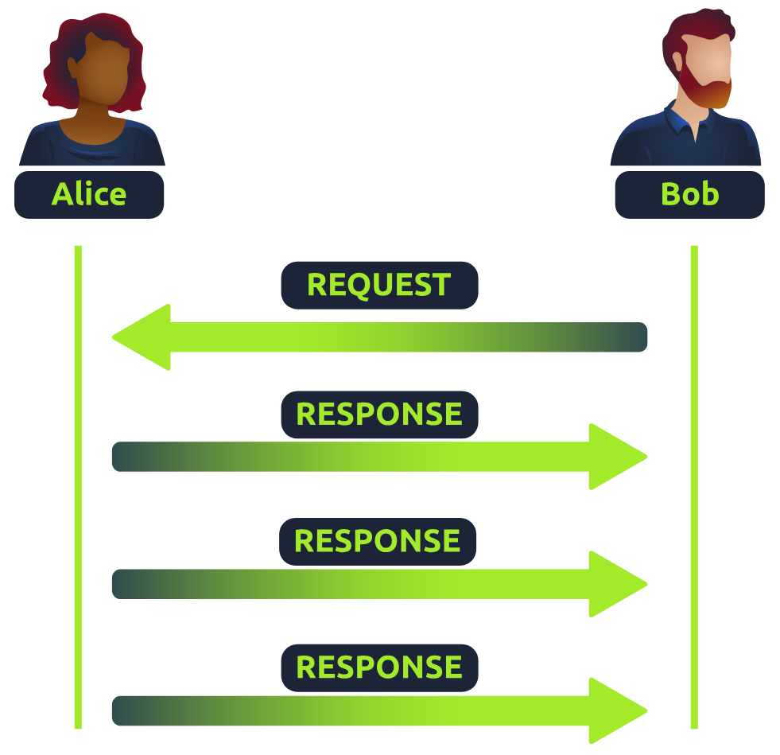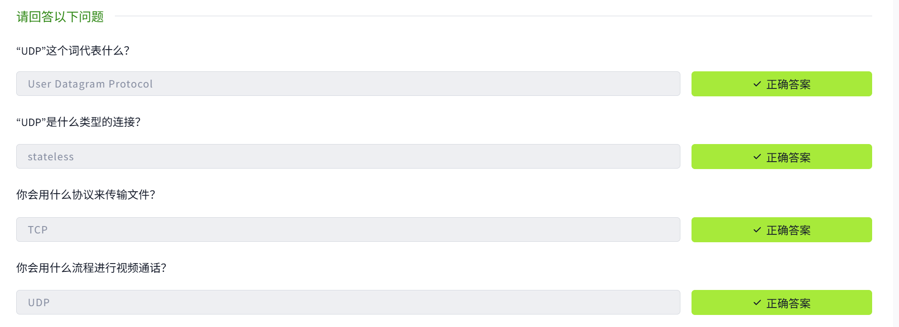

### 端口101（实用）
端口的名字或许恰如其分，是数据交换的重要节点。想象一下港口和港口。希望停靠港口的船只必须前往与船上尺寸和设施相匹配的港口。当船只对齐时，会连接到 港口。举个例子，邮轮不能停靠为渔船建造的港口，反之亦然。

这些港口严格规定哪些车辆可以停放、停在哪里——如果不兼容，就不能停在这里。网络设备在相互通信时也使用端口来执行严格的规则。当连接建立（从OSI模型的房间调用）时，设备发送或接收的任何数据都会通过这些端口传输。在计算机领域，端口是0 到**65535**（65,535）之间的数值。

由于端口范围可能从0到65535不等，很容易丢失哪个应用程序使用哪个端口。繁忙的港口就是一片混乱！幸运的是，我们把应用、软件和行为与一套标准规则联系起来。例如，通过强制任何网页浏览器数据通过80端口传输，软件开发者可以设计出像Google Chrome或Firefox这样的浏览器，使数据相互解释相同。

这意味着所有网页浏览器现在都有一个共同规则：数据通过80端口传输。浏览器的外观、使用感和易用性由设计师或用户决定。

虽然网页数据的标准规则是_端口80_，但其他一些协议也被分配了标准规则。任何位于**0**到**1024**（1,024）之间的端口都称为公共端口。下面让我们来探讨一些其他协议：

| 协议                                                                 | 端口编号 | 描述                                          |
| ------------------------------------------------------------------ | ---- | ------------------------------------------- |
| **F**ile **T**ransfer **P**rotocol （**FTP**)                       | 21   | 该协议被基于客户端-服务器模型的文件共享应用使用，这意味着你可以从中央位置下载文件。  |
| **S**ecure **Sh**ell （**SSH**)                                     | 22   | 该协议通过基于文本的界面安全登录系统进行管理。                     |
| **H**yper**T**ext 传输协议（**HTTP**)                                   | 80   | 该协议为万维网（WWW）提供动力！你的浏览器会用它来下载网页的文本、图片和视频。    |
| **H**yper**T**ext **T**ransfer **P**rotocol **S**ecure （**HTTPS**) | 443  | 该协议的工作原理与上述完全相同;但要通过加密技术安全。                 |
| **S**erver **M**essage **B**锁（**SMB**)                             | 445  | 该协议类似于文件传输协议（FTP）;不过，除了文件，SMB还允许你共享打印机等设备。  |
| **R**emote **D**esktop **P**rotocol （**RDP**)                      | 3389 | 该协议是一种通过可视化桌面界面安全登录系统的方式（区别于SSH协议的基于文本的限制）。 |
我们仅简要介绍了网络安全中更常见的协议。您可以查阅[服务名称与传输协议端口号注册表](https://www.iana.org/assignments/service-names-port-numbers/service-names-port-numbers.xhtml)以获取更多信息。

值得注意的是，这些协议只遵循标准。也就是说，你可以在非标准端口上管理与这些协议交互的应用程序（比如在8080端口上运行网页服务器，而不是80标准端口）。但请注意，申请会默认遵循标准，因此你需要提供**冒号（:)**和端口号。

**实际挑战：**

打开与此任务相关的网站，连接到端口“**1234**”上的IP地址“**8.8.8.8**”，你会收到一个标志。

# 五、人脉网络
### 端口转发导论
端口转发是连接应用程序和服务到互联网的关键组成部分。没有端口转发，应用程序和服务（如网络服务器）只能对同一直接网络内的设备开放。

以下面的网络为例。在这个网络中，IP地址为“192.168.1.10”的服务器运行着一个位于80端口的网页服务器。只有该网络上的另外两台计算机能够访问该网络（这被称为内联网）。

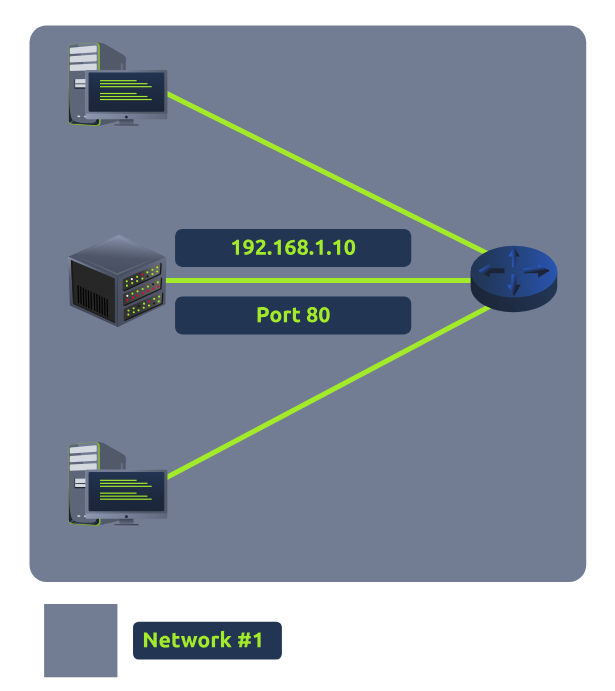
如果管理员希望网站通过互联网向公众开放，他们必须实现端口转发，如下图所示：
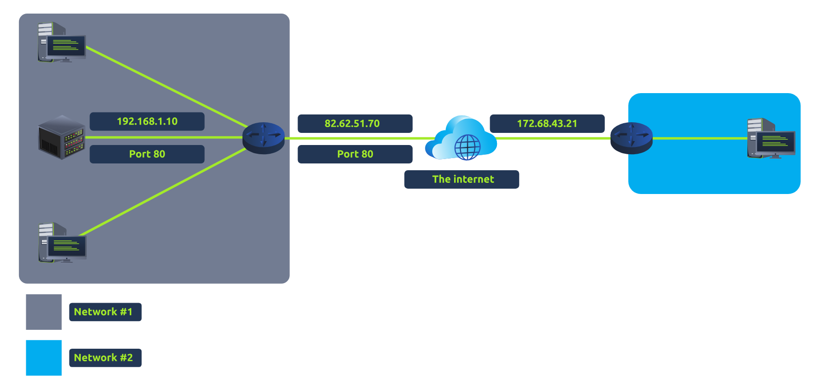
通过这种设计，网络#2现在可以使用网络#1的公共IP地址（82.62.51.70）访问运行在网络#1上的网页服务器。

端口转发很容易和防火墙的行为混淆（防火墙是我们稍后会讨论的技术）。不过，在这个阶段，只需明白端口转发会打开特定的端口（回想一下数据包的工作原理）。相比之下，防火墙决定流量是否能通过这些端口传输（即使这些端口是通过端口转发打开的）。

端口转发是在网络的路由器上配置的。
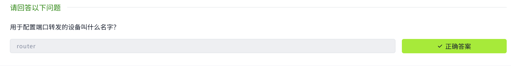

### 防火墙入门
防火墙是网络中的一种设备，负责决定哪些流量可以进出。可以把防火墙看作是网络的边界安全。管理员可以根据多种因素配置防火墙，允许 或**拒绝**进出网络的流量，例如：

  

- 流量来自哪里？（防火墙是否被要求接受或拒绝来自特定网络的流量？）
- 流量会流向哪里？（防火墙是否被要求接受或拒绝发往特定网络的流量？）
- 流量是针对哪个端口的？（防火墙是否被要求只接受或拒绝发往80端口的流量？）
- 流量使用的是什么协议？（防火墙是否被要求接受或拒绝UDP、TCP或两者都支持的流量？）

防火墙通过数据包检测来确定这些问题的答案。

  

  

防火墙有各种形状和大小。从专用硬件（通常存在于大型网络如企业）到住宅路由器（比如家中！）或软件如[Snort](https://www.snort.org/)，防火墙可以分为2到5类。

  

我们将在下表中介绍两大主要类别的防火墙：

| 防火墙类别 | 描述                                                                                                                                                                                                   |
| ----- | ---------------------------------------------------------------------------------------------------------------------------------------------------------------------------------------------------- |
| 有状态   | 这种防火墙使用连接的全部信息;它不是检查单个数据包，而是根据**整个连接**来判断设备的行为。  这种防火墙类型相比无状态防火墙消耗大量资源，因为决策是动态的。例如，防火墙可以允许TCP握手的最初部分，但这些作后来会失败。  如果主机连接不良，它会屏蔽整个设备。                                                      |
| 无状态   | 这种防火墙类型使用一组静态规则来判断**单个数据包**是否被接受。例如，设备发送坏数据包不一定意味着整个设备都会被屏蔽。  虽然这些防火墙比其他防火墙消耗的资源少得多，但它们的作却更笨拙。例如，这些防火墙的有效性仅取决于其内部定义的规则。如果规则不完全匹配，它实际上就毫无用处。  然而，当接收来自一组主机的大量流量时（例如分布式拒绝服务攻击），这些防火墙表现非常出色 |
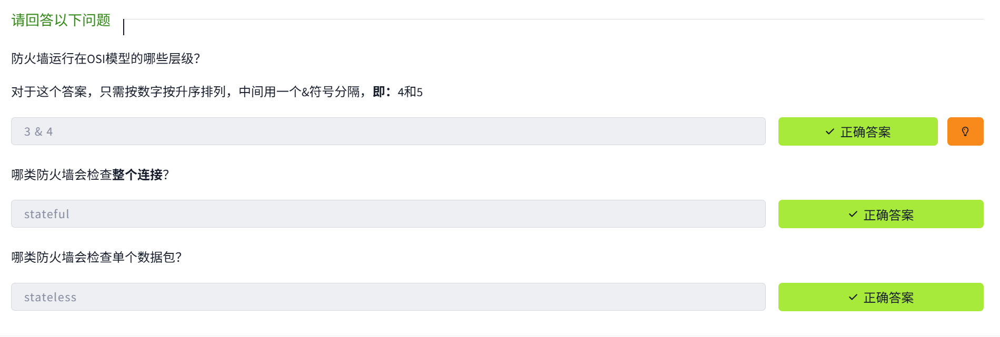

### 实用：防火墙
防火墙规则而已，不写了

### VPN基础知识
**V**irtual **P**rivate **N**etwork（简称**VPN**）是一种技术，允许不同网络上的设备通过互联网（称为隧道）建立专用路径，从而实现安全通信。连接在该隧道中的设备形成自己的专用网络。
例如，只有同一网络内的设备（如企业内部）可以直接通信。然而，VPN允许连接两个办公室。我们来看下面的图，这里有三个网络：
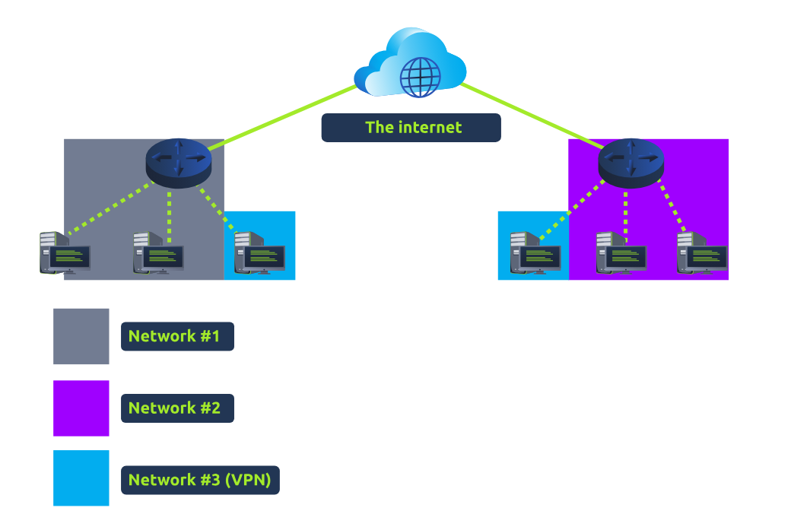
1. 网络 #1（办公室 #1）
2. 网络#2（办公室#2）
3. 网络#3（两台设备通过VPN连接）

连接到网络#3的设备仍然属于网络#1和网络#2，但它们会合并形成一个私有网络（网络#3），只有通过该VPN连接的设备才能通信。
下面表格中，我们来介绍VPN带来的其他一些好处：

| 效益             | 描述                                                                                                                                       |
| -------------- | ---------------------------------------------------------------------------------------------------------------------------------------- |
| 允许不同地理位置的网络连接。 | 例如，拥有多个办公室的企业会发现VPN很有用，因为这意味着服务器/基础设施等资源可以从另一个办公室访问。                                                                                     |
| 提供隐私。          | VPN技术使用加密来保护数据。这意味着数据只能在发送的设备之间理解，且发送的设备之间不存在被窃听的风险。                                                                                     |
| 提供匿名性。         | 记者和活动人士依赖VPN来安全地报道言论自由受控国家的全球问题。 通常，你的流量可以被你的ISP和其他中介机构查看，从而被追踪。 VPN提供的匿名程度取决于网络中其他设备是否尊重隐私。例如，一个记录你所有数据/历史的VPN在这方面基本上和不使用VPN是一样的。 |
记者和活动人士依赖VPN来安全地报道言论自由受控国家的全球问题。

通常，你的流量可以被你的ISP和其他中介机构查看，从而被追踪。

VPN提供的匿名程度取决于网络中其他设备是否尊重隐私。例如，一个记录你所有数据/历史的VPN在这方面基本上和不使用VPN是一样的。

VPN技术多年来不断进步。下面让我们来看看一些现有的VPN技术：

| VPN技术 | 描述                                                                                                                               |
| ----- | -------------------------------------------------------------------------------------------------------------------------------- |
| 公私合力  | 该技术被PPTP（下文解释）用于实现身份验证和数据加密。VPN的工作原理是使用私钥和公证书（类似于**SSH**）。私钥和证书必须匹配才能连接。  该技术无法自行离开网络（不可路由）。                               |
| PPTP  | **P**oint-to-P oint **T**unneling **P**rotocol（**PPTP**）是一种允许 PPP 数据能够传输并离开网络的技术。  PPTP非常容易设置，大多数设备都支持。然而，与其他替代品相比，它的加密较弱。 |
| IPSec | 互联网协议安全（IPsec）利用现有**的 I**nternet **P**rotocol（**IP**）框架加密数据。  IPSec 相比其他替代方案更难设置;不过，如果成功，它拥有强大的加密能力，并且在许多设备上也支持。           |
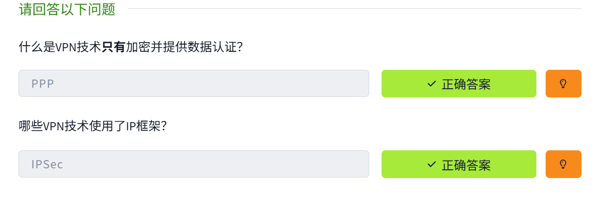

### 局域网网络设备
**什么是路由器？**

==路由器的工作是连接网络并在它们之间传递数据。它通过使用路由实现这一点（因此得名路由器！）。==

路由是数据在网络中传输过程的标签。路由涉及在网络之间创建路径，以便这些数据能够成功传递。路由器运行在OSI模型的第3层。它们通常配备交互式界面（如网站或控制台），允许管理员配置端口转发或防火墙等各种规则。

当设备通过多条路径连接时，路由非常有用，如下图所示，最优路径是：
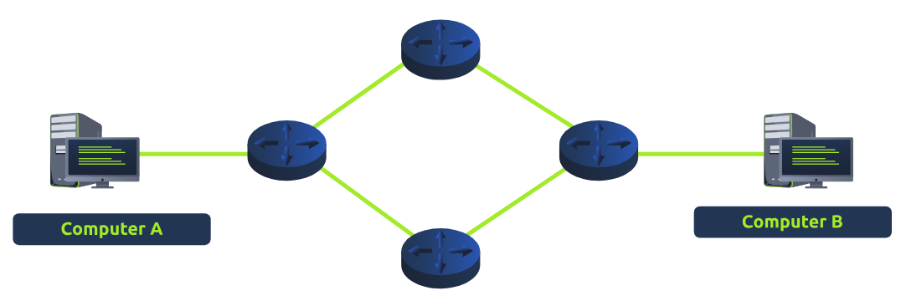路由器是专用设备，执行与交换机不同的功能。

我们可以看到计算机A的网络通过中间的两台路由器连接到计算机B的网络。问题是：将采取哪条道路？不同的方案将决定应采取哪条路径，但因素包括：

- 哪条路最短？

- 哪条路最可靠？

- 哪条路径的介质（例如铜或光纤）更快？

什么是交换机？
==交换机是一种专用的网络设备，负责提供连接多个设备的手段。交换机可以通过以太网线连接多种设备（从3台到63台）。==

交换机可以在OSI模型的第2层和第3层工作。然而，这些交换机是排他的，即第二层交换机不能在第三层工作。

举例来说，下图中的一层2开关。这些交换机会将帧（记住原始IP包封装在帧内）通过连接的设备使用其MAC地址转发。
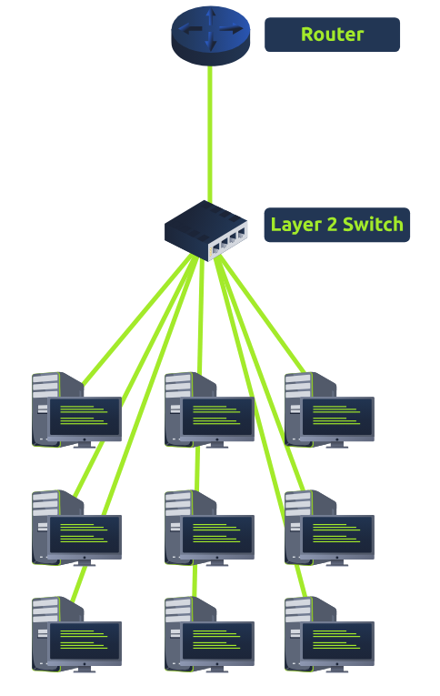
这些交换机完全负责将帧发送到正确的设备。

现在，让我们进入第三层交换机。这些交换机比第二层更先进，因为它们可以承担_路由器_的一些职责。也就是说，这些交换机会像第二层一样向设备发送帧，并通过IP协议将数据包路由到其他设备。

让我们看看下面这张3层开关的示意图。我们可以看到有两个IP地址：

- 192.168.1.1
- 192.168.2.1

一种称为**VLAN**（**V**irtual **L**， ocal **A**rea rea **n**）的技术允许网络内的特定设备虚拟拆分。这种分工意味着他们都可以从互联网连接等方面受益，但会被分开处理。这种网络分离提供了安全性，因为这意味着已有规则决定了特定设备之间的通信方式。这种分离在下图中展示了：
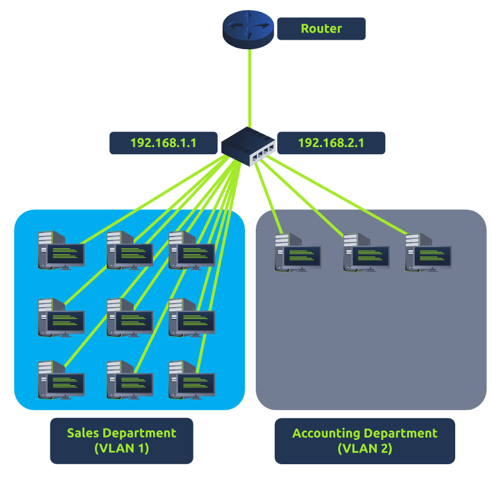
在上述图中，“销售部门”和“会计部门”能够访问互联网，但无法相互通信（尽管它们连接到同一交换机）。

### 实用：网络模拟器
暂无
