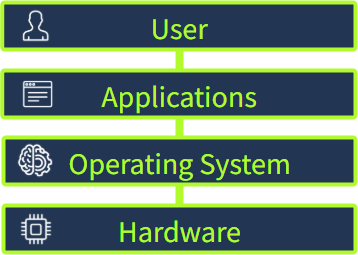

# 一、操作系统：导论
### 隐形管理者
**作系统**（OS）是协调计算机上所有发生事情的核心软件。它位于用户、应用程序和系统的物理硬件之间，充当隐形的管理器，确保整个机器作为一个统一系统运行。

一个有用的比喻是，把你的电脑想象成一个繁忙的机场，所有组件协同工作。

- 你的**硬件**（CPU、内存、存储、连接设备）：跑道、飞机、燃油系统、雷达及其他物理基础设施。
- 你的**应用程序**（网页浏览器、游戏启动器）：各种航空公司及其乘客，都在尝试起飞、降落和请求服务。
- 你的**作系统**（Windows、Linux、macOS）：整个空中交通管制系统，负责指挥所有这些活动。它安排资源，管理交通，解决冲突，并确保安全。

我们需要作系统，因为它提供了协调和结构化这一极其重要的工作，使现代计算成为可能。没有作系统，每个应用程序都需要直接控制CPU、内存、文件、设备和安全。这会很快引发冲突，作系统通过作为中央组织者来处理。在即将推出的计算机基础模块中，你学习了各种计算机组件及其职责。接下来，我们将看到作系统在你使用电脑时如何管理和分配这些资源。

#### 系统特权层

在现代计算机中，系统的不同部分在不同的权限层级下运行。部分组件可以直接与硬件通信，而普通应用程序则在更安全、受限的环境中运行。这种分离是有意为之，有助于防止冲突和安全问题。

- **内核空间**：作系统的特权、锁定核心。内核（内核）运行于此，内核是作系统中直接管理硬件和系统资源的部分。它对CPU、内存、存储和所有硬件组件都有不受限制的访问权限。
- **用户空间**：所有标准应用运行的空间。用户空间中的应用程序被有意阻止直接访问硬件。每当他们需要打开或保存文件、播放声音或连接Wi-Fi时，都必须进行系统调用，请求内核代表他们行动。

基于我们的机场比喻，让我们聚焦于特权分离的概念。内核空间是控制塔，这是一个严格保密的区域，只有可信的空中交通管制员（内核）在此工作。只有他们能直接控制跑道、雷达和其他硬件。用户领域的应用就像航空和地面上的乘客。他们不能进入塔内，也不能触碰设备。相反，他们通过无线电向基站发送请求（系统调用），基站会安全地处理这些请求。这种分离保持了作系统的可靠性：一个故障的应用无法让整个系统崩溃，就像没有塔台控制，任何航空公司都无法安全运营一样。

#### 作系统职责

既然你已经了解了作系统是什么以及系统权限如何划分，让我们看看它在幕后到底做了什么。每个作系统都负责几项核心职责，确保你的电脑安全、高效且可预测地运行。

| 操作系统的责任 | 操作系统的功能                                                         | 示例                                     |
| ------- | --------------------------------------------------------------- | -------------------------------------- |
| 流程管理    | 创建、调度、优先排序并终止正在运行的程序。作系统决定每个进程获得多少CPU时间，使多任务处理感觉无缝              | 打开多个应用，比如浏览器、音乐播放器和社交媒体，电脑不会死机         |
| 内存管理    | 为进程分配内存，保护应用程序的内存免受其他进程的侵害，并在关闭应用时回收内存。当内存不足时，作系统会使用虚拟内存来保持系统稳定 | 同时打开多个应用时，作系统会为每个应用分配内存并隔离它们，避免互相干扰或崩溃 |
| 文件系统管理  | 将文件组织成目录，处理命名、路径、权限、元数据（名称、大小、类型、时间戳）                           | 创建新文件夹、保存照片，或将文件设置为“只读”                |
| 用户管理    | 处理多个用户账户、身份验证和权限，以确定谁可以访问什么                                     | 用密码登录，并保持文件对其他用户账户无法访问                 |
| 设备管理    | 加载驱动程序并提供通用接口（硬件抽象层），让应用程序可以说“打印这个”或“播放这个声音”                    | 插入新的鼠标、打印机或外置硬盘，立即使用起来                 |
#### 作系统安全

重要的是要明白，每个作系统也都作为安全基础。在任何杀毒、防火墙或安全工具推出之前，作系统已经在后台强制执行防护措施，其中一些我们上文已介绍。

从基本层面来说，你的作系统会处理

- **认证**：通过登录密码和生物识别来验证您的身份
- **权限**：控制每个用户和应用被允许读取、写入或执行的内容
- **隔离**：将每个进程保持在自己的受保护盒子中（内核/用户空间分离）
- **系统保护**：保护关键系统文件和设置免受未经授权更改的影响