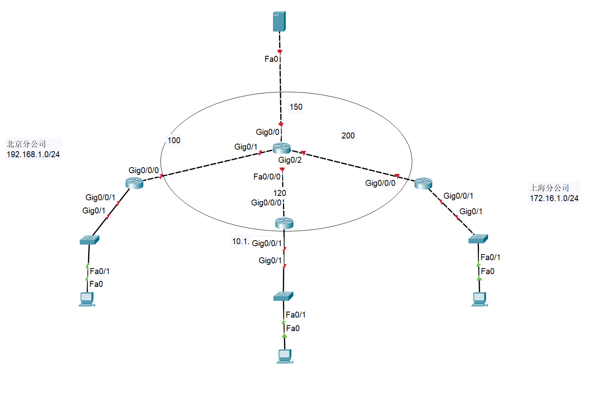
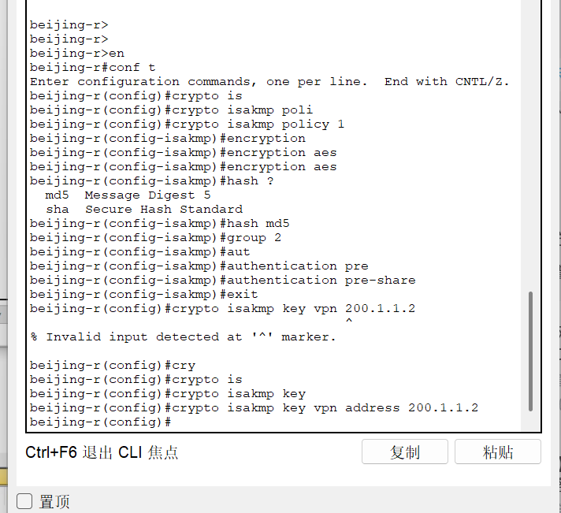
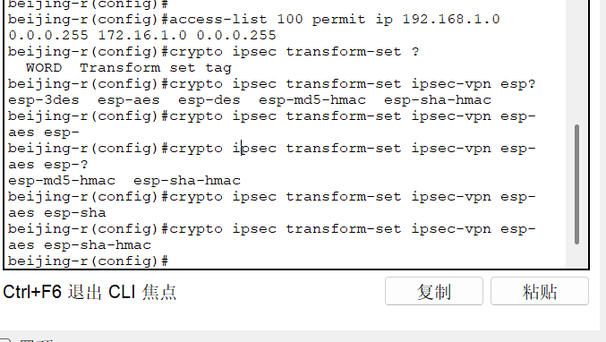
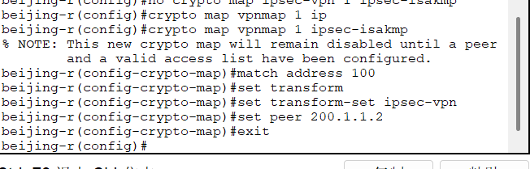
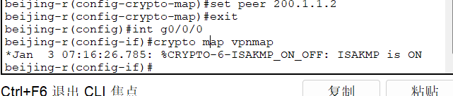
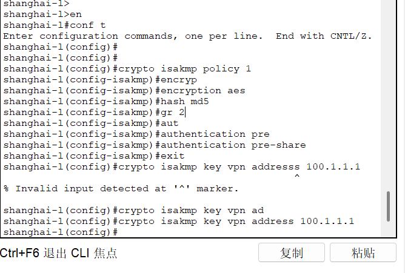
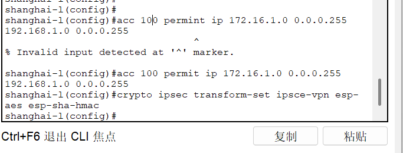
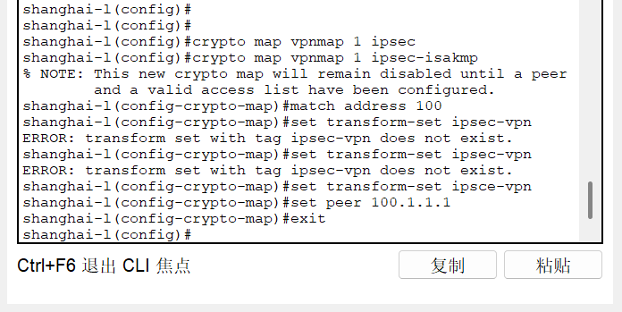
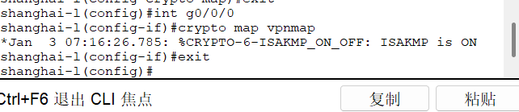
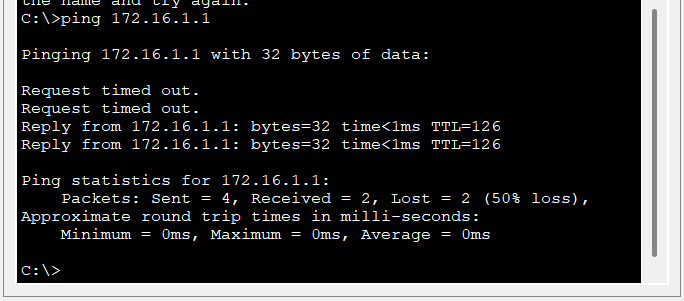

### 1、VPN(Virtual Private Network)
虚拟专有网络
虚拟专网
### 2、引入
	VPN可以实现在不安全的网络上，安全的传输数据，好像专网！
	VPN只是一个技术，使用PKI技术，来保证数据的安全三要素
### 3、安全三要素：
**1）机密性**
**2）完整性**
**3）身份验证**
### 4、加密技术：
	1）对称加密：加密与解密使用相同的密钥
	密钥是通信双方协商生成，生成过程是明文通信！
	密钥容易泄露！
	对称加密算法：==DES、3DES、AES==
	
	2）非对称加密算法：使用公钥加密数据
	公私钥成对生成，互为加解密关系！
	公私钥不能互相推算！
	双方交换公钥
	使用对方的公钥加密实现机密性
	使用自己的私钥进行自己的私钥进行签名，实现身份验证
	常见算法：==RSA、DH==
### 5、完整性算法/hash值算法：
	==MD5==
	==SHA(sha-1，sha-256，sha-512)==
### 6、VPN的类型：
**1）远程访问VPN（Remote Access VPN）**
		一般用在个人到安全连接企业内部！
		一般出差员工/在家办公，安全连接内网时使用！
		一般公司部署VPN服务器，员工在外拨号连接VPN即可！
常见RA-VPN协议：
==PPTP VPN、L2TP VPN、SSTP VPN、EZVPN/easyVPN、SSL VPN==
**2）点到点VPN**
	一般用在企业对企业安全连接！
	一般需要在两个企业总出口设备之间建立VPN通道！
	常见的点到点VPN：==IPsecVPN==

### 7、IPsecVPN：
1）属于点到点VPN，可以在两家企业之间建立VPN隧道！
2）VPN隧道优点：
	安全性！
	合并俩家企业内网！
3）VPN隧道技术：
	1）传输模式：
		只加密上层数据，不加密私有IP包头，速度快
	2）隧道模式（大部分常用这个）;
		加密整个私有IP包，包括IP包头，更安全，速度慢
4）VPN隧道技术：
		重新封装技术+加密认证技术
5）IPsecVPN分为2大阶段：
	第一阶段：管理连接
	目的：通信双方设备通过非对称加密算法加密对称加密算法所使用的对称密钥！
	命令：
```bash
	conf t                   %% IKE %%
	crypto isakmp policy 1   %% 传输集/策略集 %%
	encryption des/3des/aes  %% des（56位密钥），已经彻底废弃，绝对不安全；3des（168位密钥），曾经的标准，性能老旧，不建议使用；aes（128、192、256位密钥），现代标准，强烈推荐 %%
	hash md5/sha
	group 1/2/5             %% 这是DH组，md5（128位哈希）存在碰撞，已不安全，必须避免；sha-1（160位哈希）也有点脆弱；256，384，512现代标准 %% 
	authentication pre-share %% 1，2已经不安全了（768位，1024位），5（1536），算中等；14（2048）当前广泛使用的最低安全标准；15（3072）/16（4096位），用于更高安全 %%
	lifetime 秒       （默认86400秒，也就是24小时）
	exit
	crypto isakmp key 预共享密钥 address 对方的公网IP地址
```


第二阶段：数据连接
	目的：通过对称加密算法加密实际所要传输的私网数据！
```
	%% 定义VPN触发流量 %%
	access-list 100 permit ip 192.168.0.0 0.0.255.255 172.16.0.0 0.0.255.255
	
	%% 定义加密方式 %%
	crypto ipsec transform-set 传输模式名 esp/sh-des/3des/aes esp/sh-md5/sha-hmac
```
==ESP：==支持加密及认证（身份验证+完整性）
==AH：==只支持认证（身份验证+完整性）
### 8、创建MAP映射表：
	conf t
	crypto map map名 1 ipsec-isakmp
	match address acl表名
	set transform-set 传输模式
	set peer 对方的公网IP
	exit 

例如：
	conf t
	crypto map wenmap 1 ipsec-isakmp     %% wenmap 是名称，按照自己的需求来 %%
	match address 100  
	set transform-set wenmap            %% wenmap 依旧是名称 %%
	set peer 200.1.1.2
	exit
将map表应用到外网接口：
	int f0/1（外网接口）
		crypto map wenmap     %% 表名称 %% 
		exit
***注意：一个接口只能应用一个map表！！！！！！
### IPsec VPN实验
#### 思科图谱


#### 配置步骤
##### 1、配置路由与pc
中间互联网的不需要配置默认路由！！！
左侧R1:
	en
	conf t
	ho R1-beijing
	int g0/0/1
	ip add 192.168.1.254 255.255.255.0
	no sh
	exit
	int g0/0/0
	ip add 100.1.1.1 255.255.255.0
	no sh
	ex
	ip route 0.0.0.0 0.0.0.0 100.1.1.2
中间R2:
	en
	conf t
	ho R2-network
	int g0/1
	ip add 100.1.1.2 255.255.255.0
	no sh
	ex
	int g0/2
	ip add 200.1.1.1 255.255.255.0
	no sh
	ex
右侧R3：
	en
	conf t
	ho R3-shanghai
	int g0/0/0
	ip add 200.1.1.2 255.255.255.0
	no sh
	exit
	int g0/0/1
	ip add 172.16.1.254 255.255.255.0
	no sh
	ex
	ip route 0.0.0.0 0.0.0.0 200.1.1.1
==***此时他们并为连通，要做VPN隧道之后才可以。==

#### 配置VPN第一阶段
R1:
```
	crypto isakmp policy 1
	encryption aes
	hash md5
	group 2
	authentication pre-share
	exit
	crypto isakmp key vpn address 200.1.1.2 
	
```


#### 第二阶段
```
	acc 100 permit ip 192.168.1.0 0.0.0.255 172.16.1.0 0.0.0.255
	crypto ipsec transform-set ipsce-vpn esp-aes esp-sha-hmac
```
****

#### 整合
```
	crypto map vpnmap 1 ipsec-isakmp
	match address 100
	set transform-set ipsce-vpn      #没注意第一次写错了...
	set peer 200.1.1.2
	exit
```


#### 应用到接口
```
	int g0/0/0
	crypto map vpnmap
	exit
```


#### R2配置：
##### 第一阶段


##### 第二阶段


##### 整合
***中间写错了...


##### 应用到接口



***测试通断？

通了！！！


### 状态检查
***如果没通，就用这三个命令检查就行

#### 检查ike sa （阶段1）
注解：
	查看IKE阶段1的安全关联
**关键状态**：

- `QM_IDLE` ✅ 阶段1 成功建立
    
- `MM_NO_STATE` ❌ 阶段1 失败
    
- `MM_KEY_EXCH` 🔄 正在密钥交换

```
	show crypto isakmp sa
```
#### 检查IPSec sa（阶段2）
注解：
	查看IPSec阶段2的安全关联
**关键信息**：

- 加密/解密的数据包计数
    
- SA 的生存时间
    
- 隧道两端的地址
```
	show crypto ipsec sa
```
#### 检查crypto map状态
注解：
	综合查看所有加密会话状态
```
	show crypto session
```
或
```
	show crypto engine connections active
```
### 9、查看命令：
	show crypto isakmp sa           查看第一阶段状态
	show crypto ipsec sa            查看第二阶段状态
	
	show crypto isakmp policy       查看第一阶段的策略配置集
	show crypto ipsec transfor-set  查看第二阶段的传输模式
### 10、路由器的工作原理
内网-->to-->外网：路由--NAT--VPN--出去