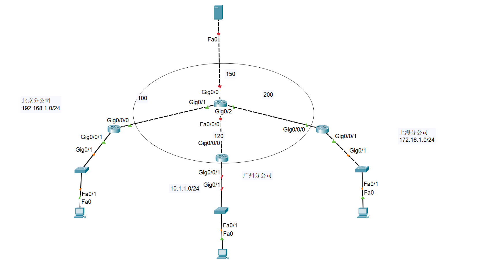

### 实验1：
北京--上海--建立VPN通道，并验证
### 实验2：
在实验1的基础上，要求2个公司能上网，但不影响VPN通道
### 实验3：
在实验1和实验2的基础上，要求北京总部与广州新成立的分公司也建立VPN隧道
## 可选：
### 实验4：
在1-3的基础上，要求广州和上海之间不建立VPN隧道，但广州和上海可以安全的通信

### 实验图谱

### 实验二步骤
#### 1、配置服务器（公网服务器）
	en
	conf t
	int g0/0
	ip add 150.1.1.254 255.255.255.0
	ex
#### 2、配置左侧总部路由PAT
	en
	conf t
	int g0/0/1      %% 定义内网接口，同下 %%
	ip nat inside
	ex
	int g0/0/0
	ip nat outside
####  3、豁免VPN地址
	do sh ip acc      %% 之前做VPN隧道，做了acc容器，这次查看一下是否有acc，把VPN隧道的这个豁免掉，不让走nat地址转换 %%
	acc 101 deny ip 192.168.1.0 0.0.0.255 172.16.1.0 0.0.0.255
	acc 101 permint ip any any      %% 所有流量都做地址转换 %% 
#### 4、nat地址转换
	ip nat inside source list 101 int g0/0/0 overload
做测试通断，是否能ping通，同理，左侧的路由也要做VPN豁免和nat，这个在此省略。
### 实验三
#### 1、配置服务器（已经做了）
#### 2、配置右侧路由PAT
	en
	conf t
	