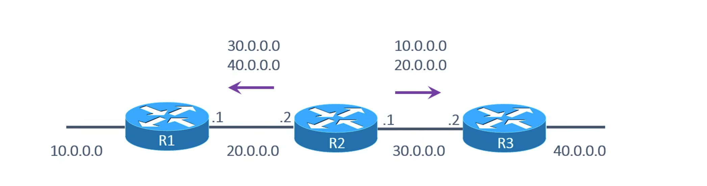
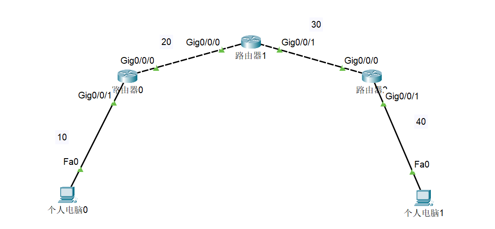
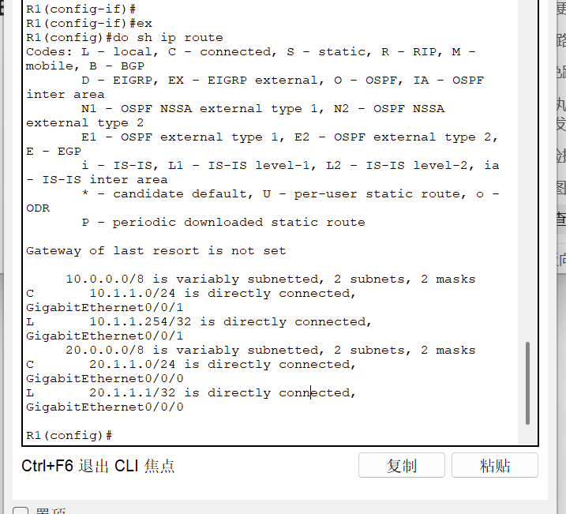
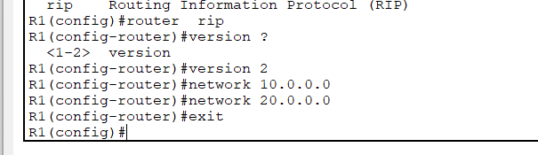
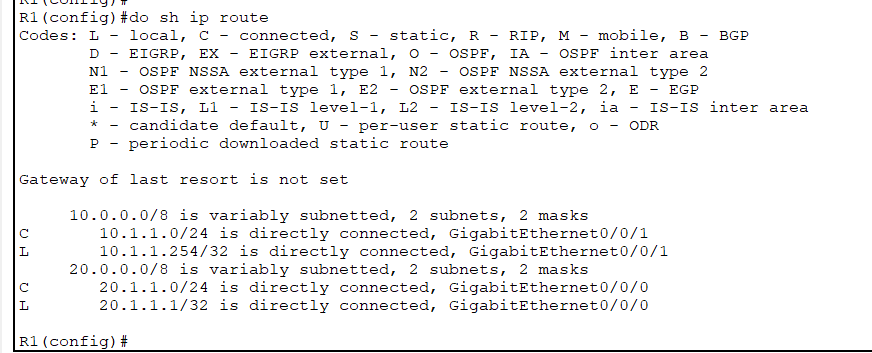
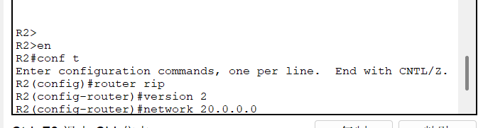
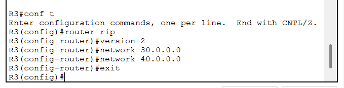
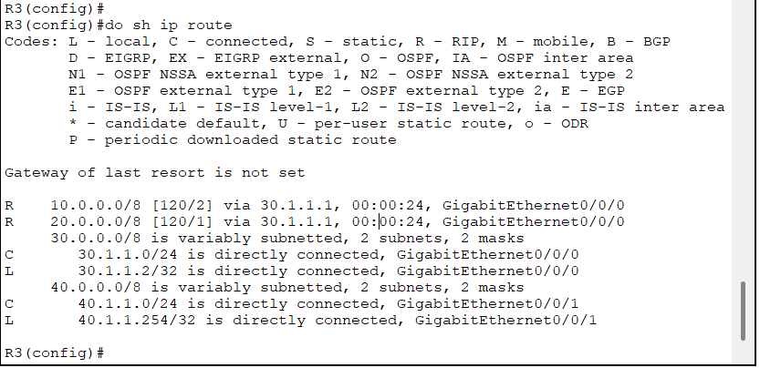

### 动态路由
	基于某种路由协议实现
### 动态路由特点
	减少了管理任务
	占用了网络带宽
### 动态路由协议概述
	路由器之间用来交换信息的语言
### 度量值（Metric）
	跳数、带宽、负载、时延、可靠性、成本
### 收敛
	使所有路由表达都达到一致状态的过程
### 静态路由与动态路由的比较
	网路中静态路由和动态路由互相补充
### 按照路由执行的算法分类
#### 距离矢量路由协议
	依据从源网络到达目标网络所经过的路由器的个数选择路由
	RIP、IGRP
#### 链路状态路由协议
	综合考虑从源网络到目标网络的各条路径的情况选择路由
	OSPF
	IS-IS
### RIP是距离-矢量路由选择协议
#### RIP的概念
	定期更新（默认时间为30秒，厂家默认的额，也可以改）
	邻居
	广播更新
	全路由表更新
### RIP度量值为跳数
	最大跳数为15跳，16跳为不可达
### RIP更新时间
	每隔30s发送路由更新信息，UDP520端口
### RIP路由更新消息
	发送整个路由表信息
---
注意：路由环路，路由器学到了错误的条目，其他路由器也学到了，造成路由环路。
### 避免路由环路
#### 执行水平分割可以阻止路由环路的发生（RIP默认开启这个）
	从一个接口学习到路由信息，不再从这个接口发送出去
	同时也能减少路由更新信息占用的链路带宽资源

### 实验搭建
#### 图例

#### 查看路由表信息

	R1：
```
	do show ip route
	
	#或者先看看都启用了哪些路由协议
	show ip protocols
	
```
	都是C直连路由

#### 步骤
##### 启用rip路由协议
```
	#配置好每个路由的IP接口信息，以及pc设置
	
	#启用RIP路由协议
		router rip       //后面可以写成router ？ 会展示能启用的各种路由协议，ospf等等的都有
	
```

##### 激活rip
```
	#启用rip服务之后，在这个里面进行设置
	
	version 2     #一共有两个版本，1太老了，选2，其他路由器的配置也要跟这个版本的一致，后面的都是2
	
	network 10.0.0.0      这个只是激活接口rip，不是网段！！！
	network 20.0.0.0
	exit
	
	#注解：rip的特性是全局广播，他的命名规则是按照abc这种走的，10和20这辆个都包含了10.1.1.0的网段。目前有两个接口，一个是路由器，一个是pc设备，如果不开启pc设备，其他路由器也就学不到了，最后还是无法访问，所以开启
	
```

##### 检查路由信息
	R1
	没有任何信息，其他的还没配置，配置好了就学习到了

	R2

	R3

##### 再次检查路由表信息
	也可以做静态路由，路由器优先会去检查静态的，有个优先级120，没有就去找rip（如果只有这个协议）

### 最重要的一步！！！
	注解：rip路由协议中，version 1（简称v1）v1版本比较老，不携带子网掩码，v2是携带的。但是！！！他们之间学习到的条目的网段会默认划分到a类地址的子网掩码（实验中是最高是40，属a类，实际情况区别对待），会造成的问题是，左边和右边都有一个相同的条目和相同的子网掩码，网络会左一跳，又一跳。
	所以需要手动让他们不要自动写入他们认为的子网掩码，用命令修改即可。
##### 命令
```
	no auto-summary
	或者no au
	#每个路由器都配置一遍
	
	#正常配置顺序为：
		1、接口ip配置好
		2、router rip
		3、no au
		4、version 2
		5、network ....
		6、exit
```
做完记得检查一下！！！